# CryptALAS Agent — Technical Reference

Everything a developer or operator needs to run, debug, extend and trust the
agent: architecture, protocols, the full HTTP API, every job type with worked
examples, the self-update and supervisor machinery, and the failures we have
actually hit in the field with the fix for each.

> **Scope.** This document covers `backend/cmd/cryptalas` and the files it ships
> with. It does not describe the trading detectors or the dashboard views.

---

## 1. What the agent is

A **single static Go binary** that runs on a compute box (Windows, macOS, Linux),
makes itself discoverable on the LAN, executes compute jobs on behalf of the
platform, and keeps itself alive and up to date without human intervention.

It has no runtime dependencies beyond an optional `python3` for the model
runners — and even that is carried inside the binary (see
[§9 Embedded runners](#9-embedded-runners)).

| Property | Value |
|---|---|
| Source | `backend/cmd/cryptalas/` |
| Language | Go (static, no cgo) |
| Default listen | `0.0.0.0:8810` |
| Discovery | UDP multicast `239.255.42.99:8788` |
| Registration | `POST <platform>/api/agents/register` |
| Update poll | every **5 s**, with an emergency push channel |
| Version format | `2.0.8-a348efa` (semver + git sha) |
| Platforms | Windows amd64, Linux amd64, macOS arm64 |

### Design principles

1. **Zero-configuration discovery.** A fresh agent on the LAN is found without
   anyone typing an IP address.
2. **Never silently wrong.** If a GPU is requested and not available, the result
   says so and names the reason. A job that errored is reported as *failed*, not
   as "done" with a hidden error.
3. **Never dies.** A supervisor restarts it; it also exits deliberately if its own
   health probe fails, so the supervisor can do its job.
4. **Self-sufficient.** If the `gpu/*.py` runners were not deployed, the agent
   writes its own copies from the binary instead of failing the job.

---

## 2. System context

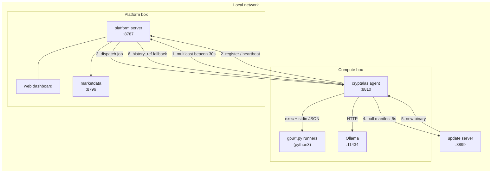

The agent is **outbound-first**: every connection it needs, it initiates. That is
what lets it run behind NAT and on locked-down networks — the only inbound
traffic it requires is the platform reaching `:8810`.

---

## 3. Process architecture

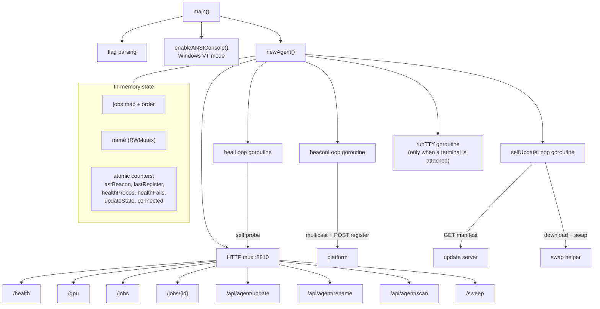

### Concurrency model

| Goroutine | Responsibility | Stop condition |
|---|---|---|
| `beaconLoop` | multicast + register every 30 s | never |
| `selfUpdateLoop` | manifest poll every 5 s, or on emergency signal | never |
| `healLoop` | self-probe `/health` every 15 s | exits process after 3 failures |
| `run(j)` | **one per job**, executes the runner | when the job finishes |
| `runTTY` | interactive shell | `quit`, or stdin EOF |

Job fields are guarded by `Agent.mu`. `name` is guarded separately by
`Agent.nameMu` because the beacon reads it while the rename handler writes it —
that split is deliberate and covered by a race test (`rename_test.go`).

---

## 4. Startup sequence

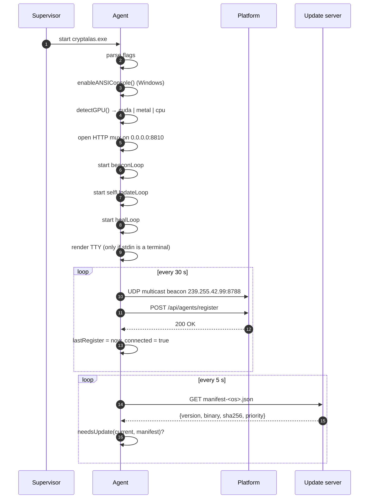

The first log lines a correctly started agent prints:

```
device auto -> cuda
beacon: SENT multicast 239.255.42.99:8788 (name=R1)
beacon: registering to http://192.168.1.111:8787
CONNECTED — platform http://192.168.1.111:8787 acknowledged this agent
```

---

## 5. Discovery and registration

Two independent mechanisms. Either one is enough; together they cover networks
where multicast is blocked (very common on Windows with a strict firewall).

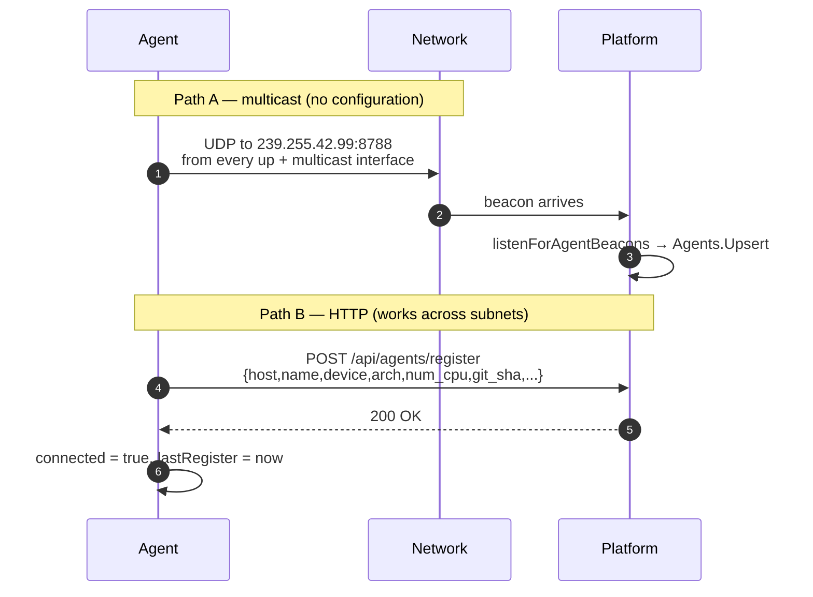

### Why the beacon is sent per interface

`net.DialUDP` with a `nil` local address uses only the default route. On a
multi-homed host (Wi-Fi + Ethernet + VPN + bridge) the beacon can therefore
leave on an interface the platform never hears. The agent enumerates every
interface that is `up` and multicast-capable and dials from each one explicitly:

```go
for i := range ifaces {
    ifi := ifaces[i]
    if ifi.Flags&net.FlagUp == 0 || ifi.Flags&net.FlagMulticast == 0 {
        continue
    }
    conn, err := net.DialUDP("udp",
        &net.UDPAddr{IP: ifaceIP(ifi)},
        &net.UDPAddr{IP: net.ParseIP(beaconGroup), Port: port})
    ...
}
```

This was a real bug: agents on a Mac with two active interfaces were invisible
until the dial was pinned per interface.

---

## 6. Job lifecycle

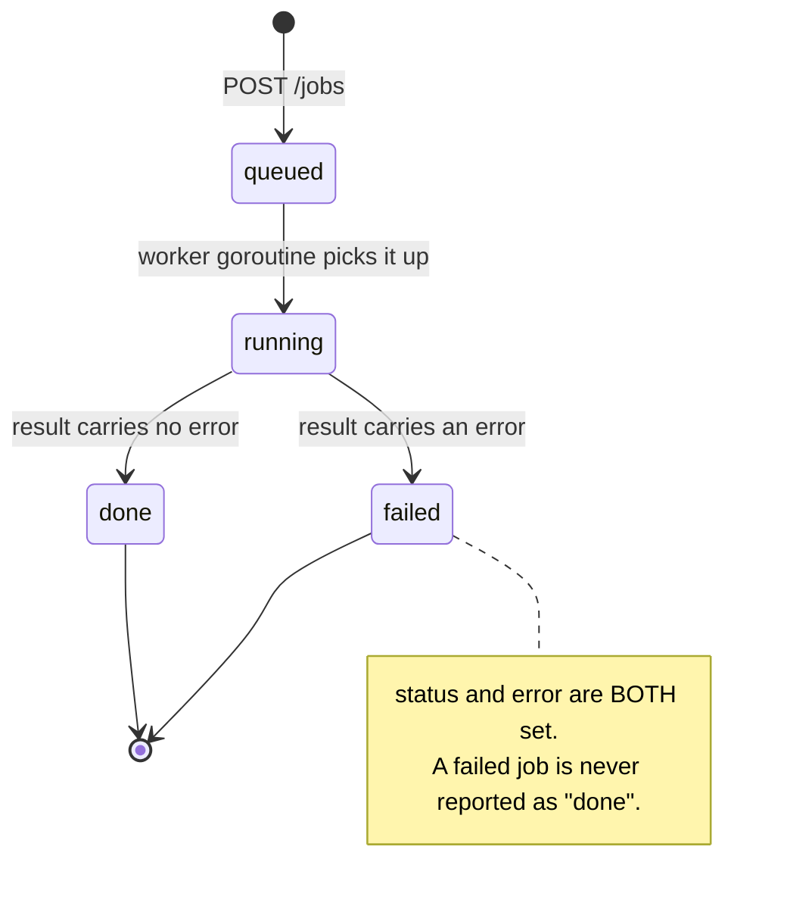

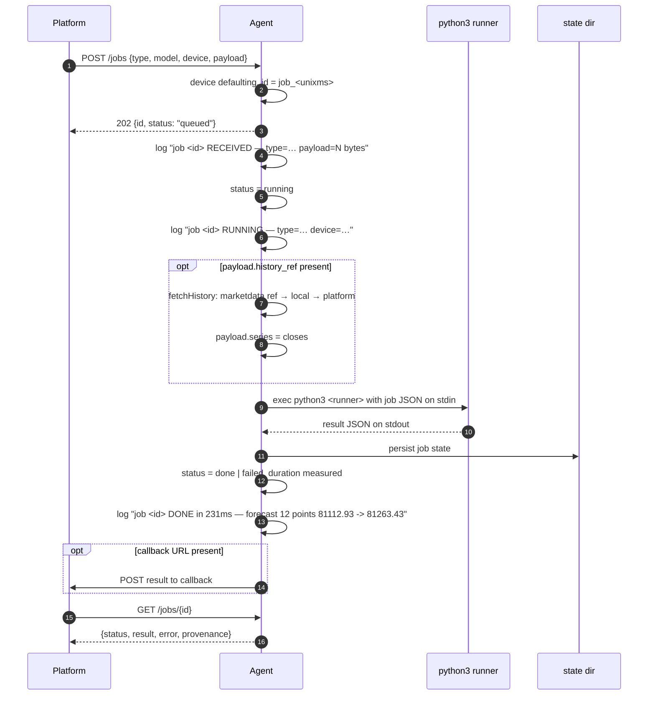

### What the terminal shows for every job

```
job job_1793224606853 RECEIVED — type=forecast model=btc-forecast device=cpu payload=4389 bytes
job job_1793224606853 RUNNING — type=forecast model=btc-forecast device=cpu
job job_1793224606853 DONE in 231ms — forecast 12 points 81112.93 -> 81263.43 (method trend, last 81320.00)
job job_1793224611222 FAILED after 12ms — need >= 3 points
```

---

## 7. HTTP API

Base URL: `http://<agent-host>:8810`

| Method | Path | Purpose |
|---|---|---|
| `GET` | `/health` | liveness, used by the self-heal probe |
| `GET` | `/gpu` | full device/resource report |
| `POST` | `/jobs` | submit a job |
| `GET` | `/jobs` | list all jobs |
| `GET` | `/jobs/{id}` | one job with its result |
| `POST` | `/api/agent/update` | emergency update push |
| `POST` | `/api/agent/rename` | change the agent's name |
| `GET` | `/api/agent/scan` | scan the local /24 |
| `POST` | `/sweep` | parameter sweep handler |

### `GET /health`

```bash
curl http://192.168.1.137:8810/health
```

```json
{"ok": true, "jobs": 3}
```

### `GET /gpu`

```bash
curl http://192.168.1.137:8810/gpu
```

```json
{
  "arch": "amd64",
  "device": "cuda",
  "git_sha": "2.0.8-a348efa",
  "go_version": "go1.27.1",
  "gpu_present": true,
  "num_cpu": 16,
  "note": "train jobs route to gpu/cuda_train.py (JAX/CUDA with CPU fallback)",
  "ollama": {
    "available": true,
    "models": ["gemma:latest", "qwen2.5:7b", "llava:7b"]
  }
}
```

### `POST /jobs`

```bash
curl -X POST http://192.168.1.137:8810/jobs \
  -H 'Content-Type: application/json' \
  -d '{
    "model": "btc-forecast",
    "type": "forecast",
    "device": "cpu",
    "payload": { "series": [{"t": 1730000000000, "v": 81238.01}], "horizon": 12, "method": "trend" }
  }'
```

```json
{
  "id": "job_1793224606853",
  "model": "btc-forecast",
  "type": "forecast",
  "device": "cpu",
  "payload": {"horizon": 12, "method": "trend"},
  "status": "queued",
  "created_ms": 1793224606853
}
```

The call returns **immediately** (202). Poll `/jobs/{id}` for the result.

### `GET /jobs/{id}`

```json
{
  "id": "job_1793224606853",
  "status": "done",
  "done_ms": 1793224607084,
  "result": {
    "forecast": [81112.93, 81125.18, 81251.22, 81263.43],
    "horizon": 12,
    "last": 81320.0,
    "method": "trend",
    "runner": "forecast.py",
    "trained": true
  },
  "provenance": {"git_sha": "2.0.8-a348efa", "go_version": "go1.27.1", "device": "cpu", "arch": "amd64"}
}
```

A failed job instead looks like:

```json
{
  "id": "job_1793224611222",
  "status": "failed",
  "error": "no kline source reachable for BTCUSDT",
  "result": {"error": "no kline source reachable for BTCUSDT", "runner": "forecast.py"}
}
```

### `POST /api/agent/update`

Wakes the update loop immediately instead of waiting for the 5 s poll.

```bash
curl -X POST http://192.168.1.137:8810/api/agent/update \
  -H 'Content-Type: application/json' \
  -d '{"emergency": true}'
```

```json
{"ok": true, "emergency": true}
```

### `POST /api/agent/rename`

```bash
curl -X POST http://192.168.1.137:8810/api/agent/rename \
  -H 'Content-Type: application/json' -d '{"name": "R1"}'
```

```json
{"ok": true, "name": "R1"}
```

The name is read live on every beacon, so the platform shows the new name within
one beacon interval (30 s).

### `GET /api/agent/scan`

```bash
curl //192.168.1.137:8810/api/agent/scan
```

```json
{
  "subnet": "192.168.1.0/24",
  "hosts": 9,
  "found": ["192.168.1.50", "192.168.1.110", "192.168.1.111", "192.168.1.137"]
}
```

The probe is a TCP connect on common ports (22, 80, 135, 445, 3389, 8810) with a
400 ms timeout, 50 in flight — ICMP needs privileges on Windows, TCP does not.

---

## 8. Job types

| `type` | Runner | Device | Result fields |
|---|---|---|---|
| `forecast` | `forecast.py` | cpu | `forecast[]`, `horizon`, `last`, `method` |
| `backtest` | Go (in-process) | cpu | `points`, `trades`, `final_equity`, `total_return`, `sharpe` |
| `train` / `regression` / `""` | `cuda_train.py` when device is cuda/gpu/metal, else in-process CPU stub | cuda/cpu | `fit`, `weight`, `intercept`, `device`, `compute`, `device_reason` |
| `ollama` | local Ollama HTTP | gpu | `ollama` reply, `model` |

### 8.1 forecast

Methods: `ema` (exponential mean, held flat), `sma` (simple mean, held flat),
`trend` (least-squares extrapolation).

```json
{
  "model": "btc-forecast",
  "type": "forecast",
  "device": "cpu",
  "payload": {
    "series": [{"t": 1730000000000, "v": 81238.01}],
    "horizon": 12,
    "method": "trend"
  }
}
```

```json
{
  "forecast": [81101.99, 81115.14, 81128.30, 81141.45],
  "horizon": 12,
  "last": 81238.01,
  "method": "trend",
  "runner": "forecast.py",
  "trained": true
}
```

### 8.2 backtest

Simple SMA-momentum: long when close > trailing SMA(window), flat otherwise,
one switch counted as a trade.

```json
{
  "type": "backtest",
  "device": "cpu",
  "payload": {"history_ref": {"symbol": "BTCUSDT", "interval": "1h", "limit": 200}, "window": 10}
}
```

```json
{
  "runner": "backtest",
  "method": "sma-momentum",
  "window": 10,
  "points": 100,
  "trades": 19,
  "final_equity": 1.047,
  "total_return": 0.047,
  "sharpe": 0.257
}
```

### 8.3 train (GPU path)

Rows carry a `label` (`P`/`D` or `1`/`0`) and a feature (`x`, `ret` or `price`).

```json
{
  "type": "train",
  "device": "cuda",
  "payload": {
    "rows": [
      {"label": "P", "x": 0.81},
      {"label": "D", "x": -0.72}
    ]
  }
}
```

Honest result when no accelerator is present:

```json
{
  "fit": true,
  "n": 40,
  "p": 20,
  "d": 20,
  "weight": 6.903409,
  "intercept": -0.0,
  "mean": 0.05,
  "std": 0.75,
  "device": "cpu",
  "compute": "cpu",
  "requested": "cuda",
  "device_reason": "no GPU runtime detected: neither jax nor torch is importable and nvidia-smi was not found",
  "trained": true,
  "runner": "cuda_train.py"
}
```

`device` is the device that **actually** ran the fit. `requested` is what was
asked for. They can differ, and when they do `device_reason` says why — an
accelerated attempt that fails is never reported as a GPU result.

### 8.4 ollama

```json
{"type": "ollama", "model": "qwen2.5:7b", "payload": {"prompt": "Summarise BTC order flow"}}
```

---

## 9. `history_ref`: where bars come from

A job can ask for history instead of shipping it inline. The agent resolves it in
order and records which source answered.

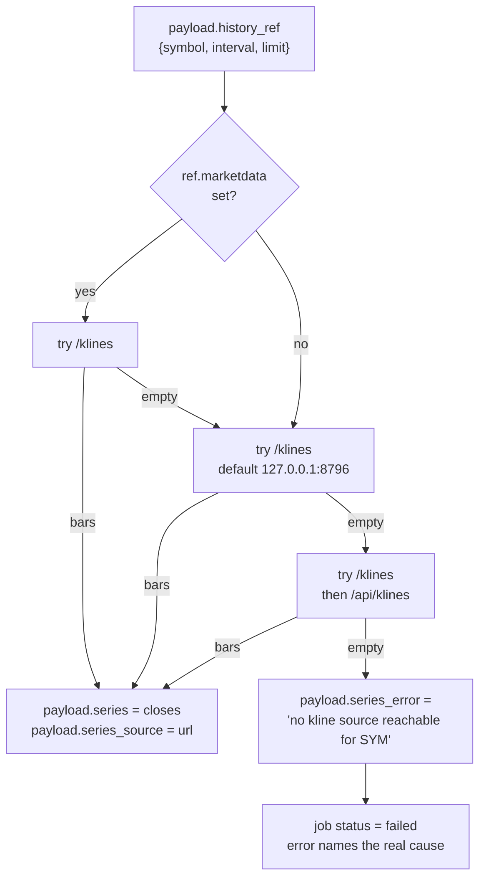

Both response shapes are accepted, because the two services disagree:

| Source | Shape |
|---|---|
| marketdata | `{"klines": [{"t": …, "c": …}]}` |
| platform | `{"bars": [{"t": …, "c": …}]}` |

```json
{
  "type": "forecast",
  "payload": {
    "history_ref": {"symbol": "BTCUSDT", "interval": "1h", "limit": 120},
    "horizon": 12,
    "method": "trend"
  }
}
```

This fallback exists because a Windows compute box usually has **no marketdata
service of its own**. Before it was added, every `history_ref` job on that box
failed with `need >= 3 points` — a downstream symptom that hid the real cause.
Now the reply says `no kline source reachable for BTCUSDT`.

---

## 10. Embedded runners

The agent carries its own copies of the Python runners. If they were not
deployed, it writes them out and runs those.

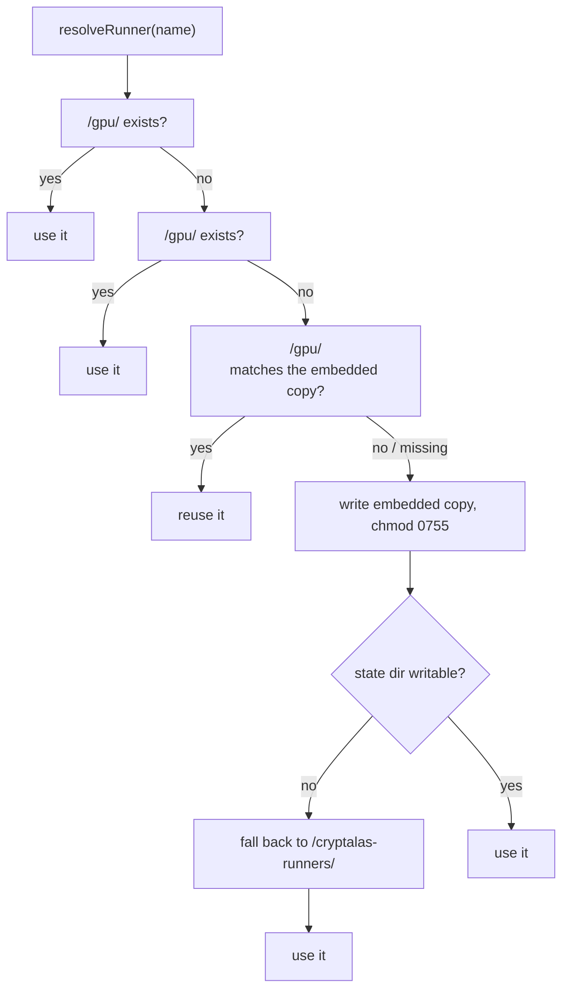

Bundled: `forecast.py`, `cuda_train.py`. A test asserts the embedded copies are
**byte-identical** to `backend/gpu/*.py`, so they cannot drift.

> A stale cached runner is rewritten whenever it differs from the embedded copy.
> Without that, an updated agent would keep executing the old script from its
> state directory — a real bug that made a GPU fix appear to have no effect.

---

## 11. Self-update

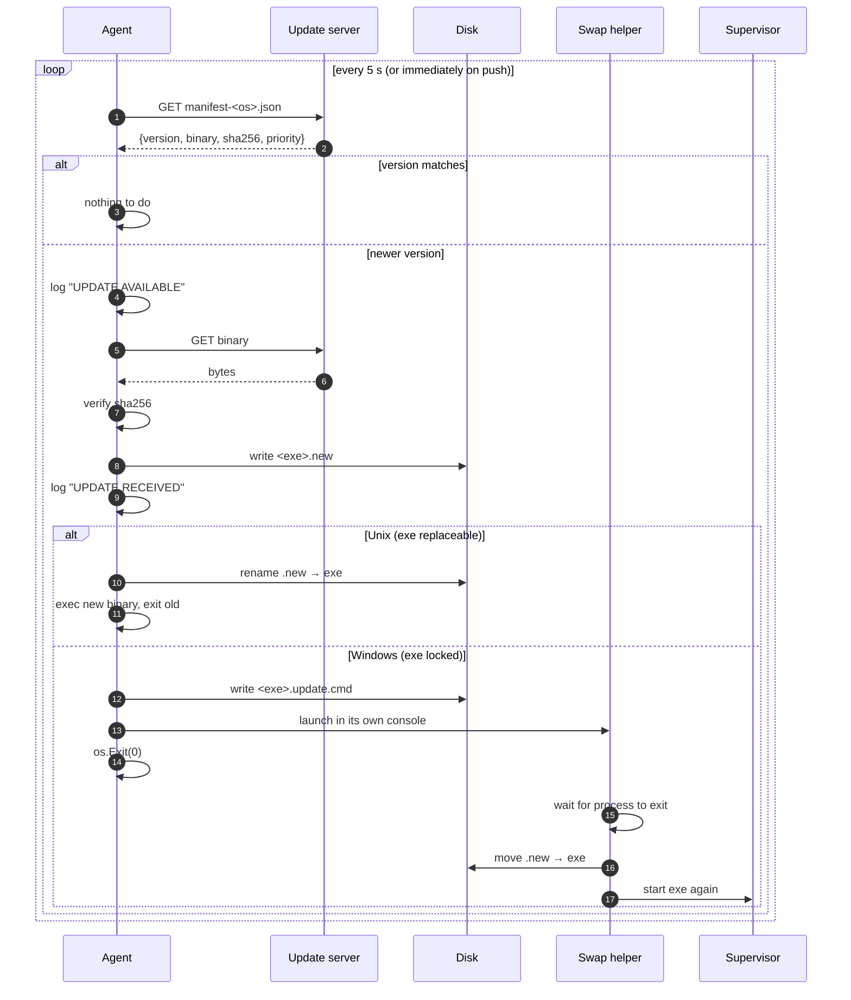

### Manifest format

```json
{
  "version": "2.0.8-a348efa",
  "binary": "http://192.168.1.111:8899/cryptalas.exe",
  "sha256": "912dbb77b5e950aed8605bc7e65e632d9581cd07f17516faeb2f0e064957b8f1",
  "priority": "emergency"
}
```

| Field | Meaning |
|---|---|
| `version` | compared to the running build; any difference is an update |
| `binary` | absolute URL; **empty means "do not update"** |
| `sha256` | verified before the file is ever moved into place |
| `priority` | `"emergency"` logs and colours the update differently |

Serving a manifest locally:

```bash
cd backend/dist && python3 -m http.server 8899
# http://192.168.1.111:8899/manifest-cryptalas.exe.json
```

### The Windows swap helper

A running `.exe` cannot be replaced on Windows, so the agent writes a small batch
file and exits; the helper finishes the job:

```bat
@echo off
setlocal
title CryptALAS update
echo.
echo   CryptALAS agent - updating to 2.0.8-a348efa
echo   from 2.0.5-a348efa
echo.
echo   waiting for the running agent to stop...
:wait
tasklist /FI "IMAGENAME eq cryptalas.exe" 2>nul | find /I "cryptalas.exe" >nul
if not errorlevel 1 (timeout /t 1 /nobreak >nul & goto wait)
echo   installing...
move /Y "C:\...\cryptalas.exe.new" "C:\...\cryptalas.exe" >nul
if errorlevel 1 (echo   install FAILED & timeout /t 5 & exit /b 1)
echo   done - restarting agent 2.0.8-a348efa
timeout /t 1 /nobreak >nul
start "" "C:\...\cryptalas.exe" -name R1
exit
```

Three details in that script are load-bearing, and each was a real bug:

| Detail | Wrong version | Symptom |
|---|---|---|
| plain quotes, not `strconv.Quote` | `"C:\\Users\\..."` | `move` could not find the file |
| `IMAGENAME eq cryptalas.exe` | full path in the filter | filter never matched, wait skipped |
| `winBase` splits on `\` and `/` | `filepath.Base` on a non-Windows build | wrong image name extracted |

### Update state machine

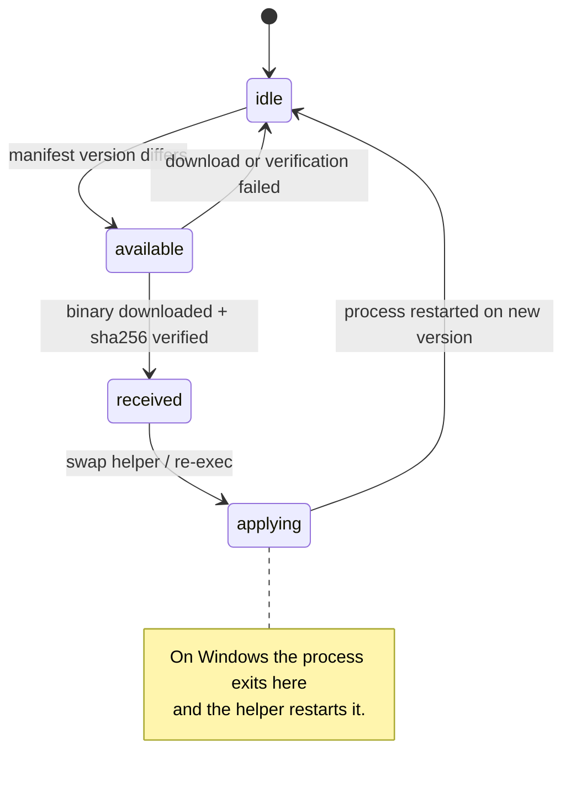

The TTY shows this as a colour-coded line in the identity card:

```
🟡 UPDATE AVAILABLE   2.0.8-a348efa
🟢 UPDATE RECEIVED    2.0.8-a348efa
```

---

## 12. Supervisor and self-heal

Two independent layers of "never dies".

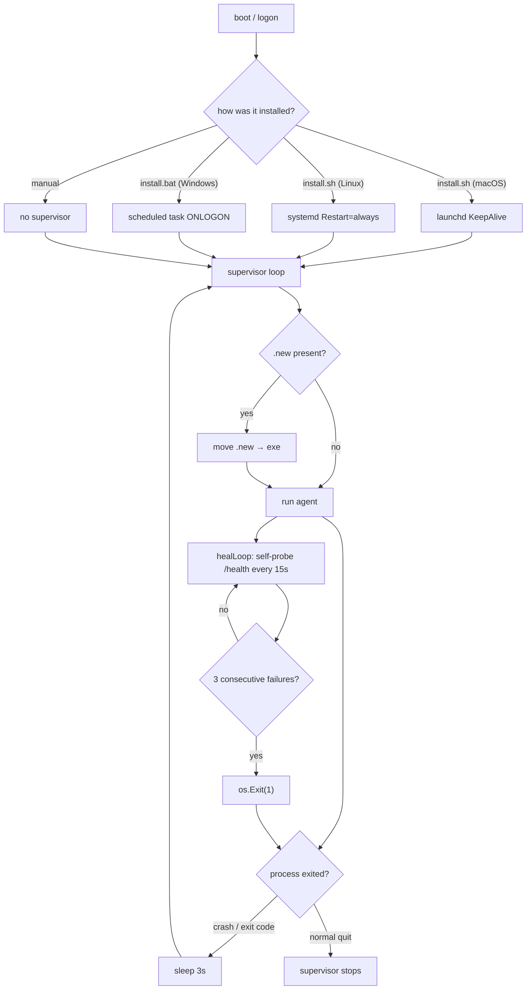

The self-heal exit is deliberate: an agent whose own HTTP server has stopped
answering is useless, so it exits and lets the supervisor produce a clean
process. That is faster and more reliable than any in-process recovery.

### Shipped supervisor files

| File | Platform | Behaviour |
|---|---|---|
| `supervise-cryptalas.sh` | macOS / Linux | loop, swaps `.new`, restarts on any exit |
| `supervise.bat` | Windows | same, for `cryptalas.exe` |
| `install.sh` | macOS / Linux | installs to `~/.cryptalas`, registers launchd/systemd |
| `install.bat` | Windows | kills conflicting processes, installs, writes `supervise.bat`, registers a task |

`install.bat` starts with `taskkill /IM cryptalas.exe /F` so an old copy can
never block the new one — the installer is allowed to kill conflicts.

---

## 13. Terminal UI

Rendered automatically when stdin is a terminal; omitted when run as a service.
State is redrawn on demand, logs stream live and persist in the MESSAGES block.

```
⚡ CRYPTALAS AGENT
────────────────────────────────────────────────────
╔════════════════════════════════════════╗
║                  R1                     ║
║  NAME      R1                           ║
║  IP        192.168.1.137                ║
║  VERSION   2.0.8-a348efa                ║
║  ······································  ║
║  running                                ║
╚════════════════════════════════════════╝
────────────────────────────────────────────────────
  — IDENTITY ────────────────────────────
    name      R1
    host      http://192.168.1.137:8810
    device    cuda   arch amd64
    version   2.0.8-a348efa   go go1.27.1
  ────────────────────────────────────────────────────
  — RESOURCES ───────────────────────────
    CPU  [██████████░░░░░░░░░░░░░░░░]  38%   16 cores
    MEM  [████████░░░░░░░░░░░░░░░░░░]  29%   4.6 GB / 16.0 GB
    GPU  [███░░░░░░░░░░░░░░░░░░░░░░░]  12%   1x NVIDIA GeForce RTX 3060  12288 MiB
  ────────────────────────────────────────────────────
  — CONNECTION ──────────────────────────
    server      http://192.168.1.111:8787
    register    ✓ REGISTERED  8s
    beacon      multicast 239.255.42.99:8788  every 30s  last 3s ago
    update      http://192.168.1.111:8899/manifest-cryptalas.exe.json
  ────────────────────────────────────────────────────
  — JOBS ────────────────────────────────   queue 0  run 1  done 12  fail 1
    ► forecast   btc-forecast      running
    ✓ forecast   btc-forecast      done
    ✗ backtest   mom               failed
```

### Commands

| Command | Effect |
|---|---|
| `help` / `?` | full command list, coloured, stays on screen |
| `status` | redraw the status panel |
| `conn` | server, register state, beacon cadence, host |
| `version` | version, build time, Go version, OS/arch |
| `gpu` | raw `/gpu` report |
| `ollama` | Ollama section of the report |
| `jobs` | job table |
| `job <id>` | one job's full JSON |
| `submit <model> [train\|ollama]` | queue a job by hand |
| `rename <name>` | rename this agent |
| `scan` | scan the local /24 |
| `watch` | redraw every second for 30 s |
| `clear` | redraw |
| `quit` / `exit` | leave the shell |

---

## 14. Configuration

| Flag | Default | Notes |
|---|---|---|
| `-addr` | `0.0.0.0:8810` | `0.0.0.0` so the platform can reach it |
| `-name` | `""` | falls back to the host name |
| `-device` | `auto` | `auto`\|`cpu`\|`gpu`\|`cuda`\|`metal` |
| `-state` | `cryptalas_state` | job state + materialised runners |
| `-register` | baked-in | platform base URL |
| `-advertise` | `http://<addr>` | URL reported to the platform |
| `-beacon-interval` | `30s` | multicast cadence |
| `-beacon-port` | `8788` | UDP port |
| `-heal-interval` | `15s` | self-probe cadence |
| `-update-manifest` | baked-in | manifest URL |
| `-update-interval` | `5s` | manifest poll |
| `-ollama` | `http://localhost:11434` | local Ollama |
| `-cuda-runner` | `gpu/cuda_train.py` | GPU trainer |
| `-marketdata` | `http://127.0.0.1:8796` | local history base; `""` disables |
| `-git-sha` | build version | reported identity |
| `-tty`, `-ui` | auto | forced by an attached terminal |

### Build-time injection

```bash
go build -ldflags "\
  -X main.version=2.0.8-a348efa \
  -X main.buildTime=2026-10-28T20:00:00Z \
  -X main.defaultManifest=http://192.168.1.111:8899/manifest-cryptalas.exe.json \
  -X main.defaultRegister=http://192.168.1.111:8787" \
  -o bin/cryptalas.exe ./cmd/cryptalas
```

`build-agent.sh` does this for all platforms; every value can be overridden:

```bash
VERSION=2.0.9-abc1234 \
MANIFEST_BASE=http://192.168.1.111:8899 \
REGISTER_URL=http://192.168.1.111:8787 \
./build-agent.sh all
```

---

## 15. Deployment

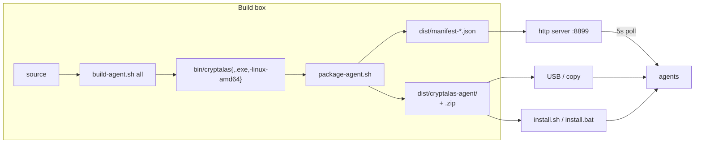

Package contents:

```
dist/cryptalas-agent/
├── cryptalas                 macOS arm64
├── cryptalas-linux-amd64     Linux x86_64
├── cryptalas.exe             Windows x86_64
├── install.sh / install.bat  installers (register a supervisor)
├── supervise-cryptalas.sh    macOS/Linux supervisor
├── supervise.bat             Windows supervisor
├── gpu/forecast.py           runners (also embedded in the binary)
├── gpu/cuda_train.py
└── README.txt
```

Install on Windows:

```bat
install.bat R1 cuda
```

Installs to `%LOCALAPPDATA%\CryptALAS`, kills conflicting processes, adds
firewall rules for `8810` and `8788`/udp, writes `supervise.bat`, registers a
logon task, and starts the agent.

---

## 16. Troubleshooting

Every entry below is a failure that actually happened, with the diagnostic and
the fix.

### The agent registers but never appears in the registry

```bash
curl http://<agent>:8810/gpu | jq .git_sha     # confirm which build runs
curl http://<platform>:8787/api/agents | jq    # confirm what the platform sees
```

The platform refuses registry entries it cannot reach only at dispatch time; the
usual cause is the agent registering to a platform bound to loopback. Check the
platform's listen address:

```bash
lsof -nP -iTCP:8787 -sTCP:LISTEN    # TCP 127.0.0.1:8787 is loopback-only
```

Fix: start the platform with `--addr 0.0.0.0:8787`.

### `python3: can't open file 'D:\tmp\dist\gpu\forecast.py'`

The runners were not deployed next to the exe. Fixed by the embedded runners
([§10](#10-embedded-runners)) — no action needed on builds at or after 2.0.3.

### A job says `done` but contains an error

Fixed in 2.0.5: a result carrying an `error` field now sets `status: "failed"`
and copies the message into `error`. Older builds only ever reported `done`.

### `need >= 3 points` on a `history_ref` job

The agent could not reach any kline source. On 2.0.6+ the message names the
cause:

```
no kline source reachable for BTCUSDT
```

Check reachability of the platform from the agent box:

```bash
curl "http://<platform>:8787/api/klines?symbol=BTCUSDT&interval=1h&limit=5"
```

### GPU requested, `device: "cpu"` returned

Working as designed — the box has no usable Python GPU stack. Read
`device_reason`. Fix on the box with either:

```bash
pip install "jax[cuda12]"
# or
pip install torch --index-url https://download.pytorch.org/whl/cu121
```

`nvidia-smi` must also be findable. The agent looks on `PATH` and in
`C:\Windows\System32\` and `C:\Program Files\NVIDIA Corporation\NVSMI\`.

### A black window flashes and loops on Windows

That is the old swap helper in a retry loop — caused by `strconv.Quote` doubling
the backslashes so `move` could not find the file. Fixed in the helper shown in
[§11](#the-windows-swap-helper). If you are diagnosing an old build, stop the
loop with:

```bat
taskkill /F /IM cryptalas.exe /T
```

### Updates never arrive

```bash
curl -s http://<manifest-base>/manifest-cryptalas.exe.json
```

If this 404s the agent has nothing to download — check that the baked
`MANIFEST_BASE` matches a server you actually run. A manifest with an empty
`binary` is *valid* and means "do not update".

### `TypeError: Load failed` in the dashboard

A network-level failure, not an HTTP error — the platform or agent stopped
responding mid-request. Verify both are up:

```bash
curl -s -o /dev/null -w '%{http_code}\n' http://127.0.0.1:8787/health
curl -s -o /dev/null -w '%{http_code}\n' http://<agent>:8810/health
```

### Dispatch goes to a dead agent

The registry outlives the process. The platform now dispatches only to agents
seen within 90 s (three missed beacons) and fails over between them.

---

## 17. Verification

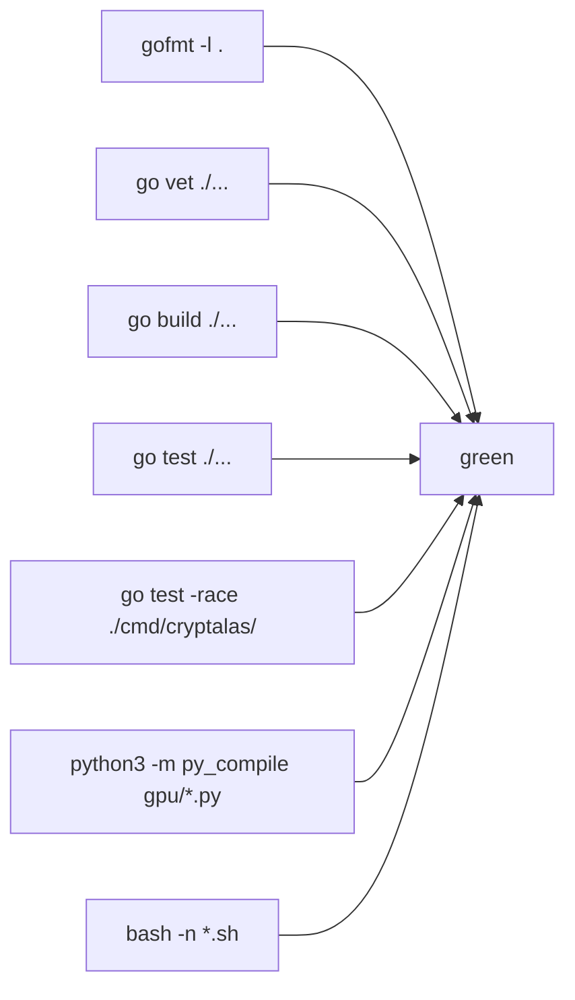

Agent test files and what they pin:

| File | Covers |
|---|---|
| `update_test.go` | version comparison, sha256 verification |
| `compute_test.go` | job execution paths |
| `swap_helper_test.go` | generated batch file: absolute paths, no escaped backslashes, bare image name, wait-before-move, restart with arguments |
| `runners_test.go` | embedded fallback, disk preference, stale-cache refresh, byte-identity with `gpu/*.py` |
| `history_test.go` | platform fallback, both kline shapes, no-source behaviour, failed-job status |
| `rename_test.go` | rename propagation, concurrent read/write |
| `joblog_test.go` | result digests, error detection, payload sizing |
| `gpu_test.go` | `nvidia-smi` lookup safety |

Tests use `httptest` servers and `t.TempDir()` — no live network, no wall clock,
no machine-specific paths. The local marketdata base is a flag precisely so a
test can switch it off.

---

## 18. Version history of the agent

| Version | Change |
|---|---|
| 2.0.8 | stale cached runners are refreshed |
| 2.0.7 | honest device reporting, Windows `nvidia-smi` lookup |
| 2.0.6 | platform fallback for `history_ref`, both kline shapes |
| 2.0.5 | failed jobs report `status: "failed"` + `error` |
| 2.0.4 | job lifecycle logging (RECEIVED / RUNNING / DONE / FAILED) |
| 2.0.3 | runners embedded in the binary |
| 2.0.2 | ASCII identity card with NAME / IP / VERSION |
| 2.0.1 | rename propagates from the beacon |
| 2.0.0 | human-readable semver + sha |
| 1.x | multicast discovery, TTY, supervisor, self-update |

---

## 19. Extending the agent

### Add a job type

1. Add a `case` in `run(j *Job, callback string)` in `cmd/cryptalas/main.go`.
2. Return a `map[string]any`; put a human-readable failure in `result["error"]`
   and the framework will mark the job `failed` and surface the message.
3. Add a test asserting the result shape and the failure path.
4. Document the payload in [§8](#8-job-types).

```go
case "zscore":
    result = a.runZScore(j)
```

### Add a runner script

1. Put it in `backend/gpu/<name>.py`.
2. Copy it to `cmd/cryptalas/runners/<name>.py`.
3. Add it to the `//go:embed` list in `runners.go`.
4. Add it to `package-agent.sh`.
5. The byte-identity test will fail until the copies match — that is the point.

### Add an endpoint

Register it on `mux` in `main()`, keep the response JSON, and add a
table entry to [§7](#7-http-api). Write the handler so a failure returns a status
the caller can act on rather than an empty 200.
