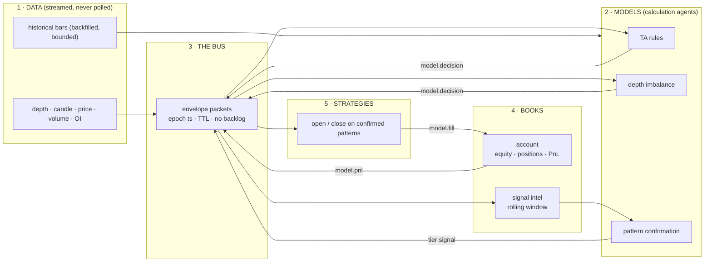
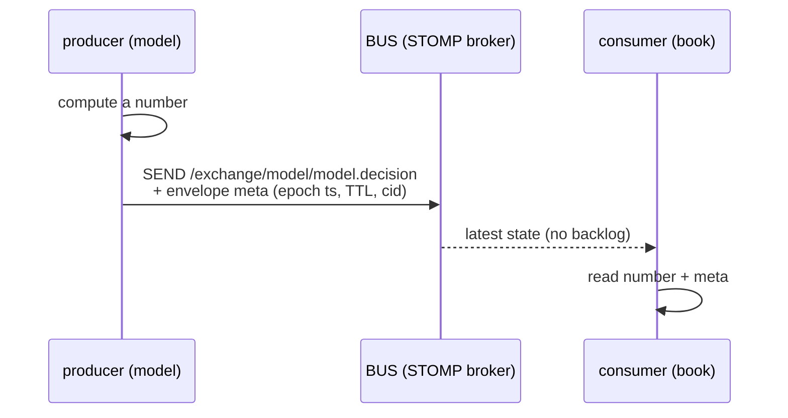
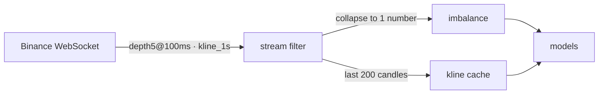
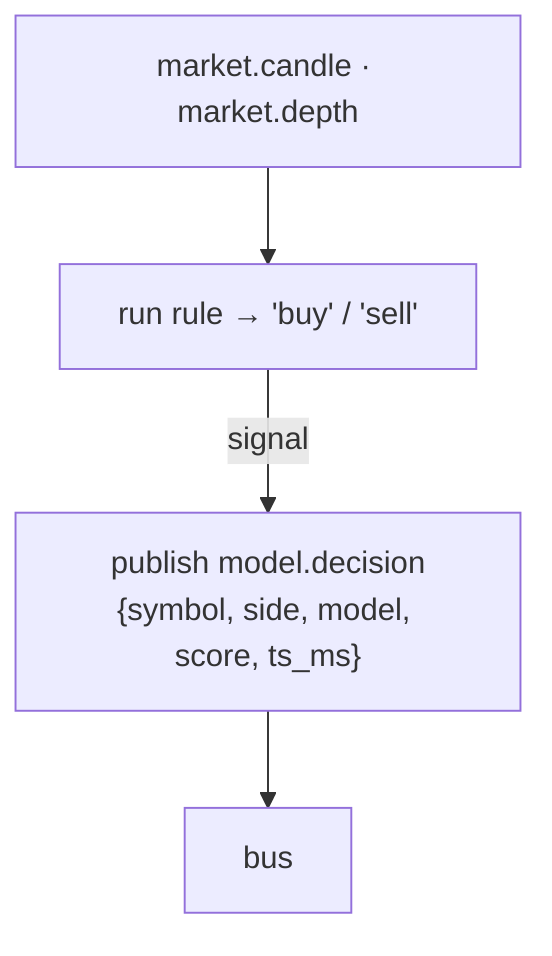
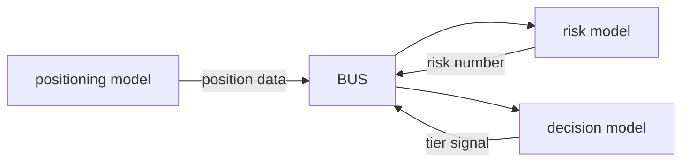
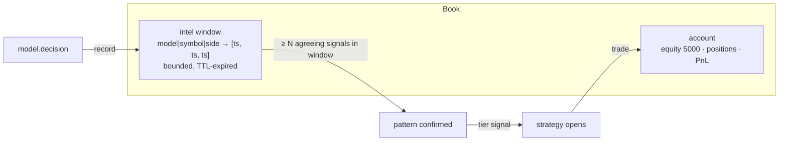
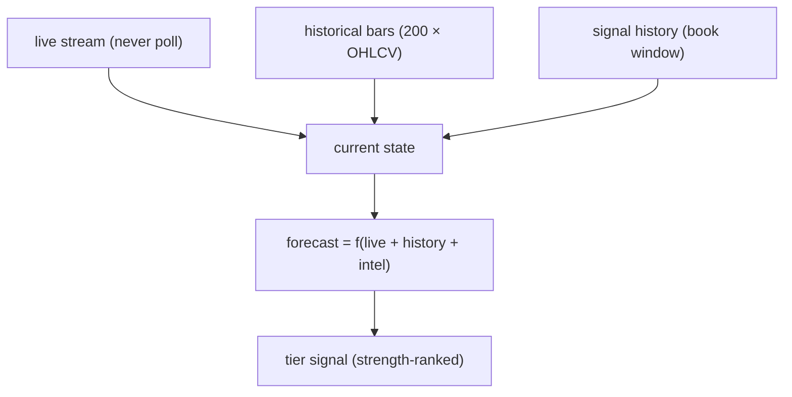
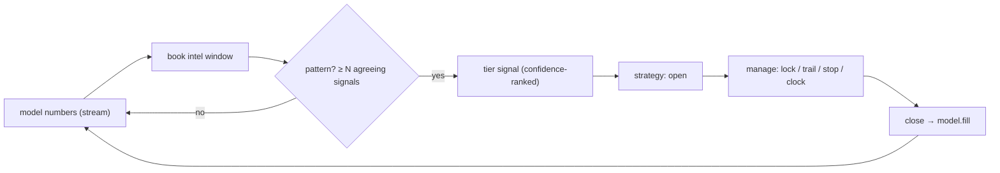
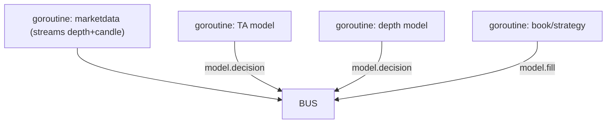
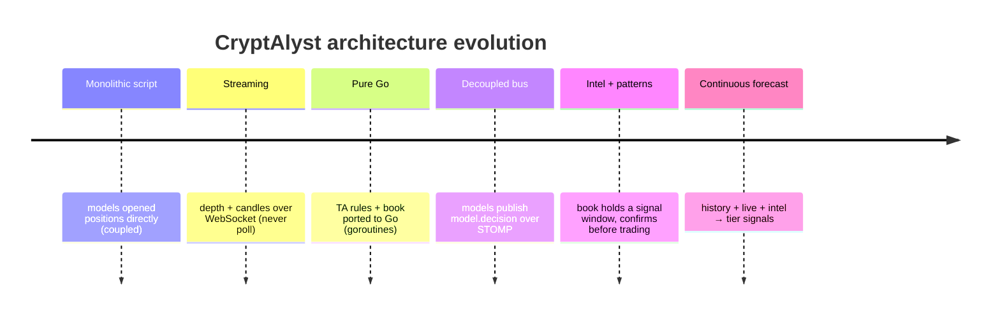

# CryptAlyst — Books, Models & Data
## The decoupled streaming forecast architecture (the "masterpiece" build)

> A complete review of the architecture we designed and built in this latest
> development. It covers **messaging, streaming, models, books, data and history** —
> and why they must be combined to *continuously forecast* and fire **tier signals**.

---

## 1. The core principle

The system is **asynchronous and decoupled**. Nothing calls anything else directly.

- **Models are calculation agents** — they publish *numbers* (a signal, a score, a probability).
- **The bus carries packets** — every message is an envelope with an **epoch timestamp and a TTL**, and it is **never backlogged**: subscribers read the latest state, nothing queues.
- **Books hold the intel** — a book accumulates the recent signal stream in a **bounded rolling window**, so a model can see a *pattern* before it is confident.
- **Strategies trade** — a strategy lives inside the book and opens/closes only when the model has confirmed a pattern.

A single signal is not enough. A model reports a signal, is *not sure* whether it is a
good idea, and waits until it sees a **pattern**. **That intel is what the book carries
and the model uses.**

---

## 2. Messaging — the bus is the nervous system

### 2.1 Envelopes: every packet is stamped

Every message on the bus is an **envelope**: a payload plus metadata. The metadata is the
provenance that makes the stream auditable and fresh.

| Field | Meaning |
|---|---|
| `topic` | the channel (e.g. `model.decision`, `market.depth`) |
| `producer` | who may write this topic (enforced by the topic registry) |
| `epoch timestamp` (`received_at`, `computed_at`) | when it happened, in UTC |
| `generation` / `seq` | monotonic ordering per topic |
| `TTL / retention` | how long the broker keeps it (`drop`, `60s`, `5m`) |
| `cid` / `parent_cid` | correlation id — links a decision to its fills (auditable chain) |
| `hops` / `refs` | the path the packet travelled and the data it references |

### 2.2 Topics — a single registry with producer contracts

`topics.go` is the **one table**. Adding a topic is one line. Each topic declares which
exchange carries it, which producers may write it, and its retention (TTL).

| Topic | Exchange | Producers | Retention |
|---|---|---|---|
| `market.price` / `market.depth` / `market.candle` | market | market_data | drop (live only) |
| `intel.signal` / `intel.flow` / `intel.movers` | intel | signals | 60s |
| `model.decision` | model | models10, curve_rider, … | 5m |
| `model.fill` | model | same | 5m |
| `model.pnl` | model | same + supervisor | 5m |
| `risk.state` | risk | risk | 5m |

**Why TTL + no backlog:** a market moves on the *latest* information. If packets queued,
a slow subscriber would act on stale data. With TTL the bus is a **state channel**, not a
job queue — every subscriber reads the current picture, and old packets simply evaporate.

---

## 3. Streaming — never poll (BPF-inspired)

### 3.1 The Berkeley Packet Filter insight

BPF filters packets **at the source** — inside the kernel — so only the data that matches
is ever copied up. We applied the same idea to market data:

1. **Filter at the source** — subscribe to only the data we need (`depth5`, not the full book).
2. **Keep only the signal** — collapse the order book to one `imbalance` number and drop the rest.
3. **Never poll** — data pushes to us over WebSocket; decisions happen on arrival, not on a timer.

### 3.2 Why streaming beat polling

Measured during the build: **one model calculation takes ~150 µs**, while **one HTTP
fetch takes ~333 ms** — the network was ~2000× slower than the math. Polling 24 endpoints
sequentially cost ~8 seconds per decision; the WebSocket stream delivers the same data in
real time. **The bottleneck was never the language — it was I/O and polling.**

| Before (poll) | After (stream) |
|---|---|
| 24 sequential HTTP fetches ≈ 8s per decision | push, ~0 latency |
| full depth (20 levels) | depth5 (5 levels) + one imbalance number |
| stale data on a timer | data on arrival |

---

## 4. Models — calculation agents that publish numbers

A model owns **one question**. It does not know about accounts, positions, or risk. It
computes and publishes — which is what makes it replaceable and testable.

| Model | Question | Output |
|---|---|---|
| `donchian55` | breaking a 55-bar range? | buy/sell |
| `orb` | breaking the opening range? | buy/sell |
| `boll_squeeze` | tight Bollinger expanding? | buy/sell |
| `rsi2` | 2-bar RSI overbought/oversold? | buy/sell |
| `vwap_revert` | stretched from VWAP? | buy/sell |
| `macd_trend` | MACD crossed zero? | buy/sell |
| `vol_break` | volume spike + directional close? | buy/sell |
| `ema_pullback` | pullback to the EMA trend? | buy/sell |
| `atr_channel` | outside an ATR channel? | buy/sell |
| `curve_rider` | strongest book imbalance? | buy/sell + score |

### 4.1 Models feed other models

A model's output is input to another model. A **positioning** model publishes where the
book is exposed; a **risk** model consumes it and publishes risk; both feed the decision.
That is the point — **models provide valuable data for other models**, and the bus is how
that data moves without any model knowing who listens.

---

## 5. Books — account **and** intel

The book is two things at once:

1. **The account** — equity, open positions, realised PnL. This survives and is reported.
2. **The intel** — a bounded rolling window of recent signals, so the model can see a
   *pattern* rather than a lone blip.

**"Never hold too much data, but imagine a bull run."** The window is bounded — old
entries expire — yet it is long enough that during a sustained move the model sees the
*streak* of agreeing signals that confirms the trend. A single signal is noise; the
**streak** is the signal.

---

## 6. Data — the market microstructure (what the market is *thinking*)

A forecast is only as good as the data behind it. The system reads the order flow, not
just the candles:

| Signal | Reads | What it reveals |
|---|---|---|
| **depth imbalance** | bid vs ask volume in the book | real buy/sell pressure now |
| **OI change** | open interest over an interval | new money entering a position |
| **price** | last / 24h move | direction + momentum |
| **volume** | quote volume / volume spike | participation and conviction |

**All three layers combined** turn a number into a *forecast*, and a forecast into a
**tier signal** — a confidence-ranked decision the strategy acts on.

---

## 7. From forecast to tier signal to trade

The **exit ladder** (what the strategy manages):

| Exit | Rule | Purpose |
|---|---|---|
| `lock` | +0.35% | bank a fee-clearing profit |
| `trail` | peak ≥ +1%, exit −0.5% off peak | ride winners |
| `stop` | −0.5% | cap every loss (no heavy bleeds) |
| `clock` | 180s hold, winners only | force turnover |

---

## 8. Pure Go — async and concurrent

The models and the engine run as **Go goroutines**, each decoupled from the others:

- **A slow model can't block the others** (each owns its goroutine).
- **A panicking model can't kill the pipeline** (panic is contained and reported).
- **Models run continuously**, publishing numbers whether or not anyone listens.

This is the runtime version of the decoupling: the same independence the bus gives at the
message level, the goroutines give at the process level.

---

## 9. What we covered — the evolution

Every step removed a coupling and added a layer of **memory** — which is exactly what a
forecast needs. The destination is the architecture on page 1: data → models → bus →
book (account + intel) → strategy → trade, with history feeding every forecast.

---

## 10. Why this is a "tier signal" system

- **A model alone is an opinion; a book with history is a conviction.**
- **Data alone is noise; data + context + memory is a forecast.**
- **The bus keeps it decoupled and real-time; TTL keeps it fresh; the window keeps it informed.**

That combination — *combined, historical, and continuously updated* — is what lets the
system **forecast** and then **fire a tier signal** a strategy can trade with confidence.
