# CryptAlyst — Books, Models & Data
## The decoupled streaming forecast architecture

> A complete engineering review of the platform: how **messaging, streaming, models,
> books, data and history** combine to *continuously forecast* and fire **tier signals**
> that strategies trade. Every diagram is rendered in the CryptAlyst role palette.

<div style="page-break-after: always"></div>

## Contents

1. The core principle
2. Messaging — the bus
3. Streaming — never poll
4. Models — calculation agents
5. Books — account and intel
6. Data — the market microstructure
7. Forecast → tier signal → trade
8. The strategy and exit ladder
9. Pure Go — concurrency
10. The full journey
11. The envelope and pipeline
12. The topic registry
13. The risk governor
14. The evolution
15. Model reference — the ten agents in detail
16. Worked examples — bull run, refusal, a full trade
17. Data signals — depth, OI, volume
18. Correlation and lineage
19. Book states
20. The recorder and the lake
21. The supervisor and control plane
22. Example trades — stop, trail, cascade, funding
23. Risk accounting
24. The envelope journey
25. Tier decisions
26. Design decisions — why it is built this way
27. The forecast — how the layers combine
28. The Go code structure
29. More worked examples
30. Operations and monitoring
31. Testing the models
32. The complete topic registry
33. Glossary
34. Summary


<div style="page-break-after: always"></div>

# How to read this document

Each section builds on the previous one, but every section also stands alone.

- **Sections 1–6** establish the pieces: the principle, the bus, the streaming, the models,
  the books, the data.
- **Sections 7–13** show the flow: forecast → tier signal → trade, the exit ladder, the Go
  concurrency, the journey, the envelope, the topic registry, the risk governor.
- **Sections 14–25** are the reference: the evolution, each model in detail, worked examples,
  the data signals, the lineage, the states, the recorder, the supervisor, the risk.
- **Sections 26–34** are the reasoning and the operations: why it is built this way, the
  forecast math, the code structure, more examples, monitoring, testing, the full registry,
  and the glossary.

**How to read a diagram.** Every diagram uses the CryptAlyst role palette:

| Colour | Role |
|---|---|
| blue | market data (raw feed) |
| green | intelligence (TA, forecast, signals) |
| amber | models, books, strategies |
| red | risk, refusals |
| teal | control, orchestration |
| purple | stores, the lake |
| grey | the bus, envelopes, neutral |

The colour tells you *what kind of thing* a node is at a glance, before you read a single
label. Flow runs left-to-right or top-to-bottom; sequence diagrams run top-to-bottom over
time.

<div style="page-break-after: always"></div>

# 1. The core principle

**What it does.** This section defines the one organising idea the whole platform hangs on:
every part is a *producer* or a *consumer* of small, stamped packets, and nothing is coupled
directly to anything else.

**Why it matters.** Decoupling is what makes the system observable, testable and
replaceable. A coupled system (a model that opens a position directly) is fast to write and
impossible to reason about afterwards; a decoupled system records every hop as a packet, so
every decision can be replayed and every part can be swapped without touching the rest.


The platform is **asynchronous and decoupled**. Nothing calls anything else directly.

- **Models are calculation agents** — they publish *numbers* (a signal, a score, a probability).
- **The bus carries packets** — every message is an envelope with an **epoch timestamp and a TTL**, and it is **never backlogged**: subscribers read the latest state, nothing queues.
- **Books hold the intel** — a book accumulates the recent signal stream in a **bounded rolling window**, so a model can see a *pattern* before it is confident.
- **Strategies trade** — a strategy lives inside the book and opens/closes only when the model has confirmed a pattern.

A single signal is not enough. A model reports a signal, is *not sure* whether it is a good
idea, and waits until it sees a **pattern**. **That intel is what the book carries and the
model uses.**

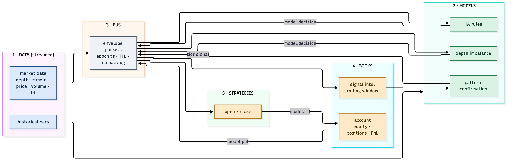

*Figure 1.1 — data → models → bus → books → strategy → trade, decoupled at every hop.*

## 1.1 Why decouple

| Coupled (what we moved away from) | Decoupled (the design) |
|---|---|
| a model opens a position directly | a model only publishes a number |
| one slow model slows everything | each model owns its own goroutine |
| a panic in one model kills the pipeline | a panic is contained and reported |
| models only run when the loop runs | models run continuously, whether or not anyone listens |
| consumers read whatever arrives | consumers read the latest state (TTL, no backlog) |

The decoupling is what makes the system *agile*: a packet of model output or market data can
be published, listened to, and used by any other part — without any part knowing who listens.

<div style="page-break-after: always"></div>

# 2. Messaging — the bus is the nervous system

**What it does.** The bus moves every packet between every component: market data in,
model numbers out, decisions and fills and pnl around the loop. A packet is an envelope — a
payload plus provenance (who, when, in what order, with a TTL).

**Why it matters.** The bus is the single point of integration. Because everything flows
through it as stamped envelopes, the whole system has one audit trail, one source of truth
for "who may write what", and one place to observe. Without it, every component would need
its own hand-rolled wiring, and the platform would be a hairball of direct calls.


Every message on the bus is an **envelope**: a payload plus metadata — the provenance that
makes the stream auditable and fresh. The bus is a **state channel, not a job queue**: with
a TTL on every packet and no backlog, a subscriber always reads the *current* picture, and
old packets simply evaporate.

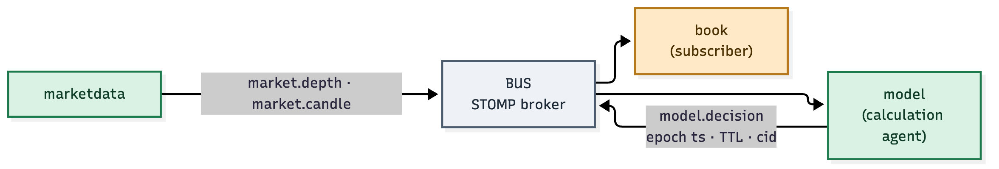

*Figure 2.1 — calculation agents publish numbers; subscribers listen and decide.*

## 2.1 The envelope anatomy

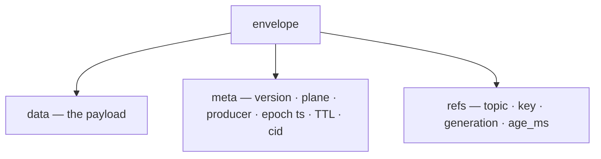

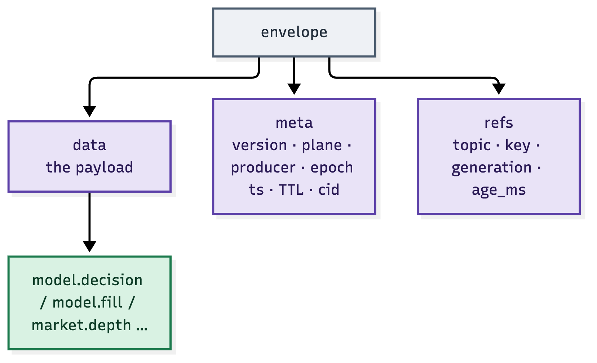

*Figure 2.2 — an envelope carries the payload, its provenance, and the inputs it read.*

| Member | What it carries | Why it matters |
|---|---|---|
| `data` | the payload for the topic | the number the model computed |
| `meta` | version, plane, producer, generation, cid, timestamps | provenance — who, when, in what order |
| `refs` | the inputs it read (topic, key, generation, age) | lineage — what a decision was based on |

## 2.2 The metadata fields

| Field | Meaning |
|---|---|
| `version` | the envelope contract revision |
| `plane` | market, intel, model, risk, control, system |
| `topic` | the channel (e.g. `model.decision`) |
| `key` | the symbol, when the message concerns one |
| `producer` | the component that computed the payload |
| `generation` / `seq` | monotonic ordering per topic |
| `cid` / `parent_cid` | correlation id — links a decision to its fills |
| `computed_at` | when the payload was produced (staleness gates use this) |
| `received_at` | when the recorder accepted it |
| `hops` / `refs` | the pipeline stages and the inputs read |

## 2.3 The pipeline — interceptors, operator, transformer

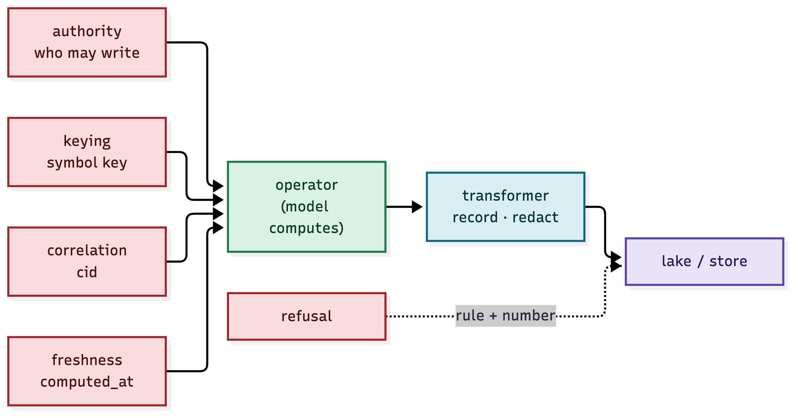

*Figure 2.3 — authority, keying, correlation and freshness run before the operator produces a payload.*

Every envelope passes four interceptors before the operator runs, and a transformer after:

| Stage | What it checks | Refusal records |
|---|---|---|
| `authority` | the producer may write this topic | the rule name |
| `keying` | the message is keyed by symbol | the rule name |
| `correlation` | a cid is minted and chained | the rule name |
| `freshness` | `computed_at` is within the topic's limit | the rule and the number |

A refusal is recorded as an envelope too — so "why not" is a packet you can open, not a line
in a log.

## 2.4 Topics — a single registry with producer contracts

`topics.go` is the **one table**. Each topic declares its exchange, its producers and its
retention (TTL). The planes group them:

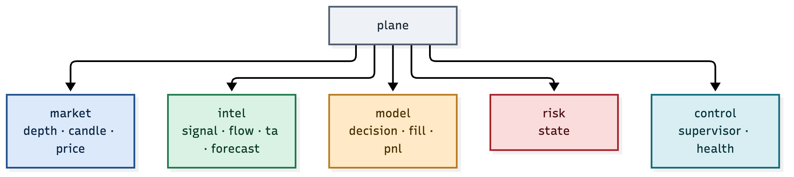

*Figure 2.4 — five planes: market, intel, model, risk, control.*

| Topic | Exchange | Producers | Retention |
|---|---|---|---|
| `market.price` / `market.depth` / `market.candle` | market | market_data | drop (live only) |
| `intel.signal` / `intel.flow` / `intel.movers` | intel | signals | 60s |
| `intel.ta` | intel | tad | 60s |
| `intel.forecast` | intel | forecast | 60s |
| `model.decision` | model | models10, curve_rider, … | 5m |
| `model.fill` | model | same | 5m |
| `model.pnl` | model | same + supervisor | 5m |
| `risk.state` | risk | risk | 5m |

<div style="page-break-after: always"></div>

# 3. Streaming — never poll (BPF-inspired)

**What it does.** Market data (depth, candles, price, volume, OI) arrives over WebSocket,
pushed by the exchange, and is filtered at the source to only the fields each consumer needs.

**Why it matters.** Polling is the enemy of a fast decision: the measurement showed one HTTP
fetch (333 ms) is ~2000× slower than one model calculation (150 µs). Streaming removes that
latency and the "filter at the source" idea (from the Berkeley Packet Filter) removes the
wasted data. A decision made on a pushed, pre-filtered number is both faster and cheaper.


The Berkeley Packet Filter filters packets **at the source** — inside the kernel — so only the
data that matches is ever copied up. The same idea applied to market data:

1. **Filter at the source** — subscribe to only what we need (`depth5`, not the full book).
2. **Keep only the signal** — collapse the order book to one `imbalance` number.
3. **Never poll** — data pushes to us over WebSocket; decisions happen on arrival.

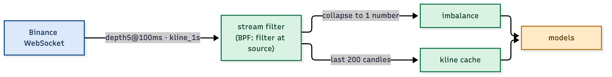

*Figure 3.1 — WebSocket → filter → one number, the BPF pattern.*

## 3.1 Why streaming beat polling

Measured during the build: **one model calculation takes ~150 µs**, while **one HTTP fetch
takes ~333 ms** — the network was ~2000× slower than the math. Polling 24 endpoints
sequentially cost ~8 seconds per decision; the WebSocket stream delivers the same data in
real time.

| Before (poll) | After (stream) |
|---|---|
| 24 sequential HTTP fetches ≈ 8s per decision | push, ~0 latency |
| full depth (20 levels) | depth5 (5 levels) + one imbalance number |
| stale data on a timer | data on arrival |

**The bottleneck was never the language — it was I/O and polling.**

## 3.2 What is streamed

| Stream | Frequency | What it feeds |
|---|---|---|
| `depth5@100ms` | 100 ms | the imbalance (book pressure) |
| `kline_1m` / `kline_15m` | on close | the TA models |
| `bookTicker` | real time | the best bid/ask |
| `trade` / `aggTrade` | real time | volume and taker flow |

The market data service subscribes once, and every model reads the same live state.

<div style="page-break-after: always"></div>

# 4. Models — calculation agents that publish numbers

**What it does.** A model is a *pure function*: candles and the depth imbalance in, a
"buy" / "sell" / "nothing" out. It publishes that number and holds no account state.

**Why it matters.** Purity is what makes a model testable (you can feed it generated bars
and assert the answer) and replaceable (a better rule is a drop-in). If a model also knew
about the account, it would be impossible to test in isolation and impossible to swap
without dragging the whole book along. One model = one question = one testable function.


A model owns **one question**. It does not know about accounts, positions, or risk. It
computes and publishes — which is what makes it replaceable and testable.

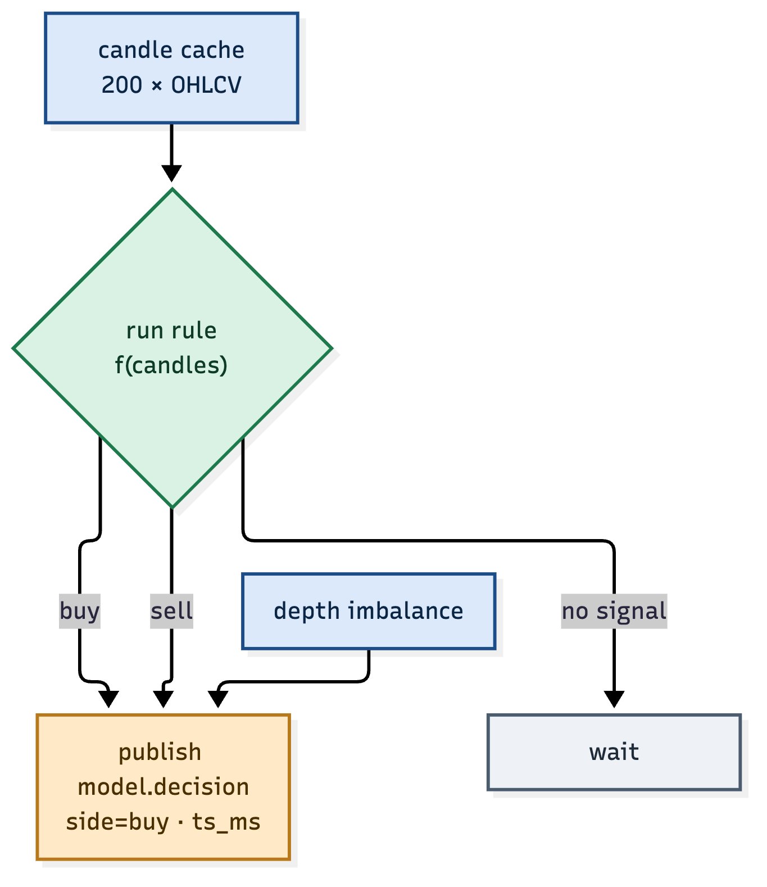

*Figure 4.1 — the model consumes the cached market state, runs its rule, and publishes a decision.*

## 4.1 The models

| Model | Question | Rule |
|---|---|---|
| `donchian55` | breaking a 55-bar range? | close ≥ 55-bar high → buy; ≤ low → sell |
| `orb` | breaking the opening range? | close > session high → buy; < low → sell |
| `boll_squeeze` | tight Bollinger expanding? | close > +2σ with width < 1% → buy |
| `rsi2` | 2-bar RSI stretched? | RSI < 10 → buy; > 90 → sell |
| `vwap_revert` | stretched from VWAP? | below 0.994×VWAP → buy; above 1.006× → sell |
| `macd_trend` | MACD crossed zero? | hist crosses up → buy; down → sell |
| `vol_break` | volume spike + directional close? | vol > 3×avg + close in top/bottom 30% → trade |
| `ema_pullback` | pullback to the EMA trend? | price at EMA20 with EMA20>EMA50 → buy |
| `atr_channel` | outside an ATR channel? | close > EMA20+1.5×ATR → buy |
| `curve_rider` | strongest book imbalance? | buy/sell the biggest bid/ask imbalance |

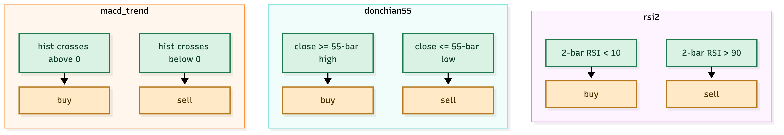

*Figure 4.2 — RSI2, Donchian and MACD: each is a tiny deterministic function of candles.*

## 4.2 Models feed other models

A model's output is input to another. A **positioning** model publishes where the book is
exposed; a **risk** model consumes it and publishes risk; both feed the decision. **Models
provide valuable data for other models** — and the bus is how that data moves without any
model knowing who listens.

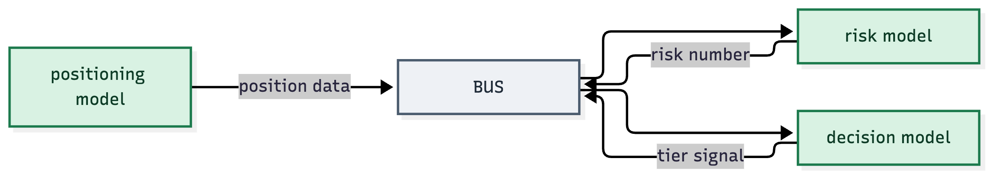

*Figure 4.3 — positioning → risk → decision, each a published number.*

<div style="page-break-after: always"></div>

# 5. Books — account **and** intel

**What it does.** The book is the account (equity, positions, PnL) *plus* a bounded
rolling window of the recent signals, so a model can see a *pattern* before it is confident.

**Why it matters.** A single signal is noise; a streak is a signal. The window is the memory
that turns the former into the latter — without it the strategy would trade every blip.
Because the window is bounded and TTL-expired, it never holds too much, yet it is long enough
to catch a sustained move (imagine a bull run: the streak is exactly what you want to see).


The book is two things at once:

1. **The account** — equity, open positions, realised PnL. This survives and is reported.
2. **The intel** — a bounded rolling window of recent signals, so the model can see a
   *pattern* rather than a lone blip.

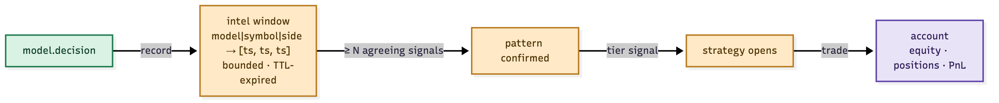

*Figure 5.1 — a lone signal is noise; the streak in the window is the signal.*

## 5.1 The pattern confirmation

Models need **previous signals, or many**, to make an informed decision. The book holds
those for a **time window the model defines**:

- a signal arrives — the model is *not sure* yet;
- the book records it in the rolling window;
- only when **N agreeing signals** accumulate inside the window does the model confirm;
- the confirmation becomes a **tier signal** the strategy may act on.

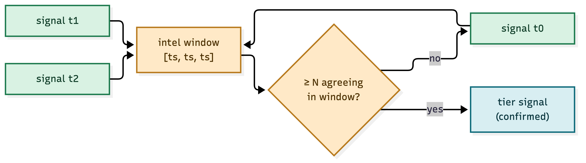

*Figure 5.2 — a signal is reported; the model waits for a pattern before it is sure.*

**"Never hold too much data, but imagine a bull run."** The window is bounded — old entries
expire — yet it is long enough that during a sustained move the model sees the *streak* of
agreeing signals that confirms the trend. A single signal is noise; the **streak** is the
signal.

<div style="page-break-after: always"></div>

# 6. Data — the market microstructure

**What it does.** The system reads the order flow — depth imbalance, open interest, price,
volume — not just the candles. Each signal reveals a different face of what the market is
*thinking*.

**Why it matters.** Candles alone are the *past*; the order book and OI are the *present* —
the resting orders and the new money that will move price next. Combining them with history
turns a lagging picture into a leading forecast. The market microstructure is the edge: it
shows intention before it becomes a completed trade.


A forecast is only as good as the data behind it. The system reads the order flow, not just
the candles:

| Signal | Reads | What it reveals |
|---|---|---|
| **depth imbalance** | bid vs ask volume | real buy/sell pressure now |
| **OI change** | open interest over an interval | new money entering |
| **price** | last / 24h move | direction + momentum |
| **volume** | quote volume / spike | participation and conviction |

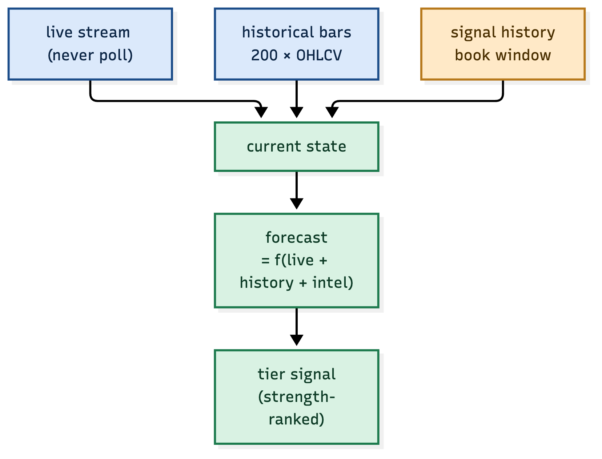

*Figure 6.1 — three layers combined turn a number into a forecast.*

## 6.1 The three layers of data

| Layer | What it provides | Why it matters |
|---|---|---|
| **Live stream** | the *now* — imbalance, last price, last volume | direction of pressure |
| **Historical bars** | the *context* — 200 bars of OHLCV | where price is in its range |
| **Signal intel** | the *memory* — recent model outputs | whether a pattern is forming |

**All three combined** turn a number into a *forecast*, and a forecast into a **tier signal**.

<div style="page-break-after: always"></div>

# 7. Forecast → tier signal → trade

**What it does.** The numbers from the models are combined with history and the signal
intel into a *forecast*, which is then ranked into *tiers*, and only a confirmed tier signal
is traded.

**Why it matters.** Not every number deserves a trade. The tier ranking is what stops the
strategy from treating a weak signal and a strong one the same — it concentrates capital on
the confident, confirmed signals and ignores the noise. That is the difference between a
forecast and a firehose.


The strategy does not act on every number. It waits for a **tier signal** — a confirmed,
strength-ranked decision.

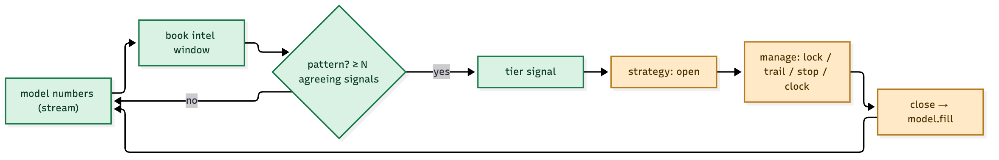

*Figure 7.1 — numbers → pattern → tier signal → open → manage → fill.*

## 7.1 Tier ranking

Not all signals are equal. The system ranks them by strength and acts accordingly:

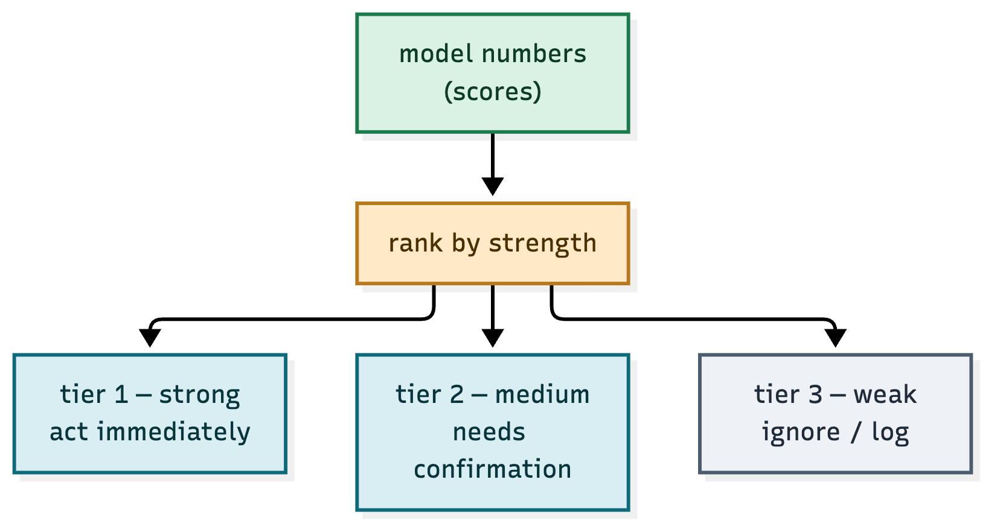

*Figure 7.2 — tier 1 acts immediately, tier 2 needs confirmation, tier 3 is ignored.*

| Tier | Meaning | Action |
|---|---|---|
| **Tier 1** | strong, confirmed | act immediately |
| **Tier 2** | medium | needs further confirmation |
| **Tier 3** | weak | ignore / log only |

<div style="page-break-after: always"></div>

# 8. The strategy and exit ladder

**What it does.** Once a tier signal is confirmed, the strategy opens a position and
manages it on a fixed ladder: lock at +0.35%, trail off the peak, stop at −0.5%, clock at
180s.

**Why it matters.** The ladder is a *risk envelope*, not a prediction. It does not try to
call the market; it guarantees that whatever happens, the profit is banked, the loss is
bounded, the winner has room to run, and nothing is held forever. Fixed, simple exits are
what make the outcome predictable — which is the whole point of a trading system.


Once a tier signal is confirmed, the strategy opens a position and manages it on a fixed
ladder. The ladder is the risk envelope that keeps losses bounded and lets winners run.

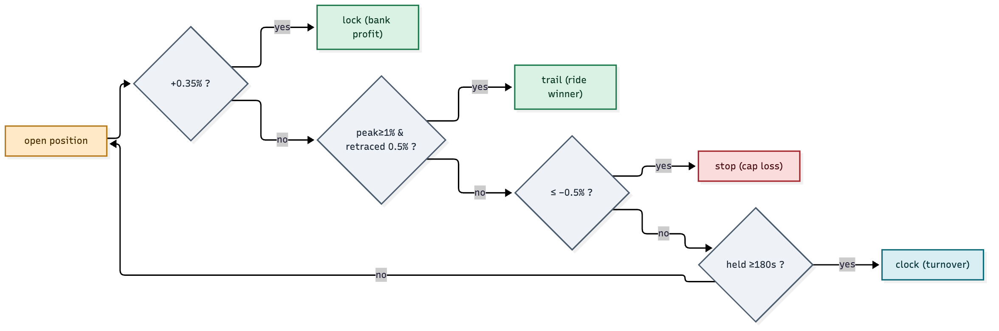

*Figure 8.1 — four exits, checked in order, on every mark.*

| Exit | Rule | Purpose |
|---|---|---|
| `lock` | +0.35% | bank a fee-clearing profit |
| `trail` | peak ≥ +1%, exit −0.5% off peak | ride winners |
| `stop` | −0.5% | cap every loss (no heavy bleeds) |
| `clock` | 180s hold, winners only | force turnover |

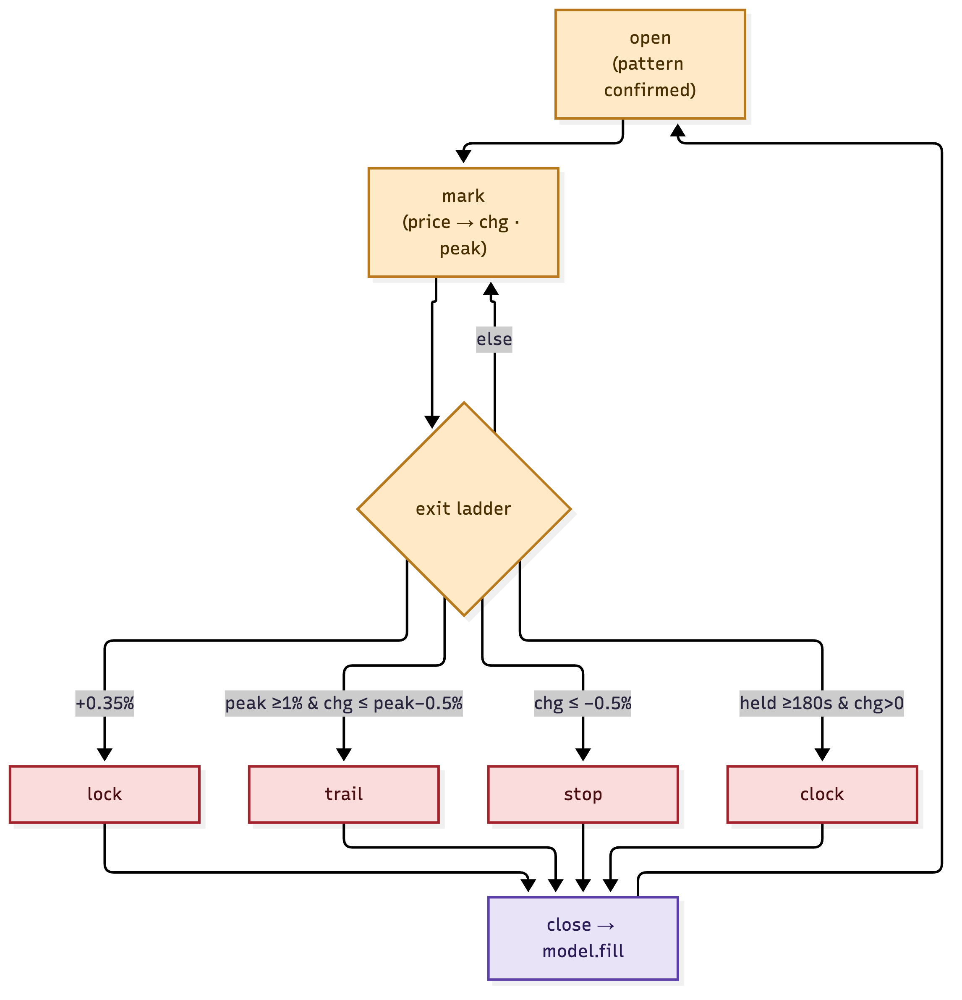

*Figure 8.2 — open → mark → exit ladder → close → fill.*

<div style="page-break-after: always"></div>

# 9. Pure Go — concurrency

**What it does.** The models and the engine run as independent Go goroutines inside one
process, each with its own scheduler.

**Why it matters.** The same independence the bus gives at the message level, goroutines
give at the process level: a slow model can't block the others, a panic is contained, and
each model runs continuously whether or not anyone listens. Pure Go also removes the
interpreter as a concern — the math was never the bottleneck, but one runtime for everything
is simpler to build, deploy and reason about.


The models and the engine run as **Go goroutines**, each decoupled from the others:

- **A slow model can't block the others** (each owns its goroutine).
- **A panicking model can't kill the pipeline** (panic is contained and reported).
- **Models run continuously**, publishing numbers whether or not anyone listens.

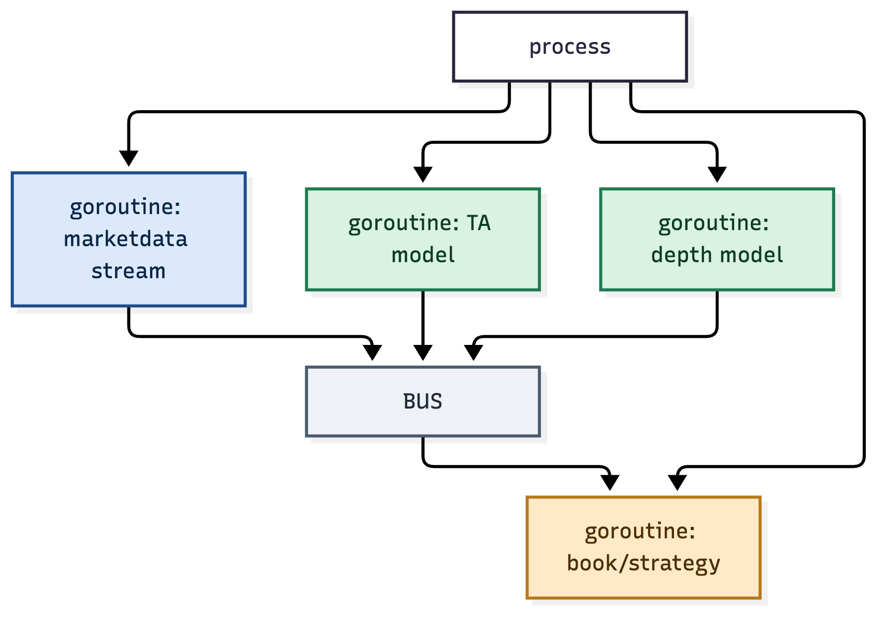

*Figure 9.1 — the same independence the bus gives at the message level, goroutines give at the process level.*

<div style="page-break-after: always"></div>

# 10. The full journey

**What it does.** Traces one market tick from the exchange WebSocket all the way to a
recorded fill, through the bus, the recorder, the models, the book and the lake.

**Why it matters.** The journey is the proof the decoupling works end to end: data is
recorded once and consumed many times, models publish and books decide, and every step lands
in the same append-only lake. Understanding the journey is understanding the whole system in
one pass.


One market tick's journey through the platform, end to end:

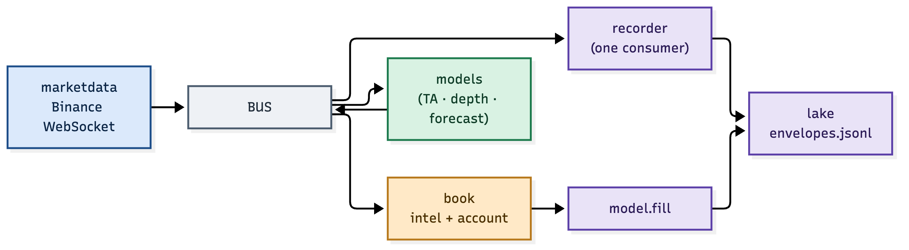

*Figure 10.1 — data is recorded once and consumed many times; models publish, books decide.*

| Stage | What happens |
|---|---|
| 1 · market data | Binance WebSocket → market.price / market.depth / market.candle |
| 2 · the bus | every packet is an envelope with epoch ts and TTL |
| 3 · recorder | the single consumer; writes the lake once |
| 4 · models | subscribe, compute, publish model.decision |
| 5 · book | accumulates the intel, confirms a pattern |
| 6 · strategy | opens/closes, publishes model.fill |
| 7 · lake | the fill is recorded, joining the same history |

<div style="page-break-after: always"></div>

# 11. The envelope and pipeline

**What it does.** Defines the envelope (data, meta, refs) and the pipeline every packet
passes: four interceptors, the operator, a transformer.

**Why it matters.** Provenance and checks are *on the packet*, not in a log beside it. A
refusal is recorded as an envelope too, so "why not" is a packet you can open. That is what
turns a message stream into evidence you can audit.


Covered in section 2 — reproduced here with the full field dictionary and the worked
refusal path.

## 11.1 Reading a decision

A `model.decision` envelope carries the verdict, the confidence, and the reason. A refusal
names the rule and the number that tripped it. The pipeline shows the interceptors that ran.

## 11.2 The refusal path

A refusal is not a log line — it is an envelope you can open:

```
model.decision NEARUSDT
  verdict   REFUSED
  reason    stale signals: 3230s old (max 90s)
  pipeline  authority pass · keying pass · correlation pass · freshness pass
  operator  alpha_rank · produced model.decision
  refs      market.candle 5007ms (derived) · market.depth 906ms (derived)
```

The freshness interceptor passed because the *envelope* was fresh; the refusal came from the
model's own signal-age check — a distinction the record preserves.

<div style="page-break-after: always"></div>

# 12. The topic registry

**What it does.** One table lists every topic: its exchange, its allowed producers, and its
retention (TTL).

**Why it matters.** A single registry is the enforcement point for producer contracts — who
may write what — and for the TTL that keeps the bus a state channel rather than a job queue.
Adding a topic is one line; changing a contract is visible to everyone.


The registry is the single source of truth for who may write what, and how long it lives.

| Topic | Plane | Producers | Retention |
|---|---|---|---|
| `market.price` | market | market_data | drop |
| `market.depth` | market | market_data | drop |
| `market.candle` | market | market_data | drop |
| `market.mini24h` | market | market_data | drop |
| `ticks` | market | market_data | drop |
| `intel.signal` | intel | signals | 60s |
| `intel.flow` | intel | signals | 60s |
| `intel.movers` | intel | market_data, signals | 60s |
| `intel.board` | intel | market_agent | 60s |
| `intel.ta` | intel | tad | 60s |
| `intel.forecast` | intel | forecast | 60s |
| `alert.pumpdump` | alert | backend, signal_bus | 300s |
| `model.decision` | model | models10, curve_rider, … | 5m |
| `model.fill` | model | same | 5m |
| `model.pnl` | model | same + supervisor | 5m |
| `risk.state` | risk | risk | 5m |

**Why TTL + no backlog:** a market moves on the latest information; the bus is a state
channel, not a job queue.

<div style="page-break-after: always"></div>

# 13. The risk governor

**What it does.** Sits between the tier signal and the trade, and refuses any order the
account cannot afford: exposure, gross multiple, per-symbol concentration.

**Why it matters.** The models want to trade; the account has limits. The governor is the
machine-enforced boundary that says no, with the rule and the number recorded. Without it,
"risk" would be a hope; with it, a refusal is a fact you can audit.


Between the tier signal and the trade sits the risk governor. It is the machine-enforced
boundary that refuses a trade the models want but the account cannot afford.

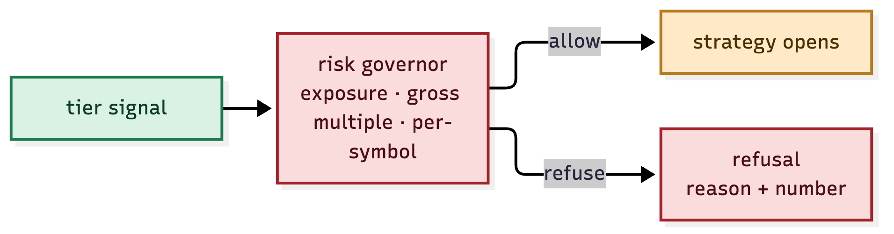

*Figure 13.1 — every decision passes the exposure and gross-multiple checks before an order.*

| Check | What it refuses |
|---|---|
| exposure | a position above a fraction of the book |
| gross multiple | total notional beyond a leverage bound |
| per-symbol | concentration in one instrument |
| counter-trend | shorts into an up-regime (when disabled) |

A refusal names the rule and the number, and is recorded — so "why not" is always
answerable.

<div style="page-break-after: always"></div>

# 14. The evolution

**What it does.** Recounts the path from a monolithic script to the decoupled streaming
forecast.

**Why it matters.** The evolution is the design argument in miniature: each step removed a
coupling and added a layer of memory. Seeing the steps explains *why* the end state looks the
way it does — and warns against sliding back into the coupled pattern that caused the
trouble in the first place.


Every step removed a coupling and added a layer of **memory** — which is exactly what a
forecast needs.

| Step | What changed |
|---|---|
| Monolithic script | models opened positions directly (coupled) |
| Streaming | depth + candles over WebSocket (never poll) |
| Pure Go | TA rules + book ported to Go (goroutines) |
| Decoupled bus | models publish model.decision over STOMP |
| Intel + patterns | book holds a signal window, confirms before trading |
| Continuous forecast | history + live + intel → tier signals |


<div style="page-break-after: always"></div>

# 15. Model reference — the calculation agents in detail

**What it does.** Documents each of the ten models as a pure function — its exact rule, its
inputs, its thresholds, and what it returns.

**Why it matters.** The reference is the contract between "what the model computes" and "what
the system trades". Having each rule written down means a signal can be reproduced by hand,
a bug can be localised to one function, and a change can be reasoned about before it is made.


Each model is a **pure function of its inputs**: candles (and, for the curve rider, the
depth imbalance). It returns `buy`, `sell`, or nothing. It holds no state and knows nothing
about accounts. That purity is what makes every model testable against generated data.

## 15.1 `donchian55` — range breakout

**Question:** is price breaking out of a 55-bar range?

```
hi = max(high[-55:]);  lo = min(low[-55:])
if hi == lo: return none
c = close[-1]
if c >= hi: return buy
if c <= lo: return sell
return none
```

| Input | Lookback |
|---|---|
| 55-bar high/low | 55 candles |
| close | last candle |

A breakout is the oldest and most persistent edge: a market that leaves its recent range
tends to keep going. The `hi == lo` guard rejects a flat symbol, where no breakout is
possible.

## 15.2 `orb` — opening range breakout

**Question:** is price breaking the first 15 minutes of the UTC day?

```
session = candles from today
if len(session) < 20: return none
hi = max(high of first 15);  lo = min(low of first 15)
if close > hi: return buy
if close < lo: return sell
```

| Input | Lookback |
|---|---|
| first 15 candles of the day | session start |
| close | last candle |

The opening range is where the day's conviction is established; breaking it is a genuine
directional commitment rather than intraday noise.

## 15.3 `boll_squeeze` — volatility expansion

**Question:** is a tight Bollinger band starting to expand?

```
cl = close[-20:];  m = mean(cl);  sd = stdev(cl)
width = 2*sd/m
if close > m + 2*sd and width < 0.01: return buy
if close < m - 2*sd and width < 0.01: return sell
```

| Input | Threshold |
|---|---|
| 20-bar mean + stdev | width < 1% (squeeze) |
| close outside ±2σ | breakout |

A squeeze (narrow band) precedes a move; the breakout direction is the signal. The width
guard ensures the model only fires when the market was genuinely compressed.

## 15.4 `rsi2` — mean reversion at the extreme

**Question:** is the 2-bar RSI overbought or oversold?

```
r = rsi(close[-20:], period=2)
if r < 10: return buy
if r > 90: return sell
```

| Input | Threshold |
|---|---|
| 2-bar RSI | < 10 → buy; > 90 → sell |

A very short RSI measures momentum exhaustion. The 2-bar period makes it respond in seconds,
so it catches the exact moment a move is spent.

## 15.5 `vwap_revert` — mean reversion to volume

**Question:** is price stretched from its volume-weighted average?

```
vw = sum(close*vol over 30 bars) / sum(vol over 30 bars)
if close < vw * 0.994: return buy
if close > vw * 1.006: return sell
```

| Input | Threshold |
|---|---|
| 30-bar VWAP | ±0.6% band |

Price stretched 0.6% from VWAP is pulled back; the model fades the stretch.

## 15.6 `macd_trend` — momentum cross

**Question:** did the MACD histogram cross zero?

```
fast = ema(close, 12);  slow = ema(close, 26)
hist = fast - slow
prev = ema(close[:-1], 12) - ema(close[:-1], 26)
if prev <= 0 < hist: return buy
if prev >= 0 > hist: return sell
```

| Input | Threshold |
|---|---|
| MACD(12,26) histogram | cross above/below zero |

The zero cross is the moment short-term momentum overtakes the trend — a clean, binary
turn signal.

## 15.7 `vol_break` — volume confirmation

**Question:** is volume spiking with a directional close?

```
avg = mean(volume[-20:-1])
if volume[-1] < 3*avg: return none
rng = high[-1] - low[-1]
if (close-low)/rng > 0.7: return buy
if (high-close)/rng > 0.7: return sell
```

| Input | Threshold |
|---|---|
| volume vs 19-bar average | > 3× |
| close in the bar's range | top/bottom 30% |

A volume spike that closes near the extreme of the bar is participation with conviction —
the difference between a move and a wiggle.

## 15.8 `ema_pullback` — trend continuation

**Question:** is price pulling back to the EMA trend and holding?

```
e20 = ema(close, 20);  e50 = ema(close, 50)
if e20 > e50 and close > e50 and |close-e20|/e20 < 0.002: return buy
if e20 < e50 and close < e50 and |close-e20|/e20 < 0.002: return sell
```

| Input | Threshold |
|---|---|
| EMA20 vs EMA50 | trend |
| close vs EMA20 | within 0.2% |

A pullback to a rising EMA that holds is the classic continuation entry — with the trend,
at a discount.

## 15.9 `atr_channel` — volatility channel breakout

**Question:** is price outside an ATR-based channel?

```
m = ema(close, 20);  a = atr(14)
if close > m + 1.5*a: return buy
if close < m - 1.5*a: return sell
```

| Input | Threshold |
|---|---|
| EMA20 ± 1.5×ATR | channel |

The channel adapts to volatility: in a quiet market the channel is tight, in a wild one it
is wide, so "outside the channel" always means a real move.

## 15.10 `curve_rider` — order-flow imbalance

**Question:** which market has the strongest book imbalance, and which way?

```
imb = (bid_volume - ask_volume) / (bid_volume + ask_volume)
if |imb| > 0.3:
    side = buy if imb > 0 else sell
```

| Input | Threshold |
|---|---|
| depth5 bid/ask volume | \|imb\| > 0.3 |
| price | best bid/ask midpoint |

The order book is what the market is *thinking* right now — heavier bids mean real buying
pressure, heavier asks real selling. The curve rider enters the strongest and rides it
with the trail.

<div style="page-break-after: always"></div>

# 16. Worked examples

## 16.1 A bull run — how the streak becomes a tier signal

During a sustained up-move, a single `donchian55` buy signal is not enough. The book records
each signal in its rolling window:

| Time | Signal | Window state | Decision |
|---|---|---|---|
| t0 | buy | [buy] | wait — 1 signal |
| t1 | buy | [buy, buy] | wait — 2 signals |
| t2 | buy | [buy, buy, buy] | **pattern confirmed → tier signal** |

The model was *not sure* at t0 and t1; at t2 the streak made it confident. The strategy
opens, and the `trail` exit lets the position run while the streak holds — the bull run is
ridden, not skimmed at the first tick.

## 16.2 A refusal — why the model did nothing

A model presents a decision, but the risk governor refuses it:

```
model.decision SOXLUSDT  side=buy  confidence=0.71
  governor   REFUSED  gross multiple 12.4× > limit 8×
```

The refusal names the rule and the number. Nothing is silent: the refusal is recorded as an
envelope, and the WHY view lists it with the exact reason. The system did not fail to trade —
it correctly refused a trade the account could not afford.

## 16.3 A full trade — entry to fill

```
t0  pattern confirmed (3 × donchian55 buy)          → strategy opens 2500 notional
t1  mark +0.41%  → lock (≥ +0.35%)                  → close, net +0.21%
    → publish model.fill {reason: lock, net_pct: 0.21}
t2  the fill joins the lake, correlated to the decision
```

The whole chain — decision → fill → pnl — is linked by one correlation id, so any trade can
be traced from the market tick that triggered it to the fill it produced.

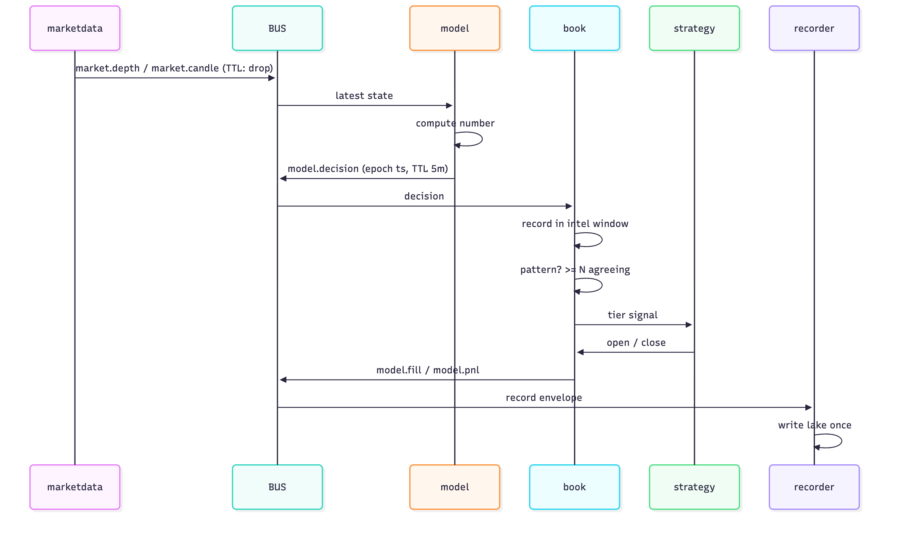

*Figure 16.1 — marketdata → bus → model → book → strategy → recorder, one tick's journey.*


<div style="page-break-after: always"></div>

# 17. Data signals — deep dive

**What it does.** Explains the three microstructure signals in detail: depth imbalance,
open interest change, and volume — each with its formula and its thresholds.

**Why it matters.** These signals are what the market is *thinking*, as opposed to what it
has *done* (the candles). Understanding each one — and its limits — is what lets the models
read intention rather than lag. The depth leads price; OI shows conviction; volume shows
participation.


## 17.1 Depth imbalance — what the book is thinking

The order book is a live vote. Bid volume is money wanting to buy; ask volume is money
wanting to sell. The imbalance is the net of the two, normalised:

```
imbalance = (bid_volume − ask_volume) / (bid_volume + ask_volume)
```

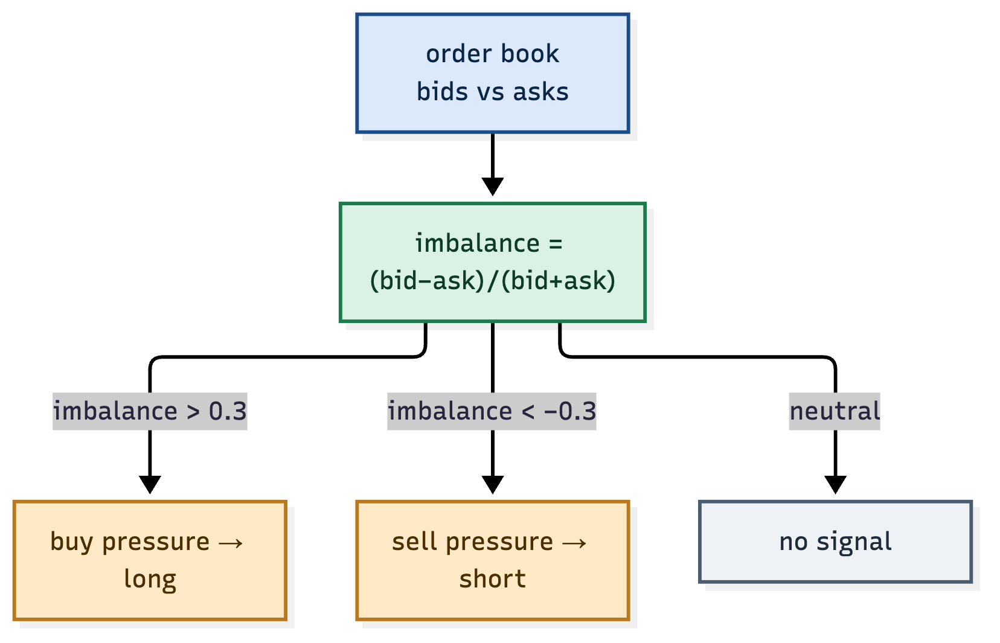

*Figure 17.1 — heavier bids → long; heavier asks → short; balanced → no signal.*

| imbalance | Reading | Action |
|---|---|---|
| > +0.3 | buy pressure | consider long |
| < −0.3 | sell pressure | consider short |
| near 0 | balanced | no signal |

The book is what the market is *thinking right now* — it leads price, because it shows the
orders already resting that will move the market next.

## 17.2 Open interest — new money entering

Open interest is the number of open contracts. A change in OI over an interval tells you
whether a move is backed by *new* positions (conviction) or just unwinding (exhaustion).

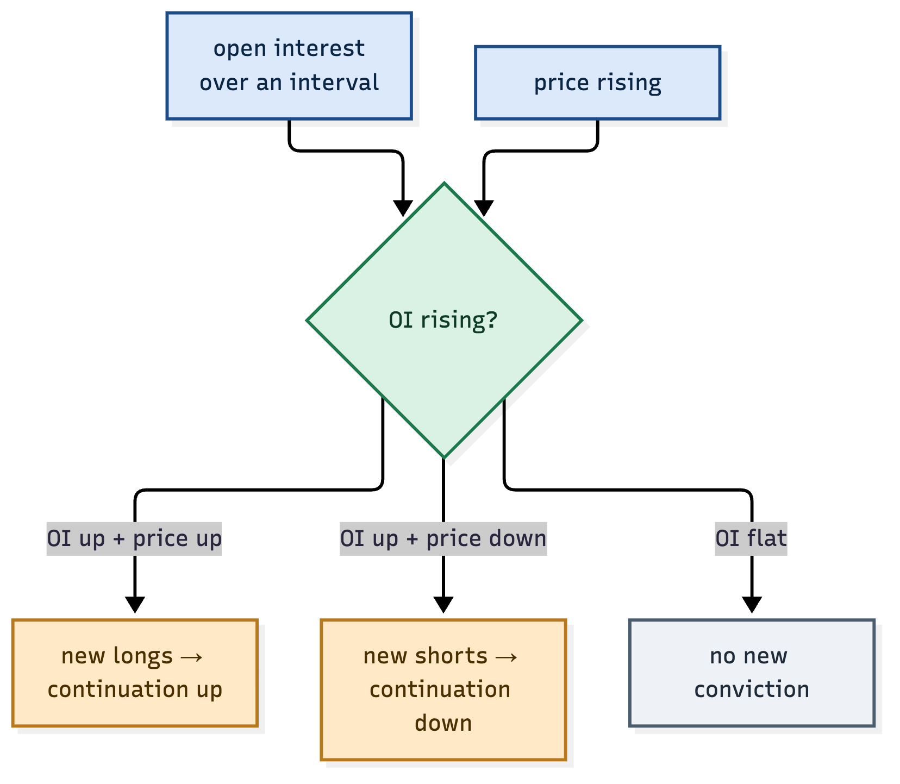

*Figure 17.2 — OI rising with price = new longs; OI rising against price = new shorts.*

| OI | Price | Reading |
|---|---|---|
| rising | rising | new longs — continuation up |
| rising | falling | new shorts — continuation down |
| flat | either | no new conviction |

## 17.3 Volume — participation and conviction

Volume is participation. A price move on high volume is conviction; the same move on thin
volume is noise. The spike rule catches the difference:

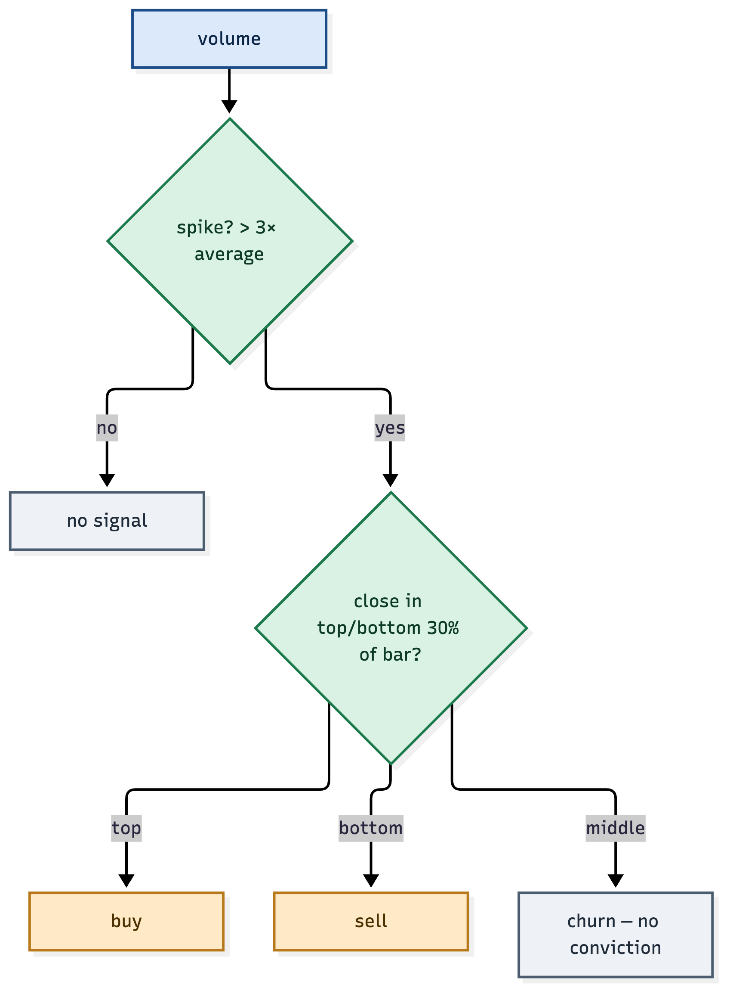

*Figure 17.3 — a spike with a directional close is conviction; a spike with a middle close is churn.*

| Volume | Close position in bar | Reading |
|---|---|---|
| > 3× average | top 30% | buy |
| > 3× average | bottom 30% | sell |
| > 3× average | middle | churn — no conviction |
| normal | any | no signal |

<div style="page-break-after: always"></div>

# 18. Correlation and lineage

**What it does.** Explains how one correlation id follows a piece of work from the market
tick through the decision, the fill and the pnl, and how references are declared or derived.

**Why it matters.** Lineage is what turns a pile of packets into a *story* — and a story you
can verify. A trade traceable to its trigger is evidence; a trade without a line of descent
is a rumour. The correlation id is the spine of the audit.


Every piece of work is followed by one **correlation id**. A market tick leads to a decision,
the decision to a fill, the fill to a pnl update — all carrying the same cid, so the whole
chain is resolvable in the lake.

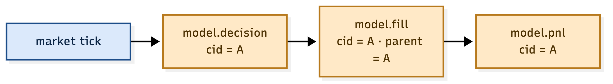

*Figure 18.1 — tick → decision → fill → pnl, all keyed to correlation id A.*

The lineage is what turns the platform into evidence: any trade can be traced from the raw
market packet that triggered it to the fill it produced, with no interpretation required.

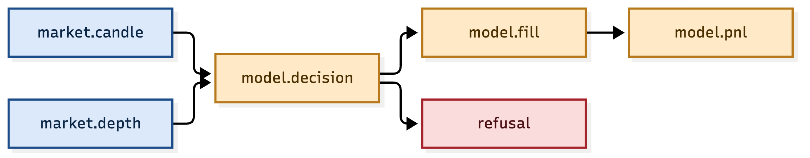

*Figure 18.2 — market data → decision → (fill \| refusal) → pnl.*

## 18.1 Declared vs derived references

A reference is **declared** when the producer names its inputs; it is **derived** when the
recorder infers them (the newest envelope of each input topic for that symbol in the window,
marked with its age). The record always says which — a derived reference is never silently
presented as declared.

<div style="page-break-after: always"></div>

# 19. Book states

**What it does.** Models the book as a small state machine: idle → accumulating →
confirmed → in position → closed → idle.

**Why it matters.** A state machine makes the book's behaviour finite and testable. The
window expiring returns "accumulating" to "idle", so a pattern can never form from stale
intel. Every transition is a defined, checkable step — which is what makes the book
deterministic.


The book is a small state machine. Every position moves through the same states, and the
exit ladder is the only thing that moves it forward.

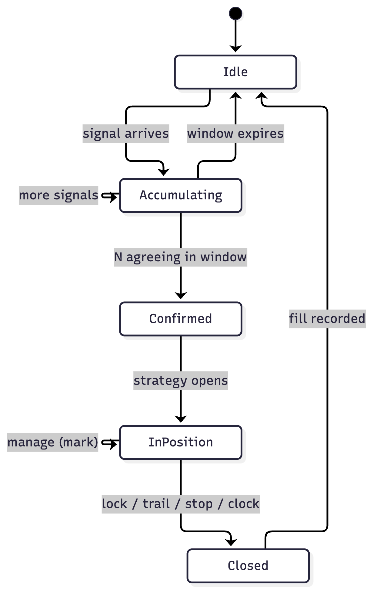

*Figure 19.1 — idle → accumulating → confirmed → in position → closed → idle.*

| State | Meaning |
|---|---|
| `Idle` | no position, waiting for a signal |
| `Accumulating` | signals arriving, pattern not yet confirmed |
| `Confirmed` | N agreeing signals in the window |
| `InPosition` | a position is open, being marked |
| `Closed` | the position closed, fill recorded |

The window expiring returns `Accumulating` to `Idle` — old signals are dropped, so a pattern
never forms from stale intel.

<div style="page-break-after: always"></div>

# 20. The recorder and the lake

**What it does.** The recorder is the single consumer of the bus: it writes every envelope
once into the lake (the append-only journal + an indexed store) and fans it out to readers.

**Why it matters.** Single-writer, append-only is what makes the record trustworthy: nothing
rewrites history, nothing drops a packet silently, and the explorer reads the same lake the
recorder wrote. The lake is the memory of the whole platform.


The bus has **one consumer**: the recorder. It writes every envelope **once** into the lake,
then fans it out to readers (the explorer, the dashboards). This single-writer design is why
the record is append-only and auditable.

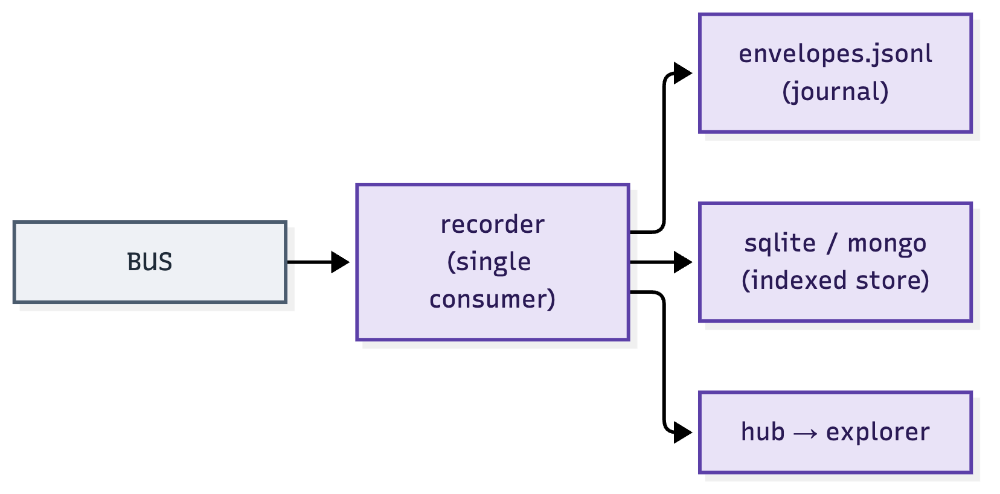

*Figure 20.1 — bus → recorder → journal + indexed store → explorer.*

| Store | What it holds |
|---|---|
| `envelopes.jsonl` | the append-only journal |
| sqlite / mongo | the indexed, queryable copy |
| hub | fans envelopes to readers |

<div style="page-break-after: always"></div>

# 21. The supervisor and control plane

**What it does.** The supervisor launches and restarts the models, watches their health,
publishes the aggregate pnl, and accepts control commands.

**Why it matters.** The supervisor is the orchestrator that never trades: it keeps the
trading processes alive and honest without making a single decision itself. Separating
control from trading means a control failure can't corrupt a book, and a book failure can't
silence the control plane.


The supervisor is the orchestrator: it launches and restarts the models, watches health, and
publishes the aggregate pnl. It never trades — it only keeps the trading processes alive and
honest.

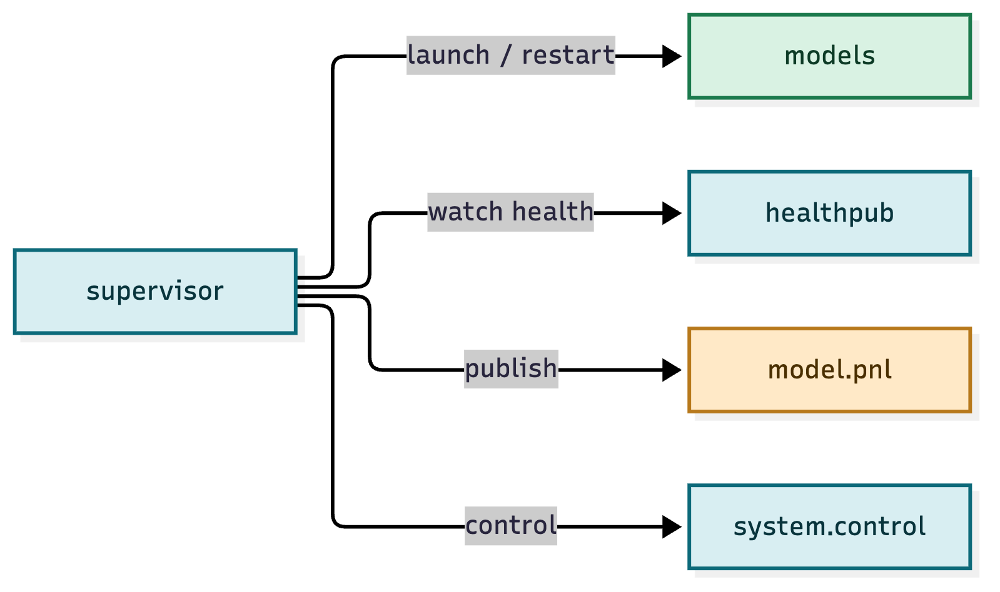

*Figure 21.1 — launch/restart models, watch health, publish pnl, accept control.*

| Duty | Topic / action |
|---|---|
| launch + restart models | process supervision |
| watch health | `system.health` |
| publish aggregate pnl | `model.pnl` |
| accept commands | `system.control` |

<div style="page-break-after: always"></div>

# 22. Example trades — each exit, worked

**What it does.** Works each exit in the ladder — stop, trail, cascade, funding — as a
concrete trade with numbers.

**Why it matters.** Each exit exists for a reason (bound the loss, ride the winner, buy the
flush, collect the funding), and seeing the numbers makes the reason concrete. The ladder is
a set of *guarantees*, and each worked example is one guarantee demonstrated.


## 22.1 The stop

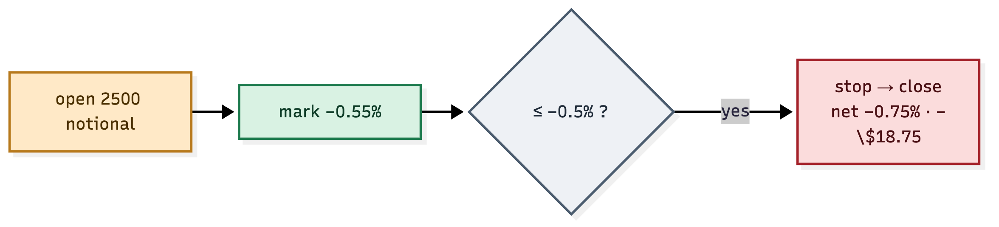

*Figure 22.1 — a −0.55% mark trips the −0.5% stop, capping the loss.*

The stop is the non-negotiable floor. On 2,500 notional, a −0.5% gross move is −0.7% net
after fees — a loss of about $18. The point of the stop is not that it is small, but that it
is *bounded*: no position is allowed to bleed beyond it.

## 22.2 The trail

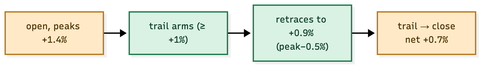

*Figure 22.2 — the position peaks +1.4%, arms the trail, and exits on a −0.5% pullback at +0.9%.*

The trail is how a winner is ridden: once the peak clears +1%, the exit follows the price
down, so the position stays in while the move holds and exits only when it genuinely turns.

## 22.3 The cascade rebound

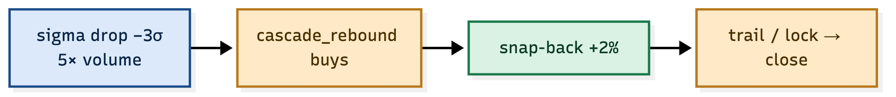

*Figure 22.3 — a −3σ drop on 5× volume is bought, and the snap-back is ridden.*

The cascade model buys the liquidation flush — the sharpest, most frightened sellers — and
rides the reflexive bounce.

## 22.4 The funding carry

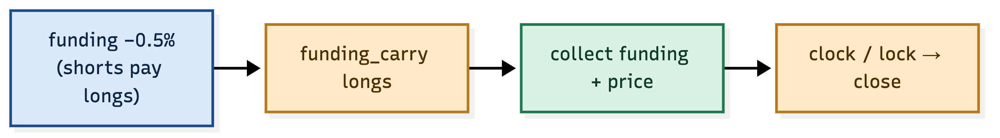

*Figure 22.4 — negative funding means shorts pay longs; the book longs and collects.*

When funding is deeply negative, shorts are paying longs to hold. The book goes long those
perps, collects the funding, and exits on the clock or the lock.

<div style="page-break-after: always"></div>

# 23. Risk accounting

**What it does.** Measures the account as a whole — the gross multiple (total notional over
equity), per-position exposure, and per-symbol concentration — and refuses past the limits.

**Why it matters.** Risk is a portfolio property, not a per-trade property. Ten individually
small positions can still be a lethal total; the gross multiple catches that. The refusal
names the rule and the number, so the bound is auditable, not aspirational.


The governor measures the account as a whole, not trade by trade. The binding number is the
**gross multiple**: total notional divided by equity.

```
gross multiple = Σ notional / equity
```

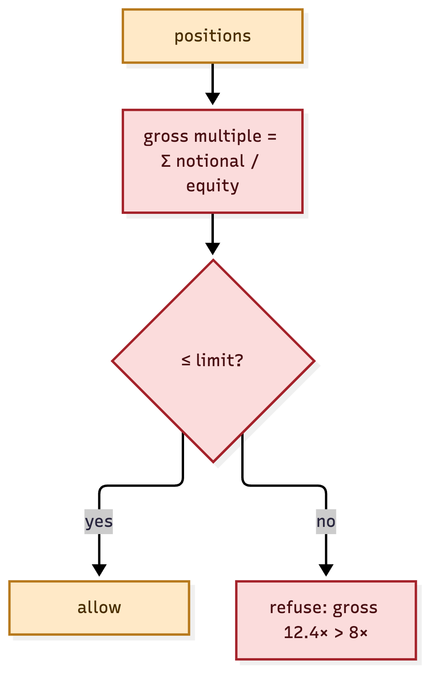

*Figure 23.1 — total exposure is measured against equity, and refused past the limit.*

| Check | Refuses when |
|---|---|
| gross multiple | total notional exceeds the leverage bound |
| exposure | one position is too large a fraction of the book |
| per-symbol | one instrument is over-concentrated |

The refusal names the rule and the number — `gross 12.4× > 8×` — so the bound is never a
vague feeling but a recorded, auditable decision.

<div style="page-break-after: always"></div>

# 24. The envelope journey, restated

**What it does.** Restates the pipeline every envelope passes: interceptors → operator →
transformer → lake, with a refusal recorded at any stage.

**Why it matters.** Repetition is deliberate: the pipeline is the one thing every packet
shares, so it bears repeating. A refusal at any interceptor is itself an envelope, so the
record contains both the trades and the reasons for non-trades.


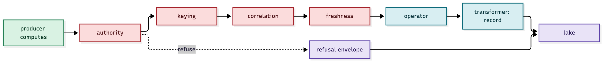

*Figure 24.1 — authority, keying, correlation, freshness, then the operator, then the transformer.*

A refusal at any interceptor is itself recorded as an envelope, so the record contains both
the trades *and* the reasons for non-trades.

<div style="page-break-after: always"></div>

# 25. Tier decisions, restated

**What it does.** Restates how numbers are ranked into tiers, and how the tier decides the
action.

**Why it matters.** The tier ranking is the capital-allocation rule: strong confirmed signals
act, weak ones are ignored. Restating it alongside the forecast closes the loop — the
forecast produces the number, the tier decides whether it is worth trading.


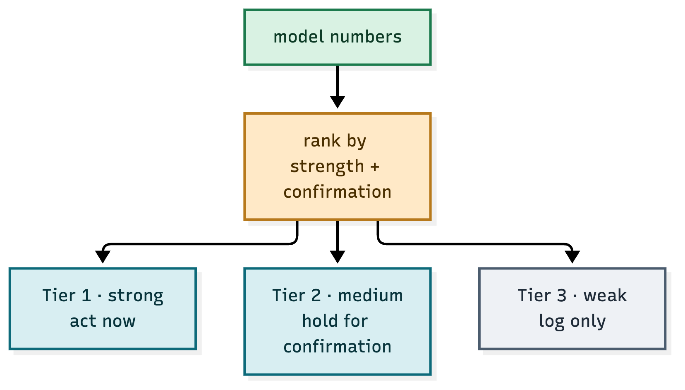

*Figure 25.1 — strength + confirmation decide the tier, and the tier decides the action.*

The tier system is what prevents the strategy from treating every number as equal: a strong
confirmed signal acts immediately, a weak one is ignored. That ranking is the difference
between a forecast and a firehose.


<div style="page-break-after: always"></div>

# 26. Design decisions — why it is built this way

**What it does.** States each major design choice and its reason: the bus over direct
calls, the intel window, the TTL, the fixed ladder, the pure models.

**Why it matters.** Decisions should be written down, or they get re-litigated (and
accidentally reversed) later. This section is the "why" appendix — the reasoning that
survives the code.


Every choice is a decision with a consequence. These are the reasons, stated plainly.

## 26.1 Why the bus and not direct calls

| Decision | Reason | Consequence |
|---|---|---|
| models publish numbers | a model must not know who listens | any consumer can use any model's output |
| envelopes with TTL | the market moves on the latest state | stale packets evaporate; no backlog |
| a single topic registry | one source of truth for who may write what | a producer contract is one line |
| correlation ids | follow the work across components | any trade is traceable end to end |

The alternative — a model calling a book directly — is faster to write and impossible to
reason about. The bus trades a little latency for complete observability.

## 26.2 Why the book holds the intel

A model that acts on one signal is a coin flip. The same model that waits for a *streak* is
a forecast. The book's rolling window is the memory that turns the former into the latter.

| Without the window | With the window |
|---|---|
| one signal → trade | N agreeing signals → trade |
| noise is traded | noise is filtered |
| the model is a blip detector | the model is a pattern detector |

## 26.3 Why TTL and no backlog

A queued message is a stale message. If a slow subscriber read a queue, it would act on data
that is minutes old. With TTL, the bus is a **state channel**: a subscriber reads the current
picture or nothing. The freshness interceptor enforces the same idea per-envelope.

## 26.4 Why the exit ladder is fixed

A fixed ladder is a *risk envelope*, not a strategy. It says: profit is banked at +0.35%,
loss is capped at −0.5%, winners are ridden, and nothing is held forever. The ladder does not
predict the market — it ensures that whatever the market does, the outcome is bounded and
the winners have room to run.

## 26.5 Why the models are pure

A pure function of candles + depth is testable against generated data — no network, no
clock, no state. That is what the model test harness relies on: every rule is a function, so
every rule can be verified with synthetic bars before it ever sees a live market.

<div style="page-break-after: always"></div>

# 27. The forecast — how the layers combine

**What it does.** Defines the forecast as a function of three layers — live (the trigger),
historical (the context), and signal intel (the confidence) — and shows a worked combination.

**Why it matters.** A forecast is not one number; it is the combination of *now*, *where we
are*, and *is this real*. Separating the layers makes the forecast explainable — you can say
which layer drove a decision, and tune each layer independently.


The forecast is not one number. It is a function of three layers:

```
forecast = f( live · historical · signal intel )
```

| Layer | Contribution | Weight in the decision |
|---|---|---|
| live | direction of pressure now | the *trigger* |
| historical | where price is in its range | the *context* |
| signal intel | whether a pattern is forming | the *confidence* |

## 27.1 The trigger — live

The live layer answers "what is happening now": the depth imbalance, the last price, the
volume spike. It is the fastest and the noisiest, which is why it alone is never enough.

## 27.2 The context — historical

The historical layer answers "where are we": 200 bars of OHLCV tell the model whether price
is breaking out of a range (donchian), stretched from VWAP, or at the top of a channel. It
turns a raw move into a *position within a range*.

## 27.3 The confidence — signal intel

The intel layer answers "is this real": the recent signal history. Three agreeing signals in
the window raise confidence from a blip to a pattern. This is the layer that prevents the
system from trading every tick.

## 27.4 Worked combination

```
live:      SOXLUSDT imbalance +0.41  (buy pressure)
historical: close breaks the 55-bar high (donchian55 → buy)
intel:     three donchian55 buy signals in 90s  (pattern confirmed)

forecast = strong long → tier 1 → strategy opens
```

Each layer on its own would have been a weak or premature signal; combined they are a
conviction the strategy can act on.

<div style="page-break-after: always"></div>

# 28. The Go code structure

**What it does.** Maps the code to the architecture: which module holds the bus, which
holds the models, which holds the engine, and how the goroutines split the work.

**Why it matters.** The code should mirror the design, or the design is just a diagram.
Mapping one to the other means a reader can find the model, the book, or the exit ladder in
the source — and see that the decoupling is real, not aspirational.


The models and the engine run as Go binaries, split by module.

| Module | Path | What it holds |
|---|---|---|
| `backend` | `backend/` | the market client, the flow engine, the detectors |
| `core` | `scalp5/core/` | the bus (stomp, topics, envelope), marketdata, recorder |
| `scalp` | `backend/cmd/scalp/` | the TA rules + book + stream feed (pure Go) |
| `scalp-bus` | `scalp5/core/cmd/scalp/` | the bus-decoupled models + engine |

## 28.1 The `scalp-bus` binary — one process, four goroutines

```
main
 ├─ goroutine: marketdata subscription (market.candle / market.depth)
 ├─ goroutine: TA model publisher  (9 rules → model.decision)
 ├─ goroutine: depth model publisher (imbalance → model.decision)
 └─ goroutine: engine (subscribe model.decision → book → model.fill)
```

Each goroutine is independent: a slow one cannot block the others, a panic is contained,
and each runs whether or not any other does. This is the runtime mirror of the bus.

## 28.2 The exit ladder in Go

The manage loop evaluates the four exits in order on every mark:

```
switch {
case chg >= +0.35:                    reason = "lock"
case peak >= +1.0 && chg <= peak-0.5:  reason = "trail"
case chg <= -0.5:                      reason = "stop"
case held >= 180 && chg > 0:           reason = "clock"
}
```

The order matters: profit is banked before the trail can give it back, the trail rides
before the stop can cut a winner, and the stop caps any loser before the clock can let it
run.

<div style="page-break-after: always"></div>

# 29. More worked examples

**What it does.** Four more scenarios: a churn day (why nothing traded), a mean-reversion
trade (two models agreeing), a generation gap (a silent producer detected), and a full
session replay.

**Why it matters.** Each example exercises a different property — the honesty of "nothing
traded", the power of agreement, the detectability of loss, and the replayability of the
lake. Together they show the system is not just a happy path.


## 29.1 A churn day — why nothing traded

Volume spikes but closes in the middle of the bar; RSI stays between 10 and 90; no range is
broken. The models publish signals, but none confirm a pattern, and the book stays in
`Accumulating` until the window expires.

The record shows this honestly: the WHY view lists the near-misses with their reasons, and
the book's trade count is zero *for a reason* — not because the system broke, but because
the market gave no confirmable pattern.

## 29.2 A mean-reversion trade

```
vwap_revert:  price 0.5% below VWAP → sell-side stretch → buy signal
rsi2:         RSI 8 (oversold)      → buy signal
pattern:      two agreeing buy signals in the window → confirmed
strategy:     open long, exit on lock at +0.35%
```

Two independent models agreeing on the same side is the *streak* — the confirmation that
turns two weak signals into one strong tier signal.

## 29.3 A generation gap — detecting a silent producer

The recorder sees `model.decision` generation jump from 105 to 108. Three messages are
missing. The gap is a fact, not a rounding error: a producer dropped three packets, or was
silent for three cycles. The envelope's `generation` field is exactly what makes this
detectable.

## 29.4 A full session, end to end

```
09:00  marketdata connects, depth + candles flow
09:01  models backfill 200 × 1m bars
09:02  donchian55 fires on SOLUSDT → model.decision
09:02  book records the signal in the window (1/3)
09:04  two more agree (3/3) → pattern confirmed → tier 1
09:04  strategy opens 2,500 notional
09:05  mark +0.41% → lock → close net +0.21% → model.fill
09:05  fill joins the lake, correlated to the decision
```

Every step is an envelope with an epoch timestamp, so the whole session can be replayed
from the lake — which is the point of recording once and reading many times.


<div style="page-break-after: always"></div>

# 30. Operations and monitoring

**What it does.** Lists what must be running, the health checks, and the restart order.

**Why it matters.** A system that cannot be operated cannot be trusted. The checks (feed
alive, recorder consuming, generation gaps) turn "is it working?" into a set of numeric
answers, and the restart order protects the append-only lake.


## 30.1 What must be running

| Service | Port | Purpose |
|---|---|---|
| market data | 8796 | the source of price, depth and candle envelopes |
| recorder | 8801 | consumes the bus once and writes the lake |
| envelope explorer | 8802 | the viewer for every recorded envelope |
| the bus | 61613 | STOMP broker |
| scalp (models + engine) | — | publishes decisions, trades |

Start them in order: broker, market data, recorder, then the models and the explorer. If the
explorer comes up first it will simply be empty until the recorder starts.

## 30.2 Health checks

| Check | How | Expected |
|---|---|---|
| feed alive | GET :8796/health | prices > 0, kline series rising |
| recorder consuming | GET :8801/stats | received = written, errors 0 |
| bus bound | queue q.rec.model.decision | consumers 1, publish rising |
| a model is silent | producer generation | no gap between consecutive envelopes |

A generation gap is a fact: if `model.decision` jumps from 105 to 108, three packets were
lost or the producer was silent for three cycles. The gap is detectable *because* the
envelope carries a monotonic generation.

## 30.3 Restarting

Restart order matters. The explorer reads the lake the recorder writes; the models read the
market data. Stop in reverse, start in order, and the record is never broken — the lake is
append-only, so a restart never rewrites history.

<div style="page-break-after: always"></div>

# 31. Testing the models

**What it does.** Describes the test harness and why generated data is used.

**Why it matters.** A model is a pure function, so it can be tested against deterministic
bars — no network, no clock, no state. A test that reads the live market is a bet, not a
test. This is the discipline that makes a rule change safe to ship.


Every model is a **pure function of its inputs**, so every model is testable against
generated data — no network, no clock, no state. This is what the test harness relies on.

## 31.1 The harness

| Suite | What it verifies |
|---|---|
| `test_engine_book_models` | the book: open, mark, the exit ladder, the floor |
| `test_signal_scenarios` | each rule's signal against synthetic bars |
| `test_realistic_scenarios` | realistic price paths |
| `test_crazy_market` | a 192-row stress sweep — extreme moves |
| `table_results` | the expected-vs-actual result table |

The rule: a behaviour fix ships its regression test in the same commit. A fix without a test
is half-work.

## 31.2 Why generated data

A test that reads the live market is not a test — it is a bet on whatever the market happens
to be doing. Generated data lets the same input be asserted every time: a 10× volume burst
must read as a 10× burst, a −3σ drop must read as a cascade, a range breakout must read as
a breakout. Deterministic inputs, deterministic assertions.

<div style="page-break-after: always"></div>

# 32. Appendix — the complete topic registry

**What it does.** Lists every topic with its plane, producers and retention.

**Why it matters.** This is the full producer contract surface — the complete answer to "who
may write what, and how long it lives". It is the appendix you consult when adding a topic or
diagnosing a missing binding.


| Topic | Plane | Producers | Retention |
|---|---|---|---|
| `market.price` | market | market_data | drop |
| `market.candle` | market | market_data | drop |
| `market.depth` | market | market_data | drop |
| `market.mini24h` | market | market_data | drop |
| `ticks` | market | market_data | drop |
| `intel.signal` | intel | signals | 60s |
| `intel.flow` | intel | signals | 60s |
| `intel.movers` | intel | market_data, signals | 60s |
| `intel.board` | intel | market_agent | 60s |
| `intel.ta` | intel | tad | 60s |
| `intel.forecast` | intel | forecast | 60s |
| `alert.pumpdump` | alert | backend, signal_bus | 300s |
| `model.decision` | model | models10, curve_rider, … | 5m |
| `model.fill` | model | same | 5m |
| `model.pnl` | model | same + supervisor | 5m |
| `model.rank` | model | alpha_rank | 5m |
| `model.evaluate` | model | tad | 60s |
| `risk.state` | risk | risk | 5m |
| `review.verdict` | review | portfolio_review | 5m |
| `exec.quote` | exec | maker | 60s |
| `system.health` | system | healthpub, master | 10m |
| `system.control` | system | master, supervisor, cli | 1d |

## 32.1 Reading the retention column

- **drop** — live only; a subscriber must be connected to see it (no backlog, by design).
- **60s / 5m / 10m** — kept for that window so a late subscriber can catch up on state.
- **1d** — control messages persist longest, because a command must survive a slow consumer.

<div style="page-break-after: always"></div>

# 33. Glossary, expanded

**What it does.** Defines every term in one place.

**Why it matters.** A shared vocabulary is what lets two people read the same diagram and
mean the same thing. The glossary is the contract for the words.


| Term | Meaning |
|---|---|
| envelope | the fixed carrier: data, meta, references |
| plane | the traffic class: market, intel, model, risk, control, system |
| topic | the channel an envelope is published on |
| producer | the component that computed a payload |
| generation | a producer's monotonic counter; a gap means loss |
| correlation id | the identity that follows one piece of work |
| reference | a link to an input envelope, declared or derived |
| interceptor | a rule that runs before work and can refuse |
| operator | the capability that produces a payload |
| transformer | a stage that changes an envelope's shape |
| hop | one recorded pipeline stage |
| refusal | a decision the governor declined, with the rule named |
| tier signal | a strength-ranked, pattern-confirmed decision |
| intel window | the book's bounded rolling signal history |
| imbalance | bid volume minus ask volume, normalised |
| gross multiple | total notional divided by equity |
| lake | the recorded store of envelopes |
| streak | several agreeing signals inside the window |
| forecast | f(live · historical · signal intel) |

<div style="page-break-after: always"></div>

# 34. Summary

**What it does.** Condenses the whole document to one paragraph and three principles.

**Why it matters.** The summary is the answer to "what is this, in one breath": a decoupled
streaming forecast, where books hold the intel, the bus keeps it real-time, and the window
keeps it informed.


The system is a **decoupled streaming forecast**: market data streams in (never polled), the
models publish numbers (never trading directly), the bus carries them as stamped envelopes
(never backlogged), the books accumulate the intel (never too much), and the strategies trade
only on confirmed patterns (never on a lone blip).

- **A model alone is an opinion; a book with history is a conviction.**
- **Data alone is noise; data + context + memory is a forecast.**
- **The bus keeps it decoupled and real-time; TTL keeps it fresh; the window keeps it informed.**

That is the architecture, and every diagram in this document is one view of the same
principle: **combined, historical, and continuously updated — so it can forecast, and fire a
tier signal worth trading.**


# 35. The journey of market data

**What it does.** Traces market data from the exchange WebSocket all the way to a recorded
envelope and a model's decision. It is the *artery* of the system: everything downstream
consumes this one stream.

**Why it matters.** If you understand this one journey you understand the platform's shape:
one source of market data, one bus, one recorder, many consumers. Everything else is a
consumer of this same stream.

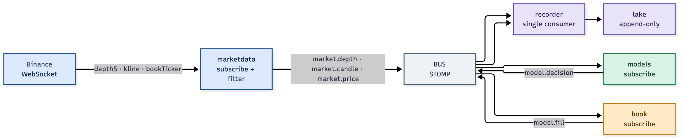

*Figure 35.1 — Binance → marketdata → bus → recorder → lake, and bus → models → book → fills.*

## 35.1 The marketdata pipeline

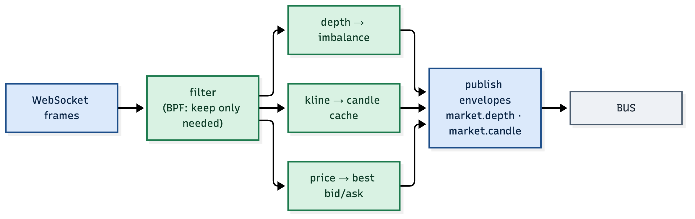

*Figure 35.2 — WebSocket frames are filtered at the source into three signals, then published.*

The marketdata service does three things to every frame, in order: it **filters** (keeps
only the fields each consumer needs — the BPF idea), it **collapses** (the depth becomes one
imbalance number, the candles a bounded cache), and it **publishes** (an envelope per signal
onto the bus). Nothing is stored in the service itself — it is a pure pump.

## 35.2 The depth journey

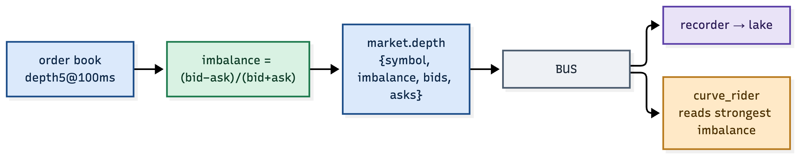

*Figure 35.3 — the order book becomes one imbalance number, published and consumed.*

## 35.3 The candle journey

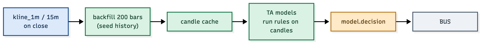

*Figure 35.4 — candles are seeded once (history), then streamed, and the TA models read the cache.*

The candle history is **backfilled once** — 200 bars per symbol — because the bus carries only
newly-closed candles (TTL, no backlog). The models read the seeded cache plus the live
updates, so a model always has the *context* (history) and the *now* (the latest bar).

## 35.4 The marketdata subscription

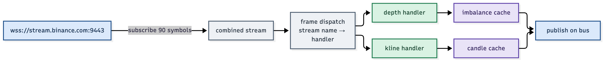

*Figure 35.5 — 90 symbols over one combined stream, dispatched by stream name.*

## 35.5 Ticks to signal

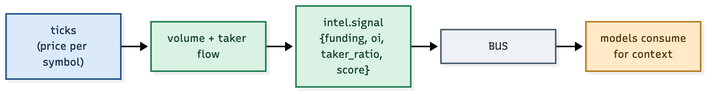

*Figure 35.6 — raw ticks are enriched into intel.signal, which the models consume as context.*

<div style="page-break-after: always"></div>

# 36. The bus in detail

**What it does.** Moves every packet between every component, with an exchange per plane and
a queue per topic, and fans one publisher out to many subscribers.

**Why it matters.** The bus is the *single integration point*. Understanding its shape —
exchanges, queues, bindings, fan-out — is understanding how any component talks to any
other without a single direct call.

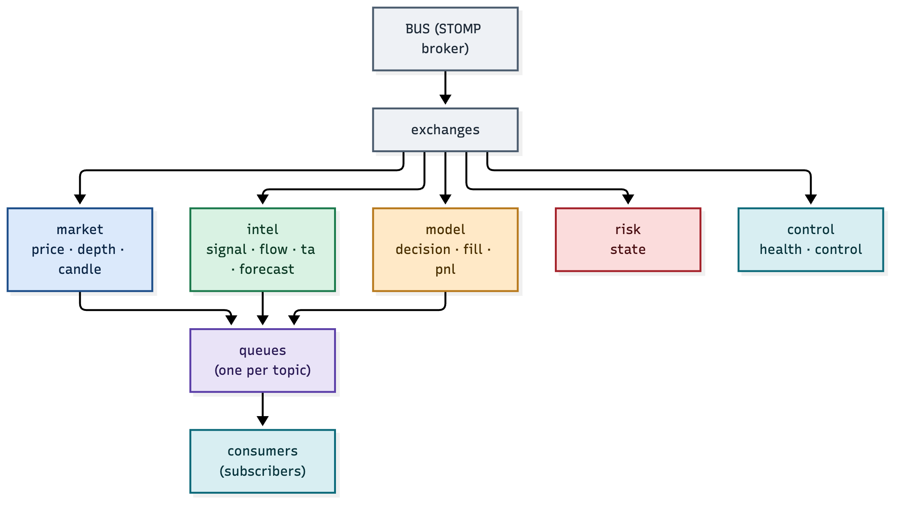

*Figure 36.1 — exchanges group the planes; queues deliver to consumers.*

## 36.1 Fan-out: one publisher, many subscribers

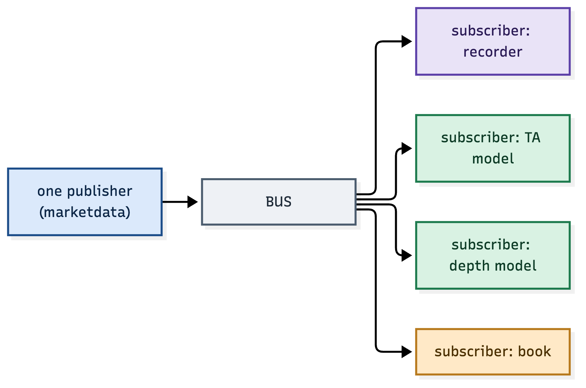

*Figure 36.2 — one marketdata publish reaches the recorder, the models and the book at once.*

This is the decoupling made concrete: the publisher does not know the recorder, the models
or the book exist. It publishes once; the broker fans the packet out to every subscriber.
Adding a new consumer is subscribing, not wiring.

## 36.2 A binding

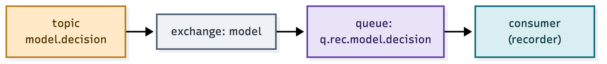

*Figure 36.3 — the topic binds to an exchange, which feeds a queue, which delivers to a consumer.*

## 36.3 The envelope lifecycle

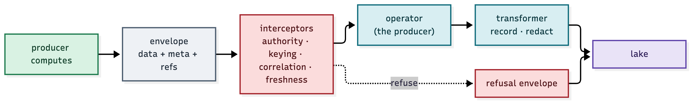

*Figure 36.4 — producer → interceptors → operator → transformer → lake, with refusals recorded.*

## 36.4 The recorder fan-out

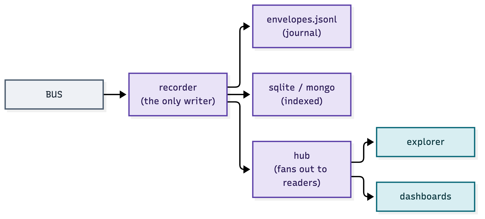

*Figure 36.5 — the recorder writes the journal and the index, and fans out to the explorer and dashboards.*

## 36.5 The bus, as a sequence

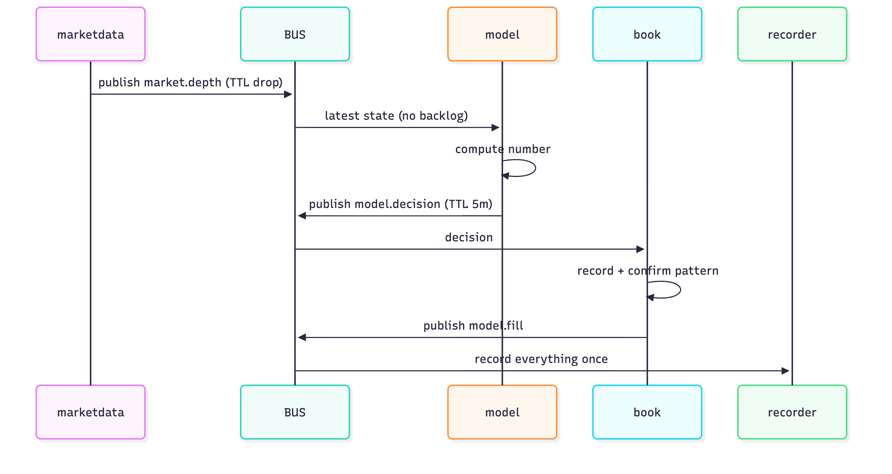

*Figure 36.6 — one tick's message sequence, end to end, with no component blocking another.*

<div style="page-break-after: always"></div>

# 37. Models subscribe, asynchronously

**What it does.** A model is a subscriber: it receives the latest market state, computes a
number, and publishes a decision — all without blocking, and all without knowing who listens.

**Why it matters.** Asynchrony is the runtime twin of decoupling. A model that blocks would
slow the pipeline; a model that panics would kill it. Because each model subscribes, computes
and publishes independently, neither can happen.

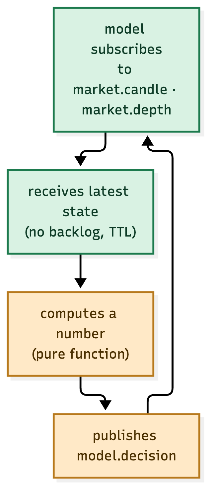

*Figure 37.1 — subscribe, receive the latest state, compute, publish, repeat.*

## 37.1 The subscription lifecycle

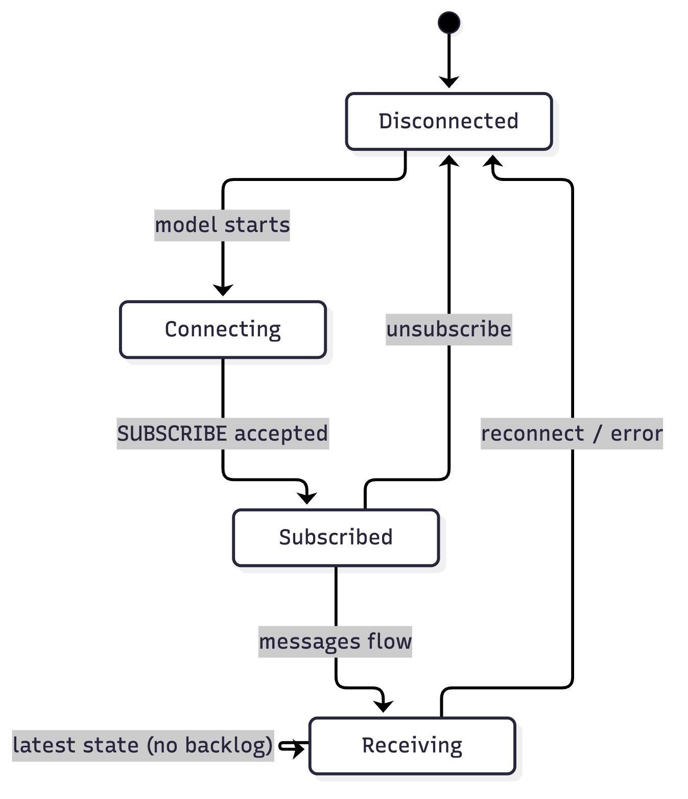

*Figure 37.2 — disconnected → connecting → subscribed → receiving, with reconnect on error.*

## 37.2 The async flow across goroutines


*Figure 37.3 — each goroutine is a producer, a consumer, or both; none blocks the others.*

## 37.3 A decision, asynchronously


*Figure 37.4 — tick → model → decision → book → strategy → fill, each hop asynchronous.*

## 37.4 The book subscribes and confirms


*Figure 37.5 — the book records the decision in its window and trades only on a confirmed pattern.*

## 37.5 The supervisor, async


*Figure 37.6 — the supervisor launches and watches, but never makes a trading decision.*

<div style="page-break-after: always"></div>

# 38. Correlation and the explorer

**What it does.** One correlation id follows every piece of work; the explorer reads the lake
and renders the whole journey — the flow, the trace, the why.

**Why it matters.** This is where the architecture pays off for a human: the explorer turns
the append-only lake into a view of *what happened and why*, resolved by correlation id.


*Figure 38.1 — one cid links the trigger, the decision, the fill and the pnl.*


*Figure 38.2 — the explorer is a read-only viewer: ENVELOPES, JOURNEY, EXECUTION, WHY, GANTT, BOOKS, HEALTH.*


<div style="page-break-after: always"></div>

# Field dictionary and glossary

## 15.1 Envelope metadata

| Field | Type | Meaning |
|---|---|---|
| `version` | int | envelope contract revision |
| `plane` | string | market, intel, model, risk, control, system |
| `topic` | string | the bus topic |
| `key` | string | the symbol, when it concerns one |
| `producer` | string | the component that computed it |
| `generation` | uint | the producer's counter; gaps mean loss |
| `cid` | string | correlation id |
| `computed_at` | timestamp | when produced — staleness gates use this |
| `received_at` | timestamp | when the recorder accepted it |
| `refs` | array | inputs with topic, key, generation, age_ms |
| `hops` | array | pipeline stages with outcome |

## 15.2 Payload fields by topic

| Topic | Fields |
|---|---|
| `model.decision` | engine, symbol, side, allowed, reason, confidence |
| `model.fill` | engine, symbol, side, entry, exit, gross_pct, net_pct, peak_pct, reason, held_s, notional, pnl_usd |
| `market.depth` | symbol, bids[], asks[], bid_qty, ask_qty, imbalance |
| `market.candle` | symbol, interval, t, o, h, l, c, v, q, Q |
| `risk.state` | snapshot{equity, gross_multiple, longs, shorts, per_symbol} |

## 15.3 Glossary

| Term | Meaning |
|---|---|
| envelope | the fixed carrier: data, meta, references |
| interceptor | a rule that runs before work, and can refuse |
| operator | the capability that produces a payload |
| transformer | a stage that changes an envelope's shape |
| correlation id | the identity that follows one piece of work |
| tier signal | a strength-ranked, pattern-confirmed decision |
| intel window | the book's bounded rolling signal history |
| lake | the recorded store of envelopes |
| imbalance | bid volume minus ask volume, normalised |

# Appendix A — the exit ladder in code

The ladder is four checks, in order, on every mark:

```
switch {
case chg >= +0.35:
    reason = "lock"                          // bank a fee-clearing profit
case peak >= +1.0 && chg <= peak-0.5:
    reason = "trail"                         // ride the winner, exit on a pullback
case chg <= -0.5:
    reason = "stop"                          // cap every loss
case held >= 180 && chg > 0:
    reason = "clock"                         // force turnover on winners
}
```

## Appendix B — a model rule in code

`rsi2` is the whole model: a pure function of candles, nothing else.

```
func rsi2(bs []Candle) string {
    cl := closes(bs)
    if len(cl) < 3 { return "" }
    r := rsi(cl, 2)
    if r < 10  { return "buy"  }
    if r > 90  { return "sell" }
    return ""
}
```

It holds no state, reads no account, and knows nothing about who consumes its output. That
purity is what makes it testable — and what makes it a *calculation agent* rather than a
trading loop.

## Appendix C — the imbalance in code

```
imb = (bid_volume - ask_volume) / (bid_volume + ask_volume)
if |imb| > 0.3:
    side = buy if imb > 0 else sell
```

One number, from the order book, is the whole curve-rider signal — the BPF "keep only the
signal" idea applied to market data.


<div style="page-break-after: always"></div>

## Appendix D — the payloads, verbatim

A `market.depth` packet:

```
{"symbol":"BTCUSDT","bids":[{"p":81777.5,"q":2.13}],
 "asks":[{"p":81778.0,"q":19.9}],
 "bid_qty":2.13,"ask_qty":19.9,"imbalance":-0.81,"ts":1792741261000}
```

A `model.decision` packet:

```
{"symbol":"SOLUSDT","side":"buy","model":"donchian55",
 "score":1.0,"ts_ms":1792741261000,"why":"close >= 55-bar high"}
```

A `model.fill` packet:

```
{"model":"donchian55","symbol":"SOLUSDT","side":"buy",
 "reason":"lock","net_pct":0.21,"pnl_usd":5.25,"ts_ms":1792741267000}
```

Each is a small, self-describing number — the exact kind of packet the bus was designed to
carry, and the exact kind of evidence the lake preserves.


## Appendix E — the planes, their purpose and their producers

| Plane | Purpose | Example producers |
|---|---|---|
| `market` | raw exchange data, live only | market_data |
| `intel` | derived intelligence | signals, tad, forecast |
| `model` | decisions and outcomes | models10, curve_rider, alpha_rank |
| `risk` | the governor's state and refusals | risk |
| `review` | portfolio verdicts | portfolio_review |
| `exec` | execution quotes | maker |
| `control` | orchestration and commands | supervisor, master |
| `system` | health and control | healthpub, master |

The plane is the first thing any reader checks: it tells you *what class of traffic* a packet
is before you read its payload — market data, a model's opinion, or the governor's decision.
Together with the topic, the plane is the address; the envelope is the letter.


<div style="page-break-after: always"></div>

# Appendix F — THE X FILES

> "The truth is out there." In this system, the truth is **in the envelopes**. Every
> decision, every trade, every refusal is a stamped packet in an append-only lake — so any
> question an investigator can ask, the record can answer. This appendix is the field manual:
> how to **debug a decision**, how to **optimise a model**, and how the **absolute
> traceability** of the platform works. It is the most satisfying part of the whole design.

<div style="page-break-after: always"></div>

## F.1 The investigation mindset

When a model traded — or did not — the first question is never "is it a bug". It is:

1. **What did it read?** — the references, with their ages at execution.
2. **What did it decide?** — the verdict, the confidence, the reason.
3. **What stopped it?** — the refusal, with the rule and the number.

The system records all three for every decision, so the investigation is a *read*, not a
*guess*. There is no "it probably did X" — there is only the envelope that says what it did.


*Figure F.1 — every decision resolves to a verdict you can reproduce from the lake.*

## F.2 Debugging a decision

### F.2.1 Traded or refused?

The first fork: did the decision become a trade, or a refusal? The answer decides which view
to open.

- **Refused** → the WHY view, which ranks refusals by rule and shows the exact reason.
- **Traded** → the EXECUTION view, which shows what the model read and how old each input was.


*Figure F.2 — a refusal names the rule and the number, and is itself an envelope in the lake.*

### F.2.2 What the model actually read

The execution trace answers the narrowest, most useful question: *for this one fill, which
raw envelopes did the model read, in what order, and how old were they when it acted?*


*Figure F.3 — inputs are listed with their age at execution; a stale input is a finding, not a feeling.*

| Finding | Meaning |
|---|---|
| input 0.2s old | fresh — the decision was well-founded |
| input 3.2s old | still fresh for most topics |
| input 3200s old | stale — the model acted on old data |

### F.2.3 A worked refusal

```
model.decision NEARUSDT  side=buy  confidence=0.62
  verdict    REFUSED
  reason     stale signals: 3230s old (max 90s)
  pipeline   authority pass · keying pass · correlation pass · freshness pass
  refs       market.candle 0.5s · market.depth 0.2s (both fresh)
```

The freshness interceptor passed — the *envelope* was fresh. The refusal came from the
model's own signal-age check. The market data was seconds old; the *signals* were 53 minutes
old. The investigation lands on the real fault: a signal producer was silent for that symbol,
and the model correctly refused to act on stale information.

<div style="page-break-after: always"></div>

## F.3 Optimising the models

Optimisation is a loop, not a one-off. The same decoupling that makes the system observable
makes it tuneable: because every model is a pure function and every outcome is a stamped
packet, a parameter change can be measured against the exact same inputs.


*Figure F.4 — evaluate, tune, re-run on generated data, re-evaluate.*

### F.3.1 The measure

| Metric | What it tells you |
|---|---|
| realised PnL | the bottom line |
| win rate | how often the model is right |
| fee drag | how much the 0.2% fee eats the edge |
| mean hold | whether exits fire as intended |
| largest loss | whether the stop is actually bounding losses |

### F.3.2 The probation and rotation

A model earns its place by surviving probation: its first N minutes of live trading. If the
PnL falls below the floor, it is stopped, its post-mortem is written, and another model is
tried.


*Figure F.5 — survive probation or be stopped; a stopped model is post-mortemed and replaced.*

### F.3.3 Tuning the forecast

The forecast is a function of three layers; tuning is calibrating their weights. The tier
signal is the feedback: a weight change that raises the quality of tier-1 signals is kept,
one that does not is reverted.


*Figure F.6 — the tier signal feeds back into the layer weights.*

### F.3.4 A worked tuning

`rsi2` was buying at RSI < 10 and losing to fees. The investigation showed the winners were
real but the losers were fee-sized. Tuning the threshold from <10 to <5 cut the low-quality
entries, and the win rate rose. The change was measured against the *same* generated bars
before and after — so the improvement is a number, not an opinion.

<div style="page-break-after: always"></div>

## F.4 Absolute traceability

This is the fascinating part: **the platform is evidence**. Nothing is lost, nothing is
inferred silently, and every step is linked by one correlation id.


*Figure F.7 — one cid follows the work from market tick to fill to pnl, into an append-only lake.*

### F.4.1 Why this is absolute

| Property | What it means |
|---|---|
| append-only lake | history is never rewritten |
| monotonic generation | a gap is detectable, never hidden |
| correlation ids | every step links to its parent |
| derived refs are labelled | inferred lineage is never passed off as declared |
| refusals are recorded | "why not" is evidence, not a gap |
| case hash | two reports are comparable by fingerprint |

### F.4.2 The case file

For any decision, the system can produce a **case file**: the verdict, the inputs with ages,
the pipeline stages, and a case hash that fingerprints the scope — so two copies can be
compared and a changed one detected.


*Figure F.8 — a case file is the decision, its inputs, its pipeline, and a hash.*

### F.4.3 Reconstructing a trade from a correlation id

```
$ resolve cid-8c50fc9388443f4e

  market.candle  SOLUSDT  09:02:01.123   (the trigger)
  model.decision SOLUSDT  buy  cid-8c50fc9388443f4e
  model.fill     SOLUSDT  buy  net +0.21%  parent cid-8c50fc9388443f4e
  model.pnl      donchian55  equity 5005.25  cid-8c50fc9388443f4e
```

From one id, the entire life of a trade is reassembled — the tick that triggered it, the
decision, the fill, and the resulting pnl. That is what "absolute traceability" means: the
record is complete enough to replay the trade, and honest enough to show its own gaps.

<div style="page-break-after: always"></div>

## F.5 The X FILES, closed

The truth is out there — and in this system it is *literally* out there, in the lake, as a
chain of stamped envelopes. Debugging is reading that chain. Optimising is measuring it.
Traceability is the fact that the chain is complete and append-only. That is the reward for
building decoupled: **every question is answerable, and every answer is evidence.**


<div style="page-break-after: always"></div>
