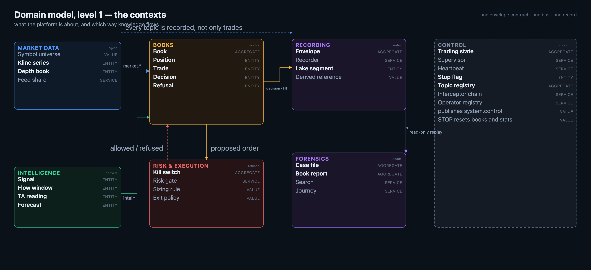
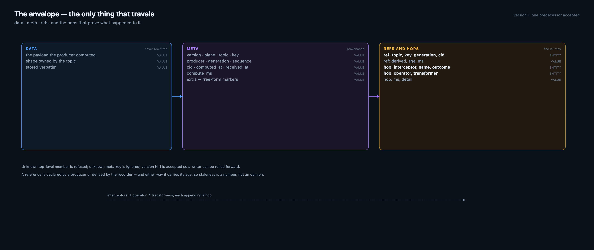
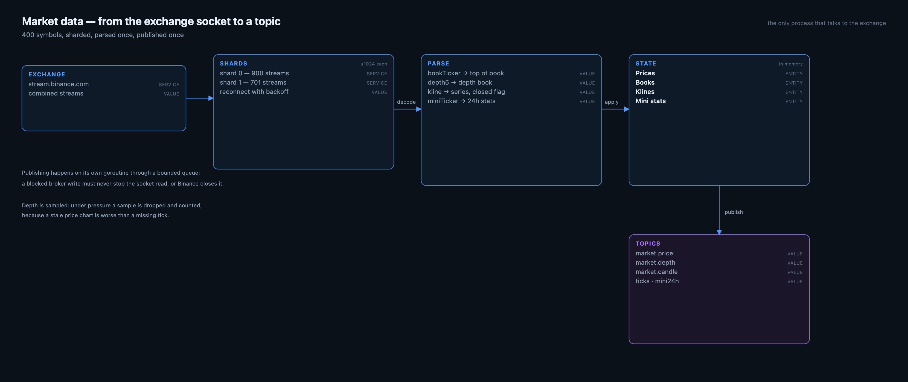
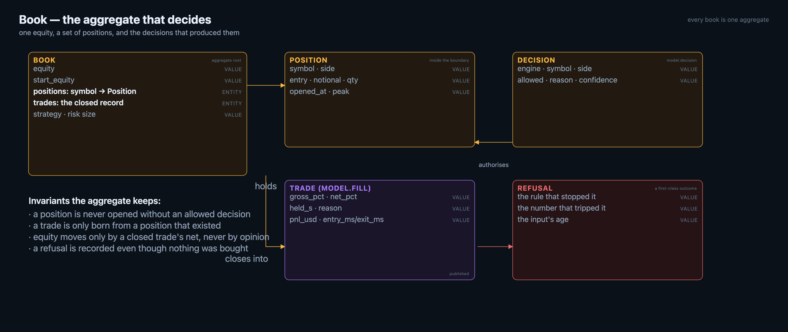
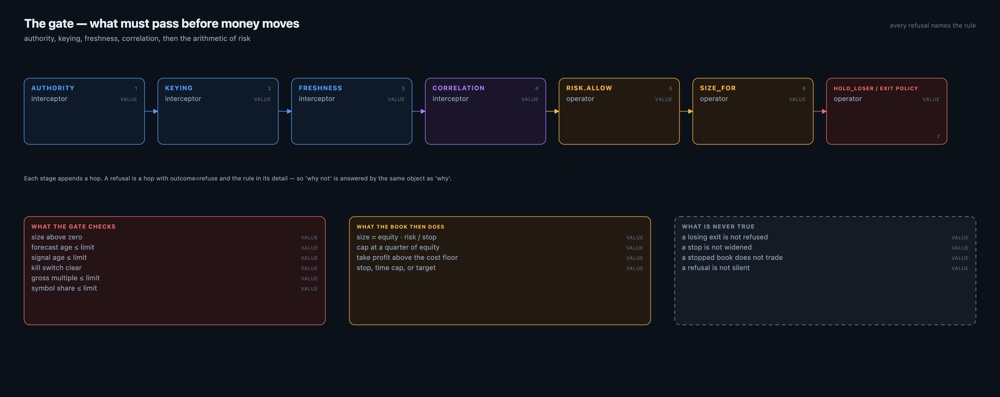
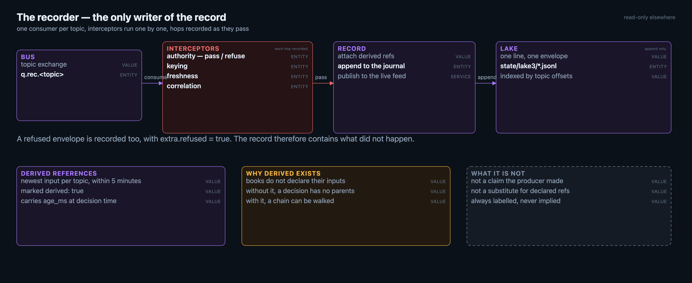
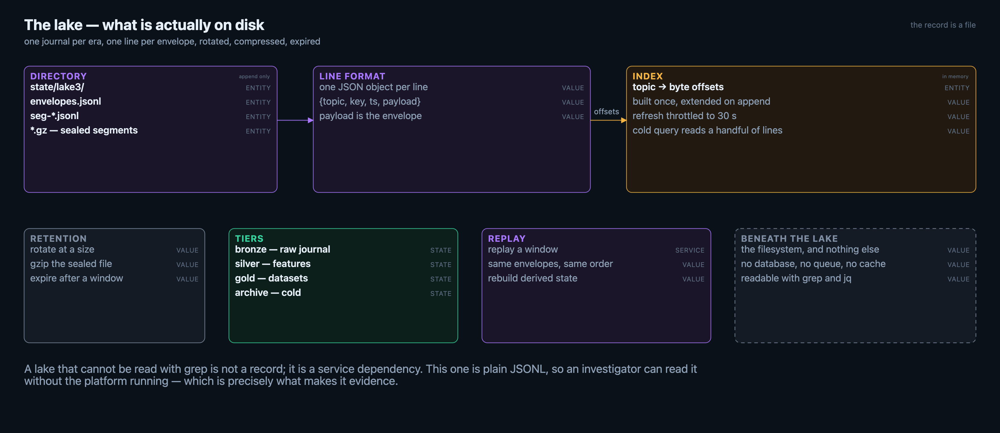
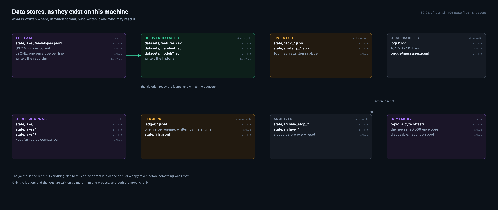
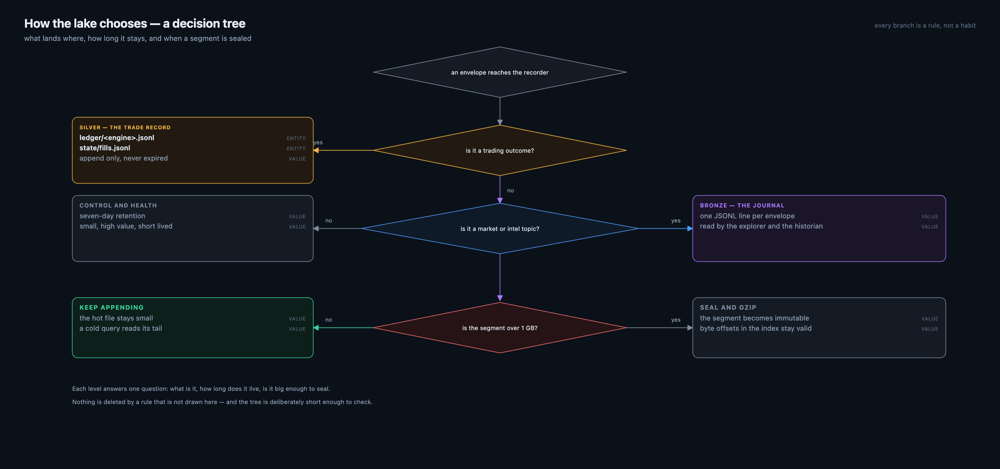
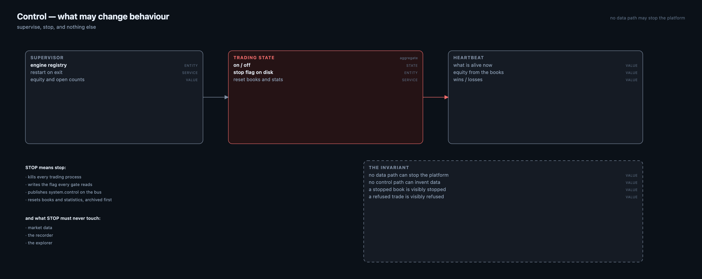

# CryptAlyst — a domain model

*from the first socket message to the byte on disk*

Seven bounded contexts, one contract between them, and a record that can be read without the platform running.

**Platform build 1.0.0 · 823eb7a · 2026-10-21**  ·  domain model · revision 1.0  ·  © 2026 CryptAlyst · designed by Andrew Preston · built by the CryptAlyst engineering team

## Contents

1. [How to read this](#how-to-read) — How the document narrows its lens, from the whole platform to a single byte on disk.
2. [Level 0 — the context map](#contexts) — The seven contexts, the aggregates each owns, and the direction knowledge travels between them.
3. [Level 1 — the envelope, the only thing that travels](#envelope) — The one object that crosses every boundary, and the hops that record what happened to it.
4. [Level 2 — market data, the only process that talks to the exchange](#market) — How an exchange socket becomes topics: shards, a single parse, in-memory state, and a publisher that cannot block the read.
5. [Level 2 — the book, the aggregate that decides](#books) — The aggregate that decides: equity, positions, the decisions that opened them and the refusals that did not.
6. [Level 2 — the gate, what must pass before money moves](#risk) — The order of the gate — identity and freshness before arithmetic — and the exit policy that books losses.
7. [Level 2 — the recorder, the only writer](#recorder) — The only writer of the record, and the derived references it attaches when a producer did not declare its inputs.
8. [Level 3 — the lake, what is actually on disk](#lake) — What is actually on disk: the journal, its line format, the index that avoids scanning it, and retention.
9. [Level 4 — beneath the lake](#beneath) — The filesystem properties that let a case file be called evidence a year later.
10. [Level 3 — the data stores, as they exist](#stores) — Every place data is actually written on this machine, in which format, by which process, for how long.
11. [Level 3 — how the lake chooses](#tree) — The decision tree that decides which store receives an envelope, how long it lives, and when a segment is sealed.
12. [Level 2 — control, what may change behaviour](#control) — What may change behaviour — supervise and stop — and what STOP must never touch.
13. [Crossing concerns — time, identity and generations](#crossing) — Time, identity and generations, modelled once in the envelope rather than per context.
14. [What the model deliberately refuses to do](#failures) — The boundaries the model will not pretend to cross, stated so they can be argued with.

### Figures

| Fig | Figure | What it shows |
|---|---|---|
| 1 | The context map | seven contexts, their aggregates, the flow between them |
| 2 | The envelope | data, meta, refs, and the hops appended along the way |
| 3 | Market data | shards, parse, state, topics — and a publisher off the read path |
| 4 | The book aggregate | equity, positions, trades, decisions, refusals |
| 5 | The gate | interceptors before arithmetic, and the exit policy |
| 6 | The recorder | one writer, hops recorded, derived references attached |
| 7 | The lake | journal, line format, index, retention, replay |
| 8 | Control | supervise, stop, and what STOP must never touch |
| 9 | Data stores | every store on disk: format, writer, reader, lifetime |
| 10 | How the lake chooses | the rules that decide where data lands and how long it lives |

---

## How to read this

> **What this shows** — How the document narrows its lens, from the whole platform to a single byte on disk.

A domain model is an argument about what belongs together, not an inventory of files. Each level here narrows the lens: the contexts, then one context at a time, then the record, and finally the bytes underneath the record.

Two rules run through every level. First, exactly one kind of thing travels between contexts: an envelope. Second, only the control plane may change what the platform does; data may inform a decision but never stop the machinery.

| Level | Question it answers | Where |
|---|---|---|
| 0 | what is this platform about? | the context map |
| 1 | what are the parts, and what do they own? | the seven contexts |
| 2 | what is inside one part? | a figure per context |
| 3 | what is the record, and what is beneath it? | the lake and the filesystem |

---

## Level 0 — the context map

> **What this shows** — The seven contexts, the aggregates each owns, and the direction knowledge travels between them.

*The platform in one picture: contexts, the aggregates they own, and which way knowledge flows.*

Seven contexts, arranged by the direction knowledge travels. Market data observes. Intelligence interprets. Books decide. Risk refuses. Recording writes. Forensics reads. Control may stop.

The arrows are not calls. Each one is a stream of envelopes on one bus, so a context can be stopped, restarted or replaced without the others knowing.

| Context | Owns | May |
|---|---|---|
| Market data | the exchange connection, the price and depth state | publish market.* |
| Intelligence | signals, flow, TA, forecasts | publish intel.* |
| Books | equity, positions, trades, decisions, refusals | publish model.* |
| Risk & execution | the gate, the sizing rule, the exit policy | allow or refuse |
| Recording | the envelope, the journal, derived references | append to the lake |
| Forensics | case files, reports, search, journey | read only |
| Control | trading state, the stop flag, the registries | supervise, stop |

---

## Level 1 — the envelope, the only thing that travels

> **What this shows** — The one object that crosses every boundary, and the hops that record what happened to it.

*Three members, and the hops that prove what happened to the envelope on the way.*

An envelope is data, meta and refs. The data is the payload a producer computed and is never rewritten. The meta is provenance: version, plane, topic, key, producer, generation, sequence, correlation id, computed_at, received_at, compute time, and a free-form extra map. The refs are the inputs, declared or derived, each carrying its age.

The contract is deliberately strict in one direction and lenient in the other. An unknown top-level member is refused, because a reader must never silently ignore something it does not understand. An unknown meta key is ignored, because provenance may grow without breaking every reader. One previous version is accepted, so a writer can be rolled forward before every reader is.

- interceptors run first and append a hop each — authority, keying, freshness, correlation, redaction
- the operator produces the payload and appends a hop
- transformers may change the shape, never the truth, and append a hop
- a refusal is a hop with outcome refuse and the rule in its detail

---

## Level 2 — market data, the only process that talks to the exchange

> **What this shows** — How an exchange socket becomes topics: shards, a single parse, in-memory state, and a publisher that cannot block the read.

*Shards, one parse, in-memory state, then topics. Publishing never blocks the socket.*

The feed streams the top symbols by 24-hour quote volume, four streams each, sharded so no websocket carries more than about a thousand streams. Each shard reconnects with backoff. The parse is single-pass: bookTicker becomes top of book, depth becomes the depth book, klines become series with a closed flag, miniTicker becomes 24-hour stats.

The one design decision worth naming: publishing happens on a goroutine through a bounded queue. Publishing inline on the read path means a slow broker write stops the reader, the exchange's ping times out, and the connection dies. Under pressure the feed drops depth samples and counts them, because a missed sample is better than a dead stream.

| State | Fed by | Served by |
|---|---|---|
| Prices | bookTicker | GET /streamprices |
| Books | depth5 | GET /depth?symbol= |
| Klines | kline_1m / kline_5m | GET /klines?symbol=&interval= |
| Mini stats | miniTicker | GET /movers |

---

## Level 2 — the book, the aggregate that decides

> **What this shows** — The aggregate that decides: equity, positions, the decisions that opened them and the refusals that did not.

*A book is one aggregate: equity, positions, and the decisions that produced them.*

A book is the unit of consistency. Its equity moves only when a position closes, by that trade's net, and never by an opinion about an open position. Positions live inside the book; a decision that would open one either becomes an allowed decision or a refusal, and both are recorded.

The refusals are the part most systems omit. A refusal carries the rule that stopped it and the number that tripped it, so the question 'why did it not trade' is answered by the same object as 'why did it trade'.

- a position is never opened without an allowed decision
- a trade is only born from a position that existed
- equity moves only by a closed trade's net
- a refusal is recorded even though nothing was bought

---

## Level 2 — the gate, what must pass before money moves

> **What this shows** — The order of the gate — identity and freshness before arithmetic — and the exit policy that books losses.

*Interceptors, then the arithmetic. Every stage appends a hop, so a refusal explains itself.*

The gate is ordered deliberately: identity and freshness before arithmetic. There is no point in sizing a trade on a signal that is four hours old, and no point in asking whether a stale signal is affordable.

The exit policy is part of the model, not an implementation detail. The platform once refused every losing exit, which made the fills table contain only winners while equity fell on the losers still open. The policy now holds a loss only while it is shallow and young, and releases it at a stop or a time cap. A loss is booked like any other outcome.

| Check | Refuses when |
|---|---|
| size | notional is zero |
| forecast age | older than the limit |
| signal age | older than the limit |
| kill switch | the stop flag exists |
| gross multiple | exposure would exceed the cap |
| symbol share | one position would exceed the book |

---

## Level 2 — the recorder, the only writer

> **What this shows** — The only writer of the record, and the derived references it attaches when a producer did not declare its inputs.

*One consumer per topic, hops recorded as they pass, derived references attached at the door.*

The recorder owns one queue per topic, so it sees every message exactly once. It runs the interceptors one at a time and records each as a hop on the envelope itself — which is why the pipeline an envelope went through is data, not a log line.

Books do not declare their inputs. Rather than leave a decision parentless, the recorder attaches derived references: the newest input per topic within five minutes, marked derived, carrying the age it had at decision time. It is the weakest form of lineage and it is always labelled as such.

- a refused envelope is recorded too, with extra.refused = true
- the record therefore contains what did not happen
- derived references are labelled, never implied
- the recorder declares its own topology; it does not rely on another process to do it

---

## Level 3 — the lake, what is actually on disk

> **What this shows** — What is actually on disk: the journal, its line format, the index that avoids scanning it, and retention.

*A journal, a line format, an index, and the retention that keeps it from growing forever.*

The lake is a directory of JSONL journals. One line is one envelope. The line carries the topic, the key, the timestamp and the envelope itself. There is no database, no queue and no cache between the record and the filesystem, which is what makes it readable by grep and jq a year later.

Reader queries do not scan the journal. An index of topic to byte offsets is built once at startup and extended as the recorder appends; refreshing it is throttled, because a cold query that walks a multi-gigabyte file is indistinguishable from a hang.

| Layer | Contents | Written by |
|---|---|---|
| bronze | the raw journal, every envelope | the recorder |
| silver | features extracted from fills | the historian |
| gold | datasets for training and study | the trainer |
| archive | sealed, compressed, cold | retention |

---

## Level 4 — beneath the lake

> **What this shows** — The filesystem properties that let a case file be called evidence a year later.

Underneath the lake there is a filesystem and nothing else. The properties that follow from that are worth stating plainly, because they are the reason a case file can be called evidence.

| Property | Consequence |
|---|---|
| one line, one envelope, append only | a line never changes after it is written |
| plain UTF-8 JSON | grep, jq, awk and a shell are enough to read it |
| no service dependency to read | an investigator does not need the platform running |
| rotation by size, then gzip | the working journal stays small and fast |
| expiry by window | the record has a stated lifetime, not an accidental one |
| offsets in memory, rebuilt on boot | the index is disposable, the journal is not |

The separation matters architecturally: the journal is the durable fact, the index is a convenience that can be thrown away and rebuilt. A corruption in the index costs a restart; a corruption in the journal costs history. Only the second one is serious, and the design keeps them apart.

---

## Level 3 — the data stores, as they exist

> **What this shows** — Every place data is actually written on this machine, in which format, by which process, for how long.

*Eight stores. The journal is the only one that is a record; the rest are derived, cached, archived or diagnostic.*

It is worth being literal about storage, because most architectures hide their stores behind services. Here there are eight, and every one of them is a file you can open.

The journal is the record: 60 GB of JSONL, one envelope per line, written by the recorder alone. The datasets are derived from it by the historian. Live state is what the books currently hold, rewritten in place and explicitly not a record. Ledgers are the per-engine trade files, appended by the engines themselves. Archives are copies taken before a reset. The index is memory, rebuilt at boot. Logs are diagnostic. Older journals are kept for replay comparison.

| Store | Format | Written by | Lifetime |
|---|---|---|---|
| state/lake3/envelopes.jsonl | JSONL | recorder | the record; rotated and expired by policy |
| datasets/ | CSV + JSON | historian | rebuilt on demand |
| state/pack_*.json | JSON | each book | until the next write |
| ledger/*.jsonl | JSONL | each engine | append only, never expired |
| state/archive_* | JSON | control on reset | kept for recovery |
| state/lake, lake2, lake4 | JSONL | older recorders | cold, for comparison |
| index (memory) | offsets | the explorer | rebuilt on boot |
| logs/ | text | every process | diagnostic |

---

## Level 3 — how the lake chooses

> **What this shows** — The decision tree that decides which store receives an envelope, how long it lives, and when a segment is sealed.

*One question per level: what is it, how long does it live, is it big enough to seal. Nothing is deleted by a rule that is not drawn here.*

Retention is not a setting in a configuration file; it is a short tree. An envelope arrives, and the first question is whether it is a trading outcome. Outcomes go to the silver record — the ledger and the fills file — which is never rotated and never expired, because a trade record that disappears is not a record.

Everything else goes to the bronze journal. There the topic class decides the lifetime: market and intelligence traffic is the bulk of the volume and lives long enough to replay; control and health messages are small, high-value and short-lived. Finally the segment is measured: past a gigabyte it is sealed and compressed, and the index keeps pointing into it.

- a trading outcome is never expired; it is the part of the record that must survive
- the journal is the default, and its lifetime is decided by topic class, not by age alone
- sealing is about the size of the hot file, not about the calendar
- sealing never invalidates the index: offsets stay valid because the line does not change

---

## Level 2 — control, what may change behaviour

> **What this shows** — What may change behaviour — supervise and stop — and what STOP must never touch.

*The supervisor, the stop flag and the heartbeat, and what STOP must never touch.*

STOP is the most important verb in the platform, so it is defined precisely. It kills every trading process, writes a flag that every gate reads, publishes a control envelope on the bus, and resets books and statistics after archiving them. It must never stop market data, the recorder or the explorer: an operator needs the record most at the moment they stop trading.

The inverse is equally deliberate: no data path can stop the platform. A feed outage, a dead book or a missing consumer degrades what you see; only the control plane changes what the platform will do next.

- STOP kills trading, writes the flag, publishes system.control, resets the books
- STOP leaves market data, the recorder and the explorer running
- starting the platform does not start trading unless it is asked to
- a stopped book is visibly stopped; it does not linger as a row on a dashboard

---

## Crossing concerns — time, identity and generations

> **What this shows** — Time, identity and generations, modelled once in the envelope rather than per context.

Three things are shared by every context and are therefore modelled once, in the envelope.

| Concern | Field | Rule |
|---|---|---|
| when it was computed | computed_at | staleness is measured from here, never from arrival |
| who is asking | cid | one identity follows work across contexts |
| what changed | generation | a gap is a missing message, not an accident |
| what it read | refs | declared or derived, always with age |
| what happened to it | hops | every stage, with outcome and duration |

A correlation id is minted locally at the boundary, so work can start without a central registry. Mapping it centrally and resolving it are separate, gated operations — a reader that cannot resolve still knows which id it was handed.

---

## What the model deliberately refuses to do

> **What this shows** — The boundaries the model will not pretend to cross, stated so they can be argued with.

A model is also a list of things it will not pretend to know. These are the boundaries, stated so they can be argued with.

- it does not reconstruct what a producer read if the producer did not say so — it derives and labels
- it does not treat a dashboard as the record; the journal is the record
- it does not let a viewer write, which is why the explorer has no write path
- it does not hide a loss: a losing exit is booked, not deferred forever
- it does not call a stopped book running, or an empty book profitable

---

*Figures are generated by `docs/domain/diagrams.py` and rendered by `docs/domain/render_figs.py`; this document and its PDF are built from `docs/domain/content.py`, so they cannot disagree.*
