# CryptAlyst Futures — a dedicated platform
## Reusing ATLAS + the envelope; rebuilding everything above the bus

> Architectural plan for a **futures and commodities** trading platform — energy,
> metals, agriculture, rates — built on the same operating system as the crypto
> platform (the envelope, the bus, the decoupled model→signal→book→strategy), but
> with a new futures domain on top: instruments, forward curves, margin, FIX,
> compliance, and fundamental modelling.

---

# 1. The advice, stated plainly

**Do not extend the crypto platform. Build a new platform that reuses its core.**

The envelope and ATLAS are *market-agnostic*. A packet is a packet — the bus does not
know or care whether it carries a BTCUSDT depth tick or a Henry Hub natural-gas forward
curve. That is precisely why the core carries over unchanged.

What must be new is **everything above the bus**: the instruments, the data, the models,
the execution, the risk and the compliance. Futures are not crypto, and the differences
are structural:

| Crypto (spot) | Futures |
|---|---|
| single asset, no expiry | an **underlying** + an **expiry** + a **roll** |
| one spot price | a **forward curve** and **basis** |
| perpetual funding | **margin** (initial/variation) and **margin calls** |
| unregulated, un-cleared | **cleared**, **FIX**, **MiFID II / EMIR** |

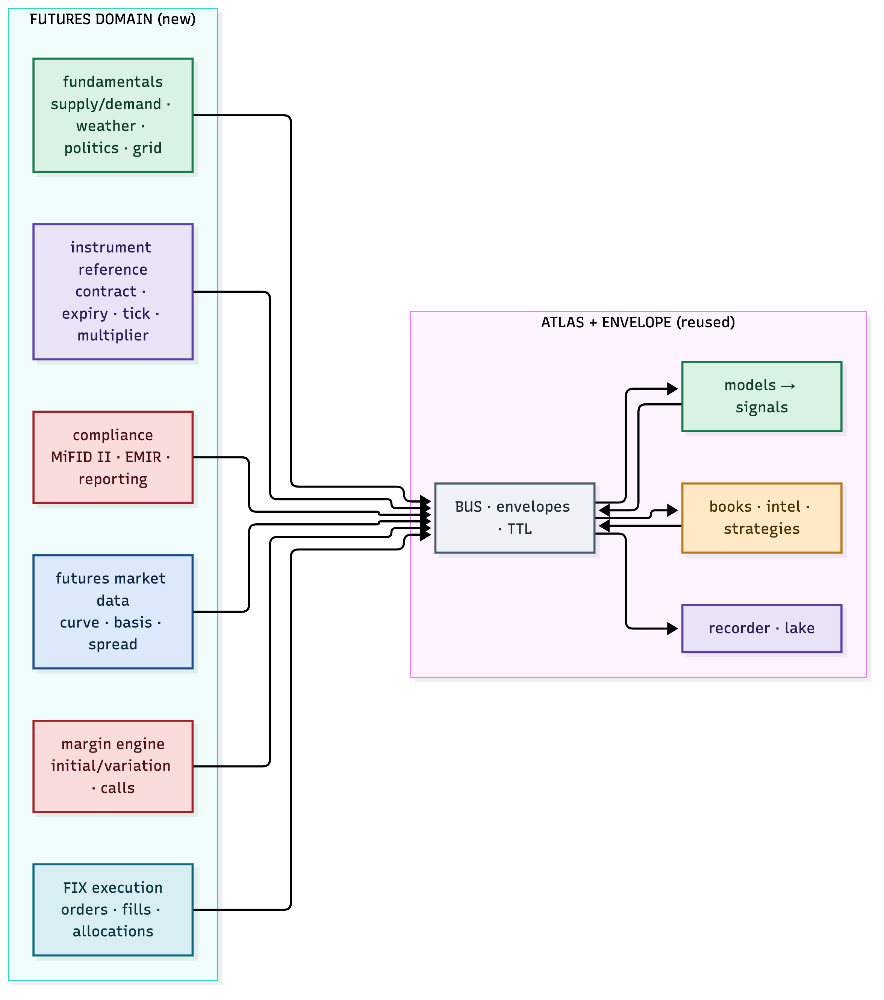

*Figure 1.1 — the envelope/bus/model/book/lake core is reused; the futures domain is built new.*

---

# 2. The planes — the futures domain

The crypto platform has five planes. The futures platform adds or reshapes them:

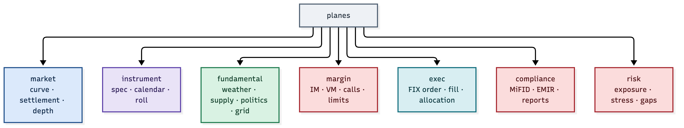

*Figure 2.1 — market, instrument, fundamental, margin, exec, compliance, risk.*

| Plane | What it carries | New or adapted |
|---|---|---|
| `market` | curve, settlement, depth, spread | adapted (curve, not spot) |
| `instrument` | contract spec, calendar, roll | **new** |
| `fundamental` | supply/demand, weather, politics, grid | **new** |
| `margin` | IM, VM, calls, limits | **new** |
| `exec` | FIX order, fill, allocation | **new** |
| `compliance` | MiFID II, EMIR, reports | **new** |
| `risk` | exposure, stress, gap | adapted |

Every one of these is a *producer of envelopes* on the same bus. The model, book and
strategy layers subscribe exactly as they do today — they just consume futures data.

---

# 3. Instrument reference data

Futures cannot be traded without knowing *what a contract is*. The instrument domain is
the single source of truth for every contract:

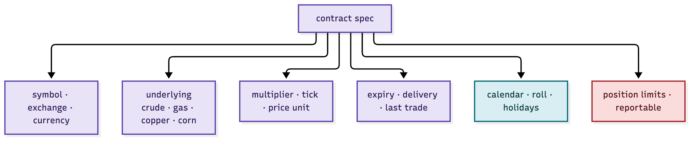

*Figure 3.1 — symbol, underlying, multiplier, tick, expiry, calendar, limits.*

| Field | Example | Why it matters |
|---|---|---|
| symbol / exchange | CL (CME), TTF (ICE), F (EEX) | the address of the contract |
| underlying | WTI crude, Dutch gas, copper | what you are actually exposed to |
| multiplier / tick | 1,000 bbl × $0.01 | the P&L per tick |
| expiry / delivery | M1 … M12, last trade date | when the contract rolls |
| calendar / roll | roll dates, holidays | how the curve is built and rolled |
| limits | position, reportable | regulatory + exchange caps |

The instrument domain is the *reference data problem* in miniature — and in a futures
platform it is the foundation every other component keys off.

---

# 4. Market data — the forward curve

Futures price is not a single number. It is a **curve**: one price per delivery month.
And the shape of that curve is itself the signal.

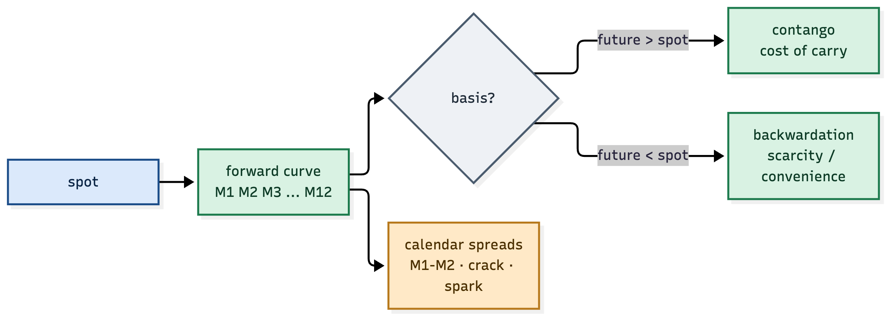

*Figure 4.1 — contango and backwardation are the market's opinion of carry and scarcity.*

| Term | Meaning |
|---|---|
| contango | futures above spot — cost of carry (storage, interest) |
| backwardation | futures below spot — scarcity or convenience yield |
| basis | future − spot |
| calendar spread | the price of one month vs the next (M1−M2) |
| crack / spark | refining / power-generation margins |

To *work out the price — flat or forward* — you must understand carry, storage, seasonality
and the shape of the curve. That is the difference from crypto, and it is the whole game.

---

# 5. Margin — the risk you cannot ignore

Trading futures **bears risk**: you post initial margin, you are marked to market daily
(variation margin), and when the account falls below maintenance you get a **margin call** —
top up or be liquidated.

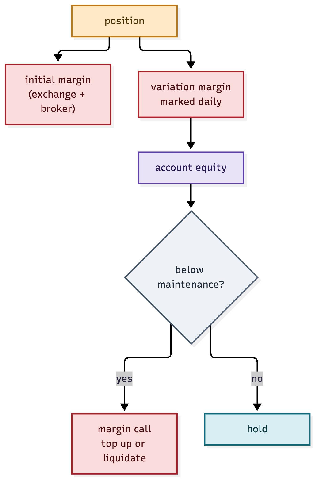

*Figure 5.1 — initial margin, variation margin, and the margin call path.*

| Margin | What it is |
|---|---|
| initial margin | posted to open a position |
| variation margin | the daily mark-to-market cash flow |
| maintenance | the floor before a call |
| margin call | the demand to top up or be closed |

The margin engine is a **first-class producer on the bus**: it publishes `margin.state` and
`margin.call` envelopes, and the risk governor refuses any order that would breach free
margin. In futures, the margin check happens *before* the order — not after.

---

# 6. Execution — FIX

Futures orders go to regulated venues (CME, ICE, EEX, LME) through brokers — and that is
**FIX**. The exec plane speaks FIX 4.4:

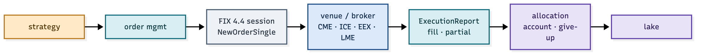

*Figure 6.1 — NewOrderSingle → venue → ExecutionReport → allocation → lake.*

| FIX message | Purpose |
|---|---|
| `NewOrderSingle` (D) | send an order |
| `ExecutionReport` (8) | acknowledge, partial, fill |
| `OrderCancelRequest` (F) | cancel |
| allocation | assign a fill to accounts (give-up) |

The FIX session is *another envelope producer/consumer*: every order, fill and allocation
is a stamped packet on the bus, correlated to the strategy that generated it — so the audit
trail from signal to fill is complete, exactly as in crypto.

---

# 7. Compliance — MiFID II and EMIR

Regulation is **not optional**. The futures platform must satisfy, at minimum:

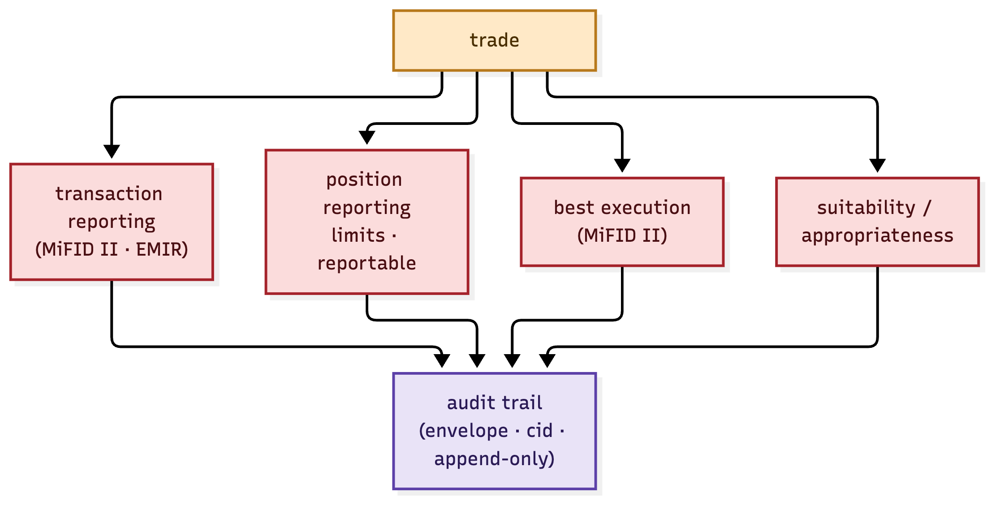

*Figure 7.1 — transaction reporting, position reporting, best execution, suitability.*

| Obligation | Regime | What it requires |
|---|---|---|
| transaction reporting | MiFID II / EMIR | report every trade, on time |
| position reporting | MiFID II / EMIR | report holdings past limits |
| best execution | MiFID II | prove you got the best price |
| suitability | MiFID II | know your client and their risk |

Because the envelope carries a correlation id and the lake is append-only, the compliance
report is **generated from the same evidence** as the trading record — a report is a view
over the lake, not a separately-maintained log. That is the envelope "having you covered".

---

# 8. Fundamentals — weather, politics, the grid

The crypto models read order flow. The futures models must also read the *world*: supply and
demand, weather, politics, and — for energy — the grid itself.

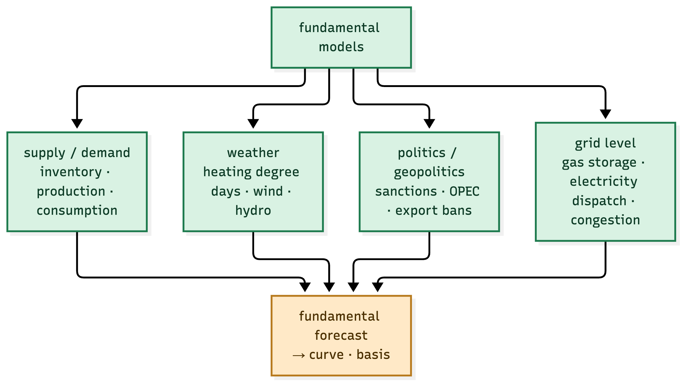

*Figure 8.1 — supply/demand, weather, politics and grid feed the fundamental forecast.*

| Fundamental | Drives | Example |
|---|---|---|
| supply / demand | inventory, production, consumption | EIA crude stocks, USDA WASDE |
| weather | heating/cooling demand, wind, hydro | HDD/CDD, wind forecast |
| politics | sanctions, OPEC, export bans | a pipeline sanction, an export tax |
| grid | dispatch, congestion, storage | gas storage %, power plant availability |

Energy, especially, is a **systems problem**: gas and electricity prices are set at the
margin by the most expensive plant, on the most congested node, at the most extreme weather.
Modelling that — down to the grid level — is a first-class model domain, publishing its
forecast as an envelope the strategies consume.

---

# 9. Risk — the governor, futures-grade

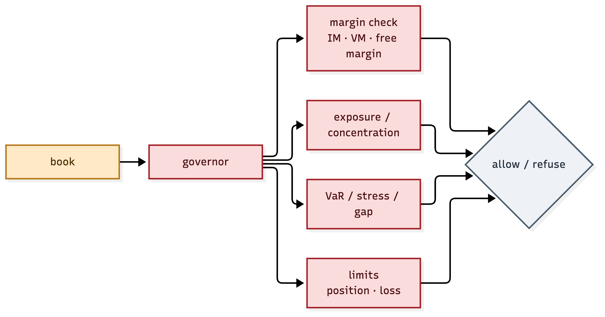

*Figure 9.1 — margin, exposure, VaR/stress/gap and limits, all before an order.*

| Check | Futures-specific |
|---|---|
| margin | free margin ≥ IM for the order |
| exposure | net and gross, per underlying and per curve bucket |
| stress / gap | what happens at expiry, or on a limit move |
| limits | exchange position limits, reportable thresholds |

The governor is the same idea as crypto — refuse with a rule and a number — but the rules
are futures-grade: margin, concentration, and gap risk on delivery.

---

# 10. The models

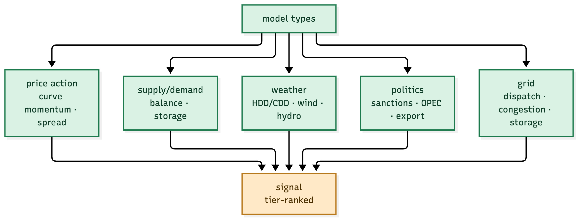

*Figure 10.1 — price action, supply/demand, weather, politics, grid — each a pure signal producer.*

| Model | Question |
|---|---|
| price action | is the curve trending, is the spread moving? |
| supply/demand | is the balance tightening or loosening? |
| weather | is demand or renewable supply shifting? |
| politics | is a supply shock forming? |
| grid | is the system at a stress point? |

Each is a **calculation agent** — a pure function of its inputs, publishing a signal with an
epoch timestamp. The book accumulates them in its intel window and confirms a pattern before
a strategy trades. Advisory, systematic and auto are just three *strategies* over the same
signals.

---

# 11. Crypto vs futures, side by side

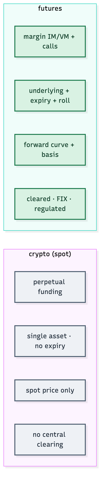

*Figure 11.1 — spot vs forward: expiry, curve, margin, clearing.*

The one line that matters: **crypto trades an asset; futures trade a curve of commitments** —
and everything new in this platform (instrument, margin, FIX, compliance, fundamentals)
exists because of that difference.

---

# 12. Build plan — phases

| Phase | What | Depends on |
|---|---|---|
| 1 · Core reuse | fork the envelope/bus/model/book/lake core | — |
| 2 · Instrument + curve | reference data, forward curve, basis | 1 |
| 3 · Market data | venue feeds (CME, ICE, EEX, LME) | 1, 2 |
| 4 · Margin + risk | margin engine, governor | 2, 3 |
| 5 · Execution | FIX 4.4 session, order/fill/allocation | 3, 4 |
| 6 · Compliance | MiFID II / EMIR reporting | 5 |
| 7 · Fundamentals | supply/demand, weather, politics, grid | 2 |
| 8 · Strategies | advisory → systematic → auto | 4, 7 |

Each phase ships envelopes on the same bus, so the platform is *observable and auditable at
every step* — which is the entire point of ATLAS and the envelope.

---

# 13. Summary

The futures platform is **the same operating system, a different market**. Reuse the
envelope, the bus, the decoupled model→signal→book→strategy, the intel window and the lake.
Build new: instruments, forward curves, margin, FIX, compliance and fundamental modelling.
The envelope covers the *how*; the futures domain is the *what*.
