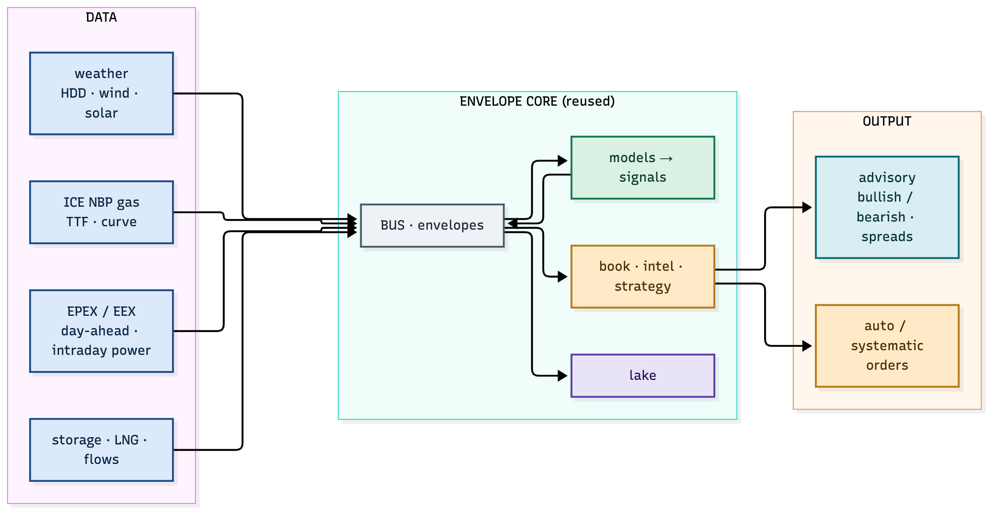
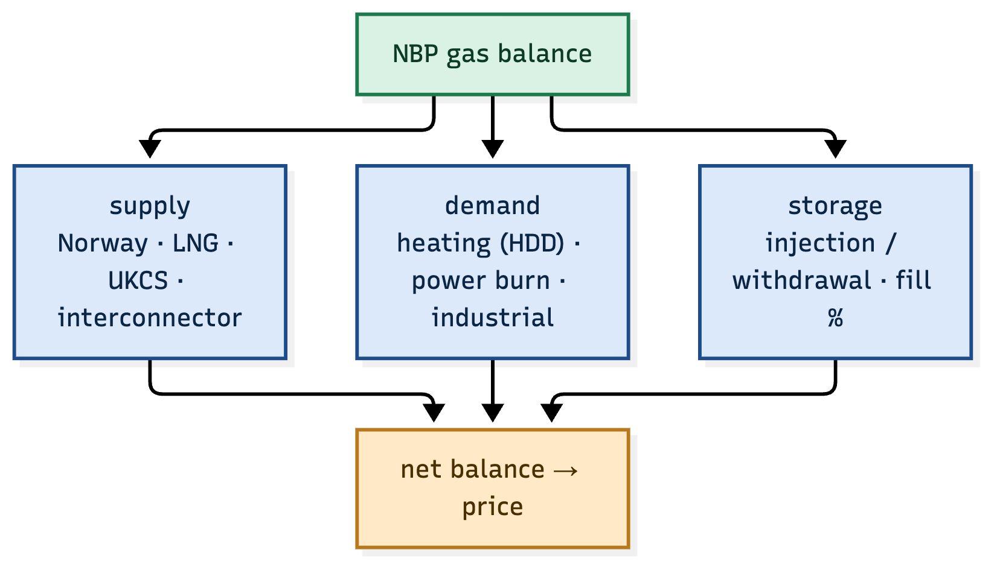
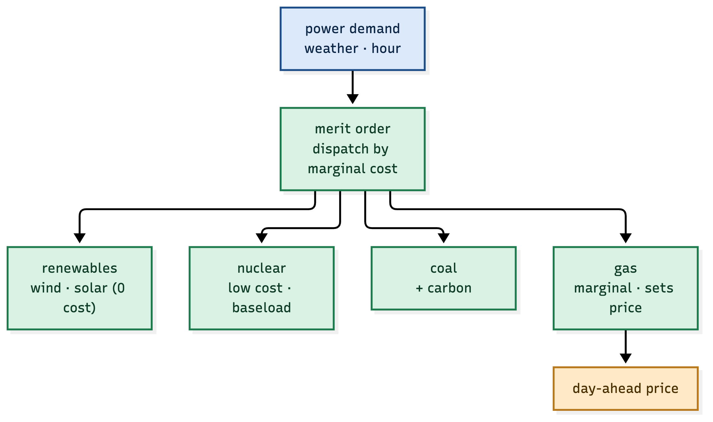
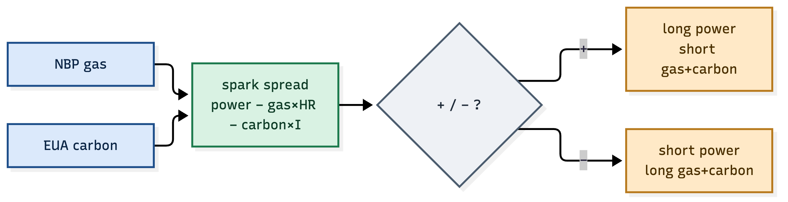
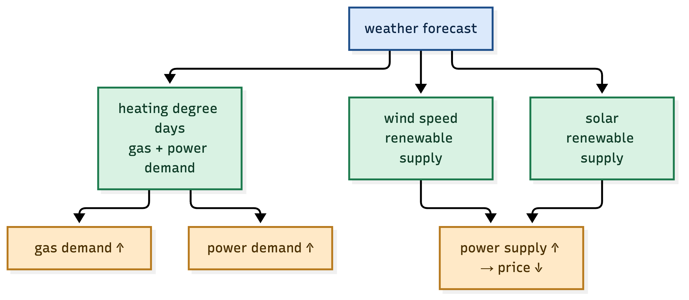
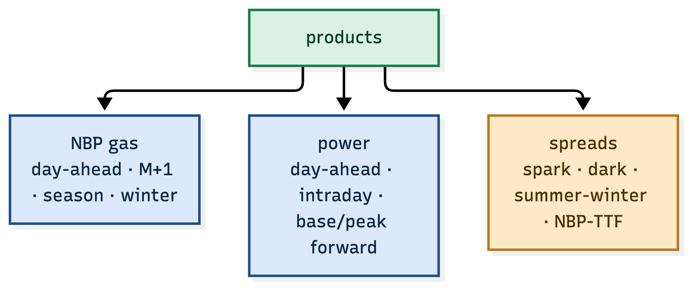
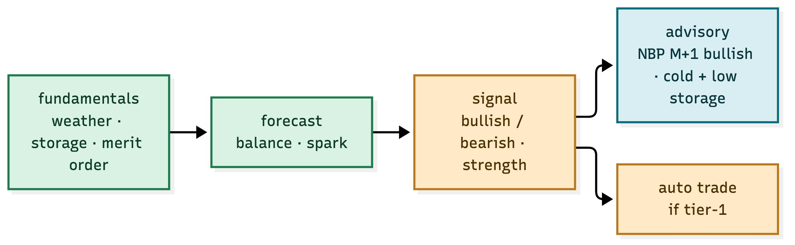
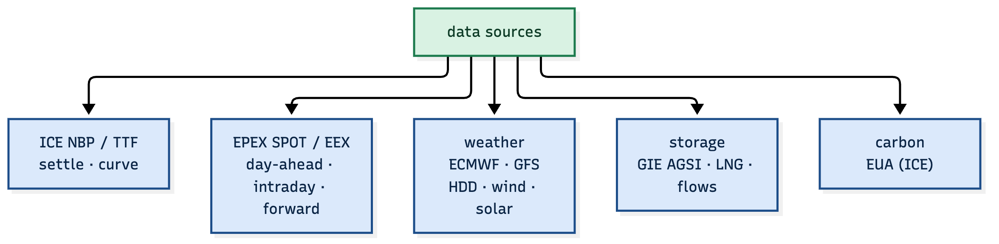

# NBP Gas & European Power — a focused trading + advisory system

> A focused system that **really trades and advises** the UK NBP natural-gas hub and the
> European power markets. Built on the ATLAS + envelope core, but with a single, sharp
> edge: **weather, storage, the merit order and the spark spread**.

---

# 1. What this system does

One market complex, two commodities, one relationship:

- **NBP gas** — the UK gas hub (p/th, GBP), the marginal fuel for UK power.
- **European power** — day-ahead and forward electricity, set by the merit order.
- **The link** — gas is the marginal fuel, so gas price and carbon drive power price
  through the **spark spread**.

The system **advises** (publishes a bullish/bearish view with a reason) and **trades**
(when the view is a tier-1 signal).



*Figure 1.1 — data in, models on the envelope core, advisory + auto out.*

---

# 2. The NBP gas balance

NBP price is a balance: supply against weather-driven demand, buffered by storage.



*Figure 2.1 — Norway, LNG, UKCS and interconnectors supply; heating and power burn demand.*

| Component | What drives it | Signal |
|---|---|---|
| supply | Norway flows, LNG arrivals, UKCS | more supply → bearish |
| demand | heating degree days, power burn | cold → bullish |
| storage | injection vs withdrawal, fill % | low storage → bullish into winter |

The balance is the model: **tight balance (low storage + cold) = bullish NBP; loose balance
(warm + high storage) = bearish.**

---

# 3. The power merit order

Power price is set by the **marginal plant** — the most expensive unit needed to meet
demand. Renewables come first (zero cost), then nuclear, then coal, then gas.



*Figure 3.1 — gas is usually the marginal plant, so gas + carbon set the power price.*

| Stack | Marginal cost | Effect on price |
|---|---|---|
| wind / solar | ~0 | more renewables → lower price |
| nuclear | low | baseload |
| coal | mid + carbon | higher |
| gas | high | **sets the clearing price** |

The insight: **gas is usually the price-setter**, so the power price is gas × heat-rate +
carbon × intensity + a margin. That is the spark spread.

---

# 4. The spark spread — the one relationship that matters



*Figure 4.1 — power minus gas and carbon, the clean margin of a gas plant.*

```
spark spread = power price − (gas price × heat-rate) − (carbon × emission intensity)
```

| Condition | Trade |
|---|---|
| spark spread high (plant is profitable) | long power, short gas + carbon |
| spark spread low / negative (plant losing) | short power, long gas + carbon |

The spark spread is the **fundamental anchor** of the whole complex: it ties the two
commodities together and gives the system a mean-reverting relationship to trade.

---

# 5. Weather — the driver of both

Weather is the single biggest short-term driver of gas demand and renewable power supply.



*Figure 5.1 — cold raises gas + power demand; wind and solar raise power supply.*

| Weather | Effect |
|---|---|
| cold (high HDD) | more heating → more gas + power demand → bullish both |
| windy / sunny | more renewables → more power supply → bearish power |
| calm / cloudy | less renewables → gas sets power → bullish power |

The weather forecast is a **first-class envelope producer**: it publishes HDD, wind and
solar forecasts, and the models consume them.

---

# 6. The products



*Figure 6.1 — gas, power and the spreads that link them.*

| Product | Example |
|---|---|
| NBP gas | day-ahead, month-ahead (M+1), season, winter |
| power | day-ahead, intraday, base/peak forwards |
| spreads | spark, dark, summer-winter, NBP-TTF |

The system trades the **spreads** first — they are the mean-reverting relationships with a
fundamental anchor — and the outrights only when the balance gives a strong directional view.

---

# 7. The advisory — what it actually says



*Figure 7.1 — the same signal drives a human-readable advisory and, at tier-1, an auto trade.*

| Signal | Advisory (verbatim) |
|---|---|
| cold + low storage + tight LNG | "NBP M+1 bullish — cold snap, storage below 5yr avg" |
| high wind forecast + mild | "power day-ahead bearish — wind up, demand soft" |
| spark spread stretched high | "spark rich — long power, short gas+carbon" |

The advisory is not a score — it is a **sentence with a reason**, because a trader (or a
compliance reviewer) needs the *why*, not just the number.

---

# 8. Data sources



*Figure 8.1 — ICE, EPEX/EEX, weather, storage and carbon feed the models.*

| Source | What it provides |
|---|---|
| ICE | NBP / TTF gas, EUA carbon — settle and forward curve |
| EPEX SPOT / EEX | day-ahead and intraday power, forward power |
| ECMWF / GFS | weather — HDD, wind, solar forecast |
| GIE AGSI | European gas storage fill levels |
| ENTSO-E | generation mix, cross-border flows |

---

# 9. Build plan — the focused version

| Phase | What | Deliverable |
|---|---|---|
| 1 | data ingestion (ICE, EPEX, weather, storage) | envelopes on the bus |
| 2 | gas balance + merit order models | fundamental forecast |
| 3 | spark-spread model | the anchor relationship |
| 4 | advisory + tier signals | human-readable views + auto |
| 5 | execution (ICE / EEX via FIX) | orders + fills on the bus |
| 6 | margin + risk + compliance | the governor + reports |

---

# 10. Why this system can really trade

- **It has an anchor.** The spark spread is a real, mean-reverting relationship, not a
  technical pattern — it can be valued and it has a reason to revert.
- **It has a driver.** Weather and storage are measurable, forecastable, and move price on
  a known timescale.
- **It has a reason for every signal.** The advisory carries the *why*, so a trade is
  explainable and auditable — which is the envelope's whole promise.

That is a system that can really trade, and really advise.
