# Trading UK Gas — a deep dive
## NBP market mechanics, the famous trades, and the strategies that worked

> A deep, factual tour of UK natural-gas trading: the NBP balance, the weather and storage
> drivers, the 2021–22 shock, the 2006 calendar-spread blow-up, and the strategies that real funds have
> used — then how AI changes all of it, now and next.

---

# 1. The market — NBP in one breath

The **NBP** (National Balancing Point) is the UK's virtual gas hub: the single price at which
UK gas trades, quoted in **pence per therm** (p/th). One therm ≈ 29.3 kWh. It is the physical
and financial reference for the whole UK gas market.

The NBP price is a **balance**: supply against weather-driven demand, buffered by storage.


*Figure 1.1 — Norway, UKCS, LNG and interconnectors supply; power, heating, industry and exports demand.*

| Fact | Number |
|---|---|
| UK gas demand | ~70–80 bcm/year |
| price unit | pence per therm (p/th) |
| hub | NBP (virtual) |
| traded | day-ahead, M+1, season, winter, forwards |

The market clears every gas day, and the price is set by the *marginal* unit of supply or
demand — exactly like the power merit order, but for molecules.

---

# 2. Supply — where the gas comes from

UK gas supply has four legs, and they matter because they are the *shocks*:

| Source | Share (approx.) | What shocks it |
|---|---|---|
| **Norway pipeline** | ~45% | outages, maintenance (Kollsnes, Troll) |
| **UKCS (North Sea)** | ~25%, declining | field decline, unplanned outages |
| **LNG** (Milford Haven, Isle of Grain) | ~20%, swing | Asian premium, cargo diversion |
| **interconnectors** (IUK to Belgium, BBL to NL) | net exporter/importer | European demand, price spreads |

Norway is the single largest source — a Norwegian outage is the classic bullish event. LNG is
the *swing*: when Asia pays up, cargoes divert and the UK tightens. The interconnectors link
NBP to TTF (Dutch) and make the UK part of one European gas system.

---

# 3. Demand — where the gas goes

| Use | Driver | Volatility |
|---|---|---|
| **power generation** | gas-fired power, wind/solar output | high, weather |
| **residential + commercial heating** | HDD (temperature) | high, winter |
| **industrial** | economic activity | low |
| **exports** (IUK/BBL) | European prices | high, event |

Heating and power burn are the weather-driven core. A cold winter day can nearly double
demand from a mild one. That is why UK gas is a **weather market** first and foremost.

---

# 4. Storage — the UK's structural weakness

The UK has **very little gas storage** — roughly **9 days** of demand, versus ~80 days for
Germany. This is the single most important structural fact about NBP:


*Figure 4.1 — inject in summer, withdraw in winter; the UK is structurally short storage.*

| Fact | Number |
|---|---|
| UK storage | ~9 days of demand |
| Germany | ~80 days |
| Rough (largest, closed 2017, partly reopened) | ~3.3 bcm |
| consequence | NBP is **more volatile** + weather-sensitive than TTF |

Because the UK cannot store its way through a cold winter, **the market is the storage** —
prices must move sharply to ration demand and attract LNG. That is the structural source of
the UK's winter price spikes.

---

# 5. The seasonal structure — summer vs winter

Gas has a *built-in* seasonal rhythm: inject in summer (cheap), withdraw in winter (dear).
The **summer-winter spread** is the price of storage plus a risk premium.


*Figure 5.1 — the winter premium is the cost of carry plus the risk of a cold, tight winter.*

The spread is the most-traded structure in gas. It *should* be bounded by storage economics
(inject now, withdraw later, earn the spread) — but it blew out dramatically in 2021–22 when
storage was low and the risk premium exploded.

---

# 6. Weather — the driver

Weather is the single biggest short-term driver. The measure is **HDD** (heating degree days):
each degree below a baseline (15.5°C) is one unit of heating demand.


*Figure 6.1 — cold raises demand and price; mild does the reverse.*

| Event | Impact |
|---|---|
| cold snap ("Beast from the East" 2018) | demand spike, price spike |
| mild winter | demand soft, price soft |
| forecast revision (colder) | price jumps on the revision |

The edge in UK gas is often the **weather forecast revision**, not the weather itself — the
trader who sizes the *change in the forecast* faster wins.

---

# 7. Geopolitics — the 2021–22 shock

The defining gas event of the era:


*Figure 7.1 — Russia's invasion cut pipeline gas, Europe scrambled for LNG, prices exploded.*

| Date | Event | NBP/TTF |
|---|---|---|
| early 2021 | tight storage, cold winter | ~40–50 p/th |
| late 2021 | Russia curtails flows | ~200+ p/th |
| Feb 2022 | invasion of Ukraine | spike |
| Aug 2022 | peak panic, LNG diversion | **~500–600+ p/th** |

The lesson: **gas is a geopolitical commodity.** A supply shock to a low-storage system with
little spare capacity is not a 20% move — it is a 10× move. The funds that were *long the
winter / long storage* ahead of 2021–22 made the trade of the decade.

---

# 8. The famous trades — what worked and what blew up

## 8.1 The 2006 calendar-spread blow-up

One large US hedge fund's lead energy trader bet huge on **natural-gas calendar spreads** (long winter / short
summer, and the March-April and Nov-Jan spreads). In September 2006 the spreads moved against
the position and the fund lost **~$6 billion in a week** — the largest hedge-fund collapse to
that date. The CFTC later charged the trader with attempted manipulation of gas futures.

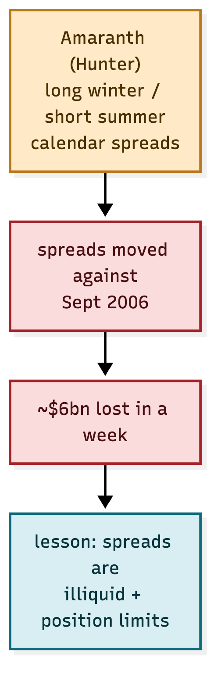

*Figure 8.1 — one over-sized spread position, one adverse move, $6bn gone.*

**The lesson is not "don't trade spreads" — it is "size the spread, know its liquidity, and
never let one position be the fund."** The calendar spread is a *good trade*; the
mistake was the *size* and the *concentration*.

## 8.2 The 2021–22 winners

The funds that won the crisis were **long winter gas, long the storage premium, and long the
tail** — via the curve and options. They read the fundamentals (low storage + tight LNG +
Russia risk) and positioned *before* the spike. That is fundamental, option-shaped trading:
**buy the tail, not the point.**

---

# 9. The strategies that have worked

## 9.1 Weather-driven (the classic play)


*Figure 9.1 — buy the cold forecast, sell into the cold.*

The classic: on a colder forecast revision, **long M+1 / winter**; when the cold arrives and
the price spikes, **sell into it**. A legendary gas trader built his fortune on weather-driven
gas trading — reading the forecast faster and better than the market.

## 9.2 Storage-based (the fundamental long)


*Figure 9.2 — low storage + tight LNG = bullish into winter.*

When storage is below the 5-year average going into winter, the winter premium is underpriced.
**Long winter / Q1**, and revalue as storage refills or weather turns mild.

## 9.3 The calendar spread (sized right)


*Figure 9.3 — trade the spread against its storage-cost anchor.*

The spread is the same instrument that fund used — but the discipline is the *anchor*: the
spread should not exceed the cost of storage plus a *reasonable* risk premium. When it does,
it is rich; sell it. When it is below, buy it.

## 9.4 The basis — NBP vs TTF


*Figure 9.4 — the NBP-TTF spread is bounded by interconnector capacity.*

NBP and TTF are linked by the IUK and BBL interconnectors. When the spread exceeds transport
cost, the flow arbitrages it away. Trade the *convergence*.

## 9.5 The spark spread — gas vs power


*Figure 9.5 — power minus gas and carbon; trade the plant margin.*

The spark spread ties gas to power. When a gas plant is profitable (spread rich), power is
bid up relative to gas; when it is losing (spread negative), gas is bid up relative to power.
Trade the mean reversion.

---

# 10. The risk lessons


*Figure 10.1 — concentration, margin, liquidity, limits and the tail, all before the governor.*

| Lesson | Source | Control |
|---|---|---|
| concentration kills | the 2006 fund | one spread ≠ one fund; limits |
| spreads are illiquid | the 2006 fund | size to the book, not the view |
| the tail is the risk | 2021–22 | options + stress, buy the tail |
| margin calls are real | 2021–22 | free-margin gate before every order |
| weather is optionality | 2018 | trade the forecast, hedge the miss |

The envelope's governor is built exactly for this: **refuse with a rule and a number**, before
the trade, while it can still be refused.

---

# 11. How AI shapes gas trading — now and next

**What it does.** AI turns the same data a trader reads — price, weather, storage, flows,
news — into *forecasts* and *signals* that are faster, more systematic and more probabilistic
than a human alone.

**Why it matters.** Gas is a data-rich, weather-driven, event-driven market. The edge is in
*fusing* many weak signals (a cold forecast, a low storage number, a pipeline outage headline)
into one strong, probability-weighted view — which is exactly what machine learning is good at.


*Figure 11.1 — data → features → ML models → signals → advisor / auto / human.*

| Layer | What AI does | Human's role |
|---|---|---|
| data | ingest + clean | verify sources |
| models | forecast, classify, rank | choose features, judge sanity |
| signals | produce a probability | override, size, approve |
| decision | recommend | own the risk |

The human does not disappear — the human moves *up* the stack, from computing to supervising.

---

# 12. Modelling — machine-learning price forecasts

**What it does.** Predicts the price (or the direction) of a contract — M+1, the winter, the
summer-winter spread — from a feature vector.

**Why it matters.** The gas price is a function of *many* interacting inputs (HDD, storage,
LNG, curve shape). ML finds the mapping where a hand-written formula would miss it.


*Figure 12.1 — features in, a price forecast out, with uncertainty.*

| Model | Strength | Use |
|---|---|---|
| gradient boosting (XGBoost/LightGBM) | tabular, interpretable | the workhorse — daily balance |
| LSTM / temporal | sequences, memory | demand over hours |
| transformer | long-range, attention | news + price, multi-horizon |

The honest forecast is not a point — it is a **distribution**. A forecast of "M+1 at 120 p/th
± 15" is tradeable; a forecast of "120" is a guess.

---

# 13. Probabilistic forecasting — trade the distribution

**What it does.** Forecasts quantiles (q05, q50, q95), not a single number.

**Why it matters.** The *asymmetry* is the trade. If the q95 is +40% but the q05 is −5%, the
risk-reward is asymmetric and you size differently than a symmetric point forecast would say.


*Figure 13.1 — quantiles give the upside/downside asymmetry, and you trade the tail.*

| Forecast | What it tells you | Action |
|---|---|---|
| q50 (median) | the central view | the base position |
| q05 | the downside | the stop / the hedge |
| q95 | the upside | the tail to buy |

This is where ML beats a rule: a rule says "cold → bullish"; a probabilistic model says
"cold → bullish with 70% confidence and a fat right tail".

---

# 14. Weather-to-demand modelling

**What it does.** Maps a weather forecast (temperature, wind) to gas and power demand.

**Why it matters.** Weather is the single biggest short-term driver of gas demand — heating in
winter, power burn. The model that maps degrees to therms is the foundation of every forecast.


*Figure 14.1 — ECMWF/GFS temperature → HDD → demand → price impact.*

| Input | Feature | Model |
|---|---|---|
| temperature | HDD (heating degree days) | demand regression / ML |
| wind | wind power output | power burn → gas demand |
| solar | solar output | same |

Heating degree days are the workhorse: one degree below a baseline is one unit of heating
demand, aggregated over population and buildings. The ML version learns the *non-linearity*
(extreme cold is worse than linear).

---

# 15. News and NLP — the event edge

**What it does.** Reads the wires and social in real time and turns them into *events* — a
pipeline outage, an LNG cargo diversion, a sanction, a strike.

**Why it matters.** The biggest gas moves are event-driven (a pipeline cut, an invasion). The
trader who learns of the event seconds faster — and sizes it correctly — has the edge.


*Figure 15.1 — NLP detects the event, the event becomes a signal with an expiry.*

| Event | Typical market impact |
|---|---|
| pipeline outage | bullish (supply cut) |
| LNG cargo cancelled | bullish (supply short) |
| mild weather revision | bearish (demand soft) |
| storage beat | bearish (looser) |

NLP turns unstructured text into a *typed event with an expiry* — the signal is "bearish
M+1, 2-day horizon", not just "negative news".

---

# 16. Sentiment — the positioning edge

**What it does.** Scores the tone of news and the positioning of the market (CFTC-style
commitments, option skew, flows).

**Why it matters.** When everyone is already long, the marginal buyer is gone — sentiment is
the contrarian and the momentum signal at once.


*Figure 16.1 — news tone + positioning fuse into a sentiment-adjusted signal.*

| Sentiment | Reading | Action |
|---|---|---|
| crowded long | exhaustion risk | fade the longs |
| crowded short | squeeze risk | fade the shorts |
| neutral + fundamentals | clean signal | follow the fundamentals |

Sentiment is a *weight*, not a direction — it tells you how much to trust the fundamental
signal, and when a move is over-extended.

---

# 17. The LLM research agent

**What it does.** A large-language-model agent that reads the lake, the news and the models,
and *answers questions with evidence*.

**Why it matters.** The platform already records everything as envelopes. An LLM agent can
read that record and explain a move — and, crucially, *cite the envelopes* as evidence.


*Figure 17.1 — a question in, a cited answer out.*

> "Why is NBP up today?" → "Cold revision (+4 HDD) and a Norwegian outage (Kollsnes, −30 mcm/d),
> against storage at 60% (below 5yr avg). See envelopes #…, #…, #…."

The LLM does not replace the models — it *narrates* them, and it makes the advisory
self-explanatory for compliance and for the human.

---

# 18. Reinforcement learning — execution and market-making

**What it does.** Learns *how to act* (order size, timing, venue) to maximise a reward
(slippage, fill, PnL).

**Why it matters.** Forecasting is "what"; execution is "how". A good forecast ruined by bad
execution is a loss. RL optimises the *how*.


*Figure 18.1 — state → action → reward, learned end to end.*

| Use | State | Action | Reward |
|---|---|---|---|
| execution | book, curve, vol | order size + timing | −slippage, fill |
| market-making | inventory, spread | quote | spread PnL − inventory risk |

RL is the future of the *tactics*, while the *strategy* (what to be long or short) remains
the fundamental and ML models.

---

# 19. Generative models — scenarios and the tail

**What it does.** Generates *synthetic* scenarios — cold snaps, pipeline cuts, LNG booms —
for stress and training.

**Why it matters.** The tail is where the money and the risk are. A generative model can
*sample* the tails that history has not yet shown, so you train and stress for the 1-in-50
winter, not just the 1-in-5.


*Figure 19.1 — scenarios feed stress tests and tail-aware training.*

| Use | What it gives |
|---|---|
| stress / VaR | the tail losses |
| training | models that have seen the extreme |

This is the answer to "what happens if we get another 2022": you generate it, and you size
for it.

---

# 20. Multi-agent systems on the envelope

**What it does.** Runs many specialised agents — weather, fundamental, news, sentiment — each
publishing on the bus, and a meta-agent that fuses them into a tier.

**Why it matters.** This is the AI version of the architecture we already built: each agent
is a calculation agent, the bus is the nervous system, the meta-agent is the book's intel
window. AI slots *into* the envelope, it does not replace it.


*Figure 20.1 — weather, fundamental, news, sentiment agents → bus → meta-agent → trade.*

The envelope architecture was built for this: **models publish numbers, the book accumulates
them and confirms a pattern.** AI models are just more, and better, numbers.

---

# 21. Human-in-the-loop

**What it does.** Keeps a human in the decision — the AI proposes, the human sizes, approves,
vetoes — and records who did what.

**Why it matters.** Regulation (MiFID II, suitability) and risk demand accountability. The AI
can be wrong in ways a human catches (a headline the model mis-read, a tail it has not seen).
The human is the *guardian*, and the envelope records the override.


*Figure 21.1 — AI signal → human override or auto → audit of who + why.*

| Mode | Human's role |
|---|---|
| advisory | human reads the AI view |
| systematic | human approves the rules |
| auto | human sets the bounds, AI executes within them |

---

# 22. The data stack for AI

**What it does.** The pipeline from raw data to a deployed agent.

**Why it matters.** AI is only as good as the data. The stack — clean, align, feature, train,
validate, deploy — is where most AI projects fail, and where the envelope helps: every stage
is a stamped, versioned artefact.


*Figure 22.1 — raw → clean → features → train → deploy, looping.*

| Stage | Envelope role |
|---|---|
| raw | recorded as market/fundamental envelopes |
| features | a derived dataset, versioned |
| train | a model artefact, versioned |
| deploy | an agent that publishes signals |

Versioned data + versioned models = a forecast you can reproduce, which is the same
traceability the trading platform already guarantees.

---

# 23. Ensembles and signal fusion

**What it does.** Combines the fundamental, ML, weather and sentiment models into one signal
with a confidence.

**Why it matters.** No single model is right all the time. The ensemble is more robust than
the best single model — it is the *pattern* of agreement that matters, exactly like the
book's intel window.


*Figure 23.1 — four models fuse into one tier signal with confidence.*


*Figure 23.2 — fundamental + ML + sentiment → probability → decision.*

| Fusion | How |
|---|---|
| voting | count agreeing models |
| weighted | weight by track record |
| stacked | a meta-model learns the weights |

The tier signal is the *confidence* — and confidence is what separates a trade from a gamble.

---

# 24. Now → next → future


*Figure 24.1 — ML forecasts today, LLM agents + RL next, autonomous desks later.*

| Horizon | Capability |
|---|---|
| now | ML price/demand forecasts, NLP news, sentiment |
| next | LLM research agents, RL execution, generative scenarios |
| future | autonomous multi-agent desks, human as supervisor |

The direction is clear: the human moves from *computing* to *supervising*, and the platform —
with its envelope, its bus, its audit trail — is already built to host that future.

---

# 25. Governance — the risks of AI trading

**What it does.** Governs the AI like it governs any model: versioned, validated, bounded,
and accountable.

**Why it matters.** An AI that trades gas can fail silently (a drift in the weather model) or
loudly (a mis-read headline). The same controls that apply to any model apply to AI — plus
new ones.

| Risk | Control |
|---|---|
| model drift | monitor forecast error, retrain on schedule |
| hallucination (LLM) | cite envelopes, never invent a fact |
| overfitting | validate out-of-sample, walk-forward |
| tail blindness | generative stress, size for the tail |
| opacity | a reason for every signal, a human override |

The envelope is the answer to all of them: **every signal carries a reason, a timestamp and a
provenance, and every decision is auditable.** AI does not change that — it makes it more
necessary.

---

# 26. Corruption in energy markets

**What it is.** Energy markets — gas and power especially — have been repeatedly abused,
because the underlying is physical, the benchmark is an assessment, and one big player can
move a thin market. Understanding the abuses is part of trading it honestly.

**Why it matters.** The same mechanics that make gas tradable (a physical balance, a
price-assessment window, an illiquid curve) are the mechanics that get manipulated. A trader
must both *avoid* the abuses and *recognise* them in the tape.

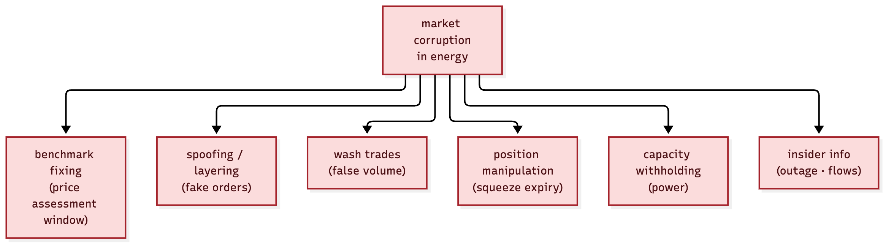

*Figure 26.1 — benchmark fixing, spoofing, wash trades, position manipulation, withholding, insider.*

| Abuse | What it is | Example pattern |
|---|---|---|
| benchmark fixing | trading in the assessment window to move the published price | trading at the fix to mark a book |
| spoofing / layering | placing orders you intend to cancel to move price | a wall of bids pulled at the last moment |
| wash trades | trading with yourself to fake volume | two accounts crossing the same ticket |
| position manipulation | squeezing a delivery/expiry point | cornering the prompt month |
| capacity withholding | a generator withholds to lift power price | a plant "outage" at peak |
| insider information | trading on non-public outage/flow data | a physical trader acting before an outage is public |

The UK and EU regimes — **REMIT** (energy market integrity), **MAR** (market abuse), and the
CFTC across the Atlantic — prohibit these, with reporting, position limits and surveillance.

---

# 27. Liquidity — where the risk hides

**What it is.** The gas curve is *not* uniformly liquid. The front month is tight; the back
(seasons, years) is thin; and the spreads and options are thinner still. Liquidity is the
difference between a trade you can exit and a trade that owns you.

**Why it matters.** The 2006 calendar-spread collapse and the 2022 spike were both, at root,
*liquidity events*: when a position is too big for the market, the exit *is* the move.

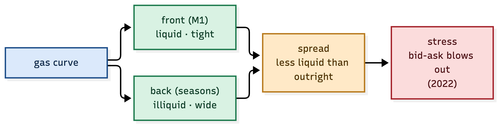

*Figure 27.1 — front liquid, back illiquid; the spread is thinner than the outright.*

| Instrument | Liquidity | Risk |
|---|---|---|
| front month (M1) | tight, deep | low |
| seasons / years | thin, wide | high |
| calendar spread | thinner than outright | high (the 2006 lesson) |
| options / tail | very thin | very high, especially in stress |

The rule follows: **size to the liquidity, not to the conviction.** A correct view in an
illiquid instrument is still a loss if you cannot get out.

---

# 28. Governance and surveillance

**What it does.** The platform's own answer to corruption and illiquidity: every order, fill
and signal is an envelope; surveillance is a *view over the lake*, not a separate log.

**Why it matters.** The same traceability that makes a trade auditable makes a *manipulation*
auditable. A spoof is a pattern of cancelled orders in the record; a wash is two accounts
crossing; a squeeze is a position against the limit. All are detectable from the envelopes.

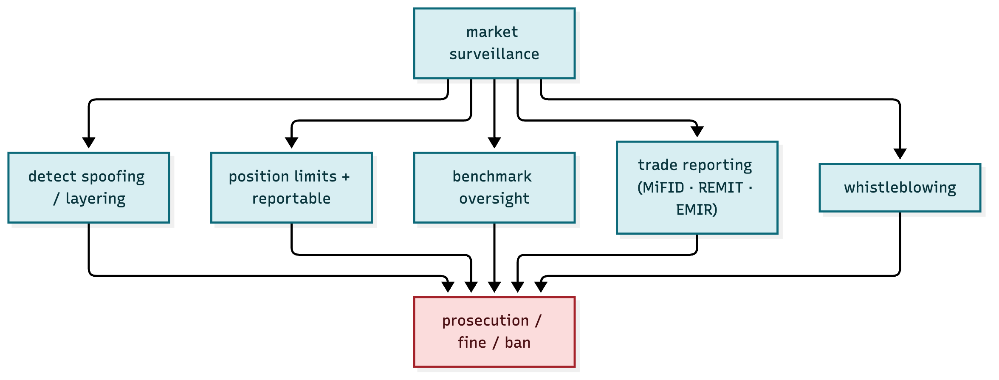

*Figure 28.1 — spoof/layering detection, position limits, benchmark oversight, reporting, whistleblowing.*

| Control | What it watches |
|---|---|
| spoof / layering detection | order-to-trade ratios, cancel patterns |
| position limits | exposure against the exchange + regulatory caps |
| benchmark oversight | trading around the assessment window |
| reporting | REMIT / MAR / EMIR / MiFID II |
| whistleblowing | a channel for the inside report |

The envelope is the honest broker: **it records everything once, in order, with a correlation
id — so both the trade and the attempt to game it leave the same kind of trace.**

---

# 29. Summary — trading UK gas, honestly and well

- **Know the balance** — Norway, UKCS, LNG, interconnectors; power, heat, industry, exports.
- **Know the structure** — the UK's ~9 days of storage, the summer-winter spread.
- **Know the drivers** — weather (HDD), storage, geopolitics.
- **Know the trades** — weather, storage, the calendar spread (sized), the basis, the spark.
- **Know the risks** — concentration, illiquidity, the tail, corruption.
- **And let AI help** — forecasts, news, sentiment, agents — all on the same envelope, so
  every signal has a reason and every trade is auditable.

That is the whole game: **a physical market, an honest platform, and a disciplined edge.**

---

# 30. Why ATLAS is the foundation for gas trading

**What it does.** ATLAS is the *data god*: it **collects**, **stores** and **transforms** every
piece of market data, and turns it into the envelopes that everything else consumes.

**Why it matters.** Gas is a data-fusion problem — weather, storage, flows, news, sentiment,
price — and a compliance problem. ATLAS is the layer that does both: it *collects* the raw
data, *stores* it append-only, and *transforms* it into derived signals, with every step
versioned and auditable.

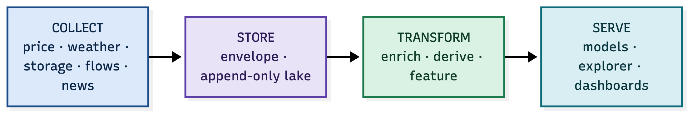

*Figure 30.1 — ATLAS is the backbone: data in, stored once, transformed, served to all.*

| Stage | What ATLAS does |
|---|---|
| collect | every source publishes an envelope on the bus |
| store | the recorder writes it once into the append-only lake |
| transform | enrich, derive, feature-engineer into derived datasets |
| serve | models, the explorer, the dashboards read the same lake |

This is the answer to "would ATLAS be beneficial?" — **yes**, because the hard problems in gas
are *collection, storage and transformation*, and ATLAS is already the best answer to all three.

---

# 31. The transformation pipeline

Raw data is not a signal. The transformation pipeline turns raw envelopes into derived
features, and it is where most of the value is added.

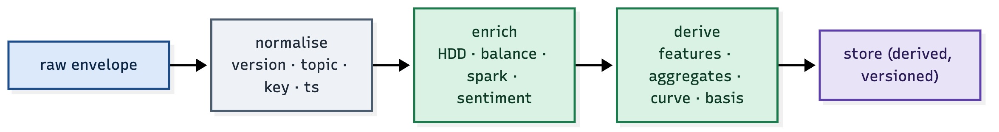

*Figure 31.1 — every raw envelope is normalised, enriched and derived, versioned at each step.*

| Step | Example |
|---|---|
| normalise | raw temperature → a `fundamental.weather` envelope with a key + timestamp |
| enrich | temperature → **HDD** (heating degree days) |
| derive | HDD + storage → a **balance forecast**; gas + carbon → a **spark spread** |
| store | the derived dataset is versioned, so a forecast is reproducible |

Because every transformation is itself an envelope, the *lineage* is preserved: a forecast
carries the references to the raw inputs it used, with their ages. That is the ATLAS
guarantee — and it is exactly what a gas forecast needs to be auditable.

---

# 32. The gas-specific transformations

The gas domain is where ATLAS's "transform" shines, because each raw input becomes a
*derived* signal:

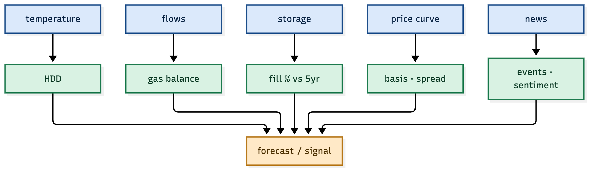

*Figure 32.1 — temperature→HDD, flows→balance, storage→fill, price→basis, news→events.*

| Raw | Transformation | Derived signal |
|---|---|---|
| temperature | heating degree days | demand pressure |
| pipeline/LNG flows | net balance | supply tightness |
| storage | fill % vs 5yr | winter risk premium |
| price curve | basis, spread | carry / scarcity |
| news | NLP events + sentiment | shock direction |

Each derived signal is a *pure transformation* published as an envelope — which means it can
be reproduced, versioned and audited. That is the difference between a spreadsheet of numbers
and a trading system you can trust.

---

# 33. The ATLAS benefits, mapped to gas

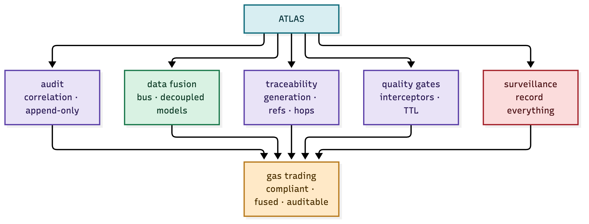

*Figure 33.1 — audit, fusion, traceability, quality gates and surveillance, all feeding gas trading.*

| ATLAS capability | What it gives gas |
|---|---|
| correlation id + append-only lake | an audit trail from market tick to fill |
| the bus + decoupled models | fusion of weather, storage, news and sentiment |
| generation, refs, hops | full lineage — what a forecast read, and how old |
| interceptors + TTL | data-quality gates — freshness, authority, keying |
| record everything | surveillance — spoofing and wash trades are visible |

**The verdict, restated:** ATLAS does not give you the *gas edge* — the weather model, the
storage model, the spark spread. It gives you the **trust, the traceability and the substrate**
that let that edge be traded, explained, audited and governed. For a commodity as regulated,
event-driven and data-rich as UK gas, that is the foundation — not an add-on.

---

# 34. Why a long-term curve trader would love this — and why it outclasses a terminal

**What this is.** A long-term gas curve trader holds positions across months and seasons —
calendar spreads, butterflies, the shape of the curve — for days and weeks. Their edge is
*slow and fundamental*, not tick-by-tick. This section argues that ATLAS + the envelope is
the platform that edge has always needed.

**Why it matters.** The incumbent tool (a data terminal) gives you the *price*; ATLAS gives
you the price *and the reason and the record*. That difference is everything for a portfolio
manager who must explain, replay and audit their book.

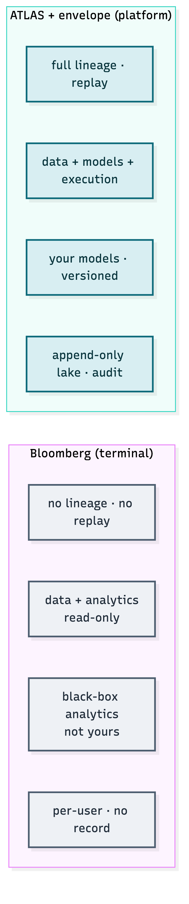

*Figure 34.1 — a terminal is read-only; a platform records, versions and replays.*

| | A terminal | ATLAS + the envelope |
|---|---|---|
| data | yes, read-only | yes, plus *your* sources |
| analytics | theirs, black-box | yours, versioned, replayable |
| lineage | none | full refs, per signal |
| audit | none | append-only lake |
| execution | no | yes, on the same bus |
| IP | rented | owned |

A terminal tells you *what the price is*. ATLAS tells you *why your model said what it said,
what it read, and what you did about it* — and proves all three.

---

# 35. Yes — it is the envelope

The magic is not the database or the UI. It is the **envelope**: the tiny, stamped packet that
carries its own provenance, lineage, correlation and pipeline. Everything else in this
document — the fusion, the audit, the replay, the surveillance — is a consequence of the
envelope being the *unit of record*.

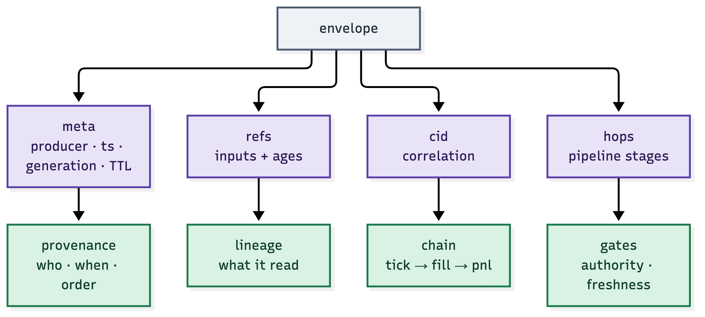

*Figure 35.1 — meta, refs, cid, hops: provenance, lineage, chain, gates.*

| Feature | What it answers |
|---|---|
| `meta` (producer, ts, generation, TTL) | who, when, in what order, how fresh |
| `refs` (inputs + ages) | what this decision read, and how old |
| `cid` (correlation id) | the whole chain: tick → decision → fill → pnl |
| `hops` (pipeline) | which gates ran, and what they refused |

The rest of this section is **case studies** — each one is a feature of the envelope, shown as
a concrete example a curve trader or PM would actually hit.

---

# 36. Case studies — the envelope in action

## 36.1 Lineage — "why did the model go long Q1?"

A PM asks why the model went long Q1 on 3 February. The forecast's **refs** answer it:

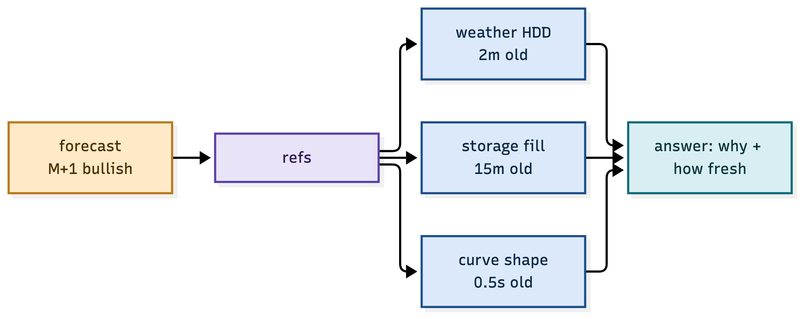

*Figure 36.1 — the forecast carries its inputs and their ages.*

```
forecast M+1 bullish
  ├─ ref: fundamental.weather  (HDD +4, 2m old)
  ├─ ref: fundamental.storage  (fill 60%, 15m old)
  └─ ref: market.curve         (backwardated, 0.5s old)
```

The answer is not a recollection — it is **the record**. The PM sees the exact inputs, and
their ages, and knows the decision was well-founded (or stale). That is the difference between
a model you trust and a model you hope is right.

## 36.2 Correlation — "replay the whole trade"

One correlation id follows the work from the market tick to the P&L:

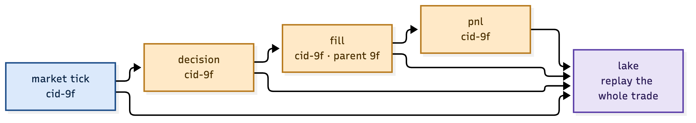

*Figure 36.2 — one cid resolves the tick, the decision, the fill and the pnl from the lake.*

```
$ resolve cid-9f
  market.tick     09:02:01  (the trigger)
  model.decision  09:02:03  long M+1 · cid-9f
  model.fill      09:02:05  net +0.4% · parent cid-9f
  model.pnl       09:02:05  equity +£1,240 · cid-9f
```

From one id, the entire life of a trade is reassembled. For a curve trader holding for weeks,
that means every position's *whole story* is recoverable — for the PM, the risk team, and the
regulator.

## 36.3 Generation — "the weather feed silently died"

A weather feed stops publishing. Because the envelope carries a **monotonic generation** per
topic, the gap is *detected*, not inferred:

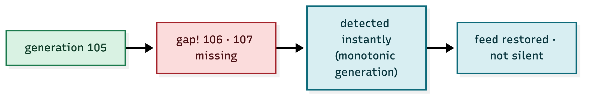

*Figure 36.3 — a gap in generation is a fact, caught instantly.*

```
fundamental.weather  generation 105
fundamental.weather  generation 108   ← 106, 107 missing
```

A terminal would simply show a stale (or blank) weather number and you would never know. ATLAS
*flags the gap* — the forecast that would have used a silent feed is refused as stale, and the
feed is restored. This is the difference between "the data was wrong" and "the data went
silent, and we caught it".

## 36.4 Versioning — "why did the view change?"

The forecast changed overnight. The **versioned** envelope shows exactly why:

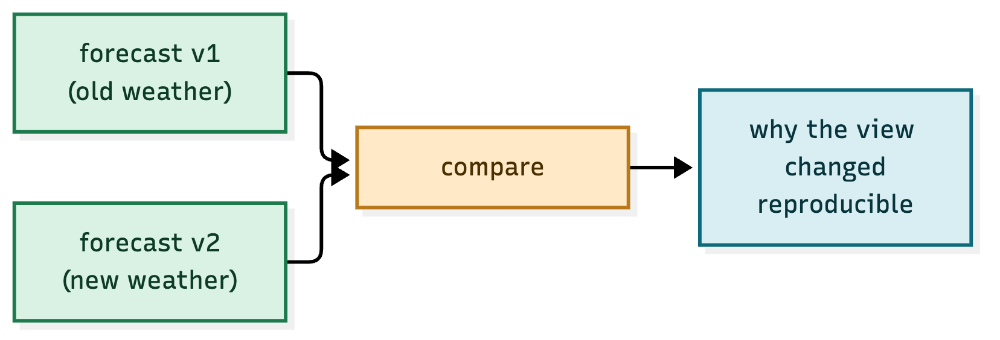

*Figure 36.4 — two versions differ by one input, and the difference is reproducible.*

```
forecast v1 (old weather):  M+1 bearish
forecast v2 (new weather):  M+1 bullish   ← the cold revision
```

Because data and models are versioned, the change in the view is *attributable* to the change
in the input — not to a mystery. A PM can show the trader, the risk team and the client
exactly why the book changed.

## 36.5 Freshness — "the stale storage number"

The envelope's **TTL** and the freshness interceptor refuse a stale input:

```
model.decision M+1 long
  → freshness interceptor: REFUSED
    reason: storage ref 32h old (max 15m)
```

A terminal would let you trade on a number you *think* is live. The envelope refuses to. For a
market where a storage print or a weather run is the whole trade, that freshness gate is the
difference between an informed position and a stale one.

---

# 37. The curve trader's day, with ATLAS

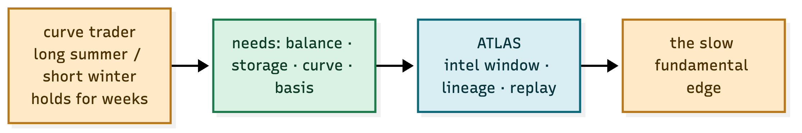

*Figure 37.1 — the slow fundamental edge, on a platform that records it.*

| The curve trader does | ATLAS provides |
|---|---|
| reads the balance, storage, weather | fused envelopes, with lineage |
| forms a slow view (summer-winter, basis) | the intel window confirms the pattern |
| expresses it via spreads | orders + fills on the bus |
| holds for weeks | every mark, every P&L, recorded |
| explains the P&L to the PM | the correlation chain + the case file |

A long-term curve trader does not need a faster terminal. They need a **system that remembers
why they are in the trade, proves it, and replays it.** That is ATLAS, and that is the envelope.

---

# 38. More envelope features — the fascinating part

The envelope does more than record. It *remembers*, *replays* and *proves*. These are the
features that make a trader or PM stop and say "oh — that's why it's different."

## 38.1 The intel window — conviction over days, not ticks

A curve trader's edge is slow. The book's **intel window** is the memory that matches it: it
accumulates signals over days and only acts when a *pattern* forms.

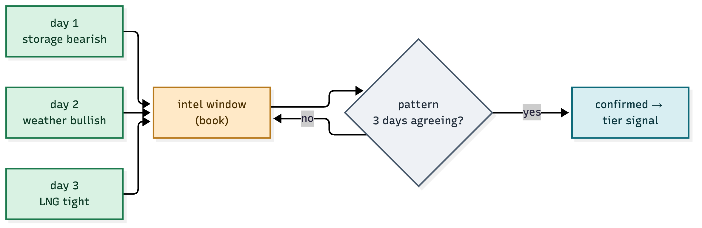

*Figure 38.1 — three days of agreeing signals become one confirmed tier signal.*

```
day 1: storage bearish   →  recorded (1/3)
day 2: weather bullish   →  recorded (2/3)
day 3: LNG tight         →  recorded (3/3)  →  pattern confirmed
```

A tick-based system would have traded each day's noise. ATLAS waits for the *streak* — which is
exactly the discipline of a long-term curve trader, now machine-enforced.

## 38.2 The transform chain — every step is a packet

From raw temperature to the final fill, **every step is an envelope**, so the whole chain is
versioned and replayable.

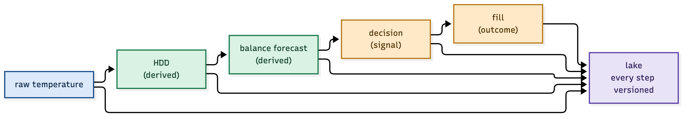

*Figure 38.2 — the full chain, each step a versioned envelope in the lake.*

```
raw temperature  →  HDD  →  balance forecast  →  decision  →  fill
   (envelope)      (envelope)    (envelope)        (envelope)   (envelope)
```

The trader can point at *any* link and ask "what did this read, and was it right?" — and the
answer is in the lake, not in someone's memory.

## 38.3 The refusal record — "why didn't we trade?"

Most systems record only the trades. ATLAS records the **non-trades** too — every refusal is
an envelope naming the rule and the number.

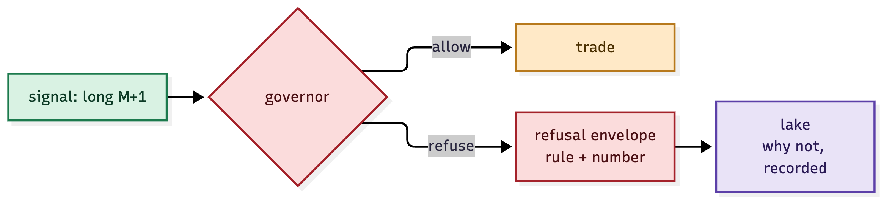

*Figure 38.3 — a refused signal is itself an envelope, so "why not" is answerable.*

```
signal: long M+1
  → governor: REFUSED  (gross 12.4× > limit 8×)
```

For a PM reviewing the book, this is gold: the *absence* of a trade is explained, not a mystery.
The discipline is visible — and the discipline is the edge.

## 38.4 Replay — the time machine

The lake is append-only, so any day can be **replayed with the exact same data, in the exact
same order**.

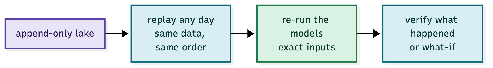

*Figure 38.4 — replay the day, re-run the models, verify what happened.*

A trader can ask "what did my model actually see at 09:02 on 3 February?" — and *see it*.
And "what would it have done with the corrected weather?" — and *re-run it*. That is a
capability no terminal has: a **time machine** for your own decisions.

## 38.5 Model comparison — fair, on the same data

Two models can be run on the **same versioned inputs** and compared fairly — same data, same
clock, different models.

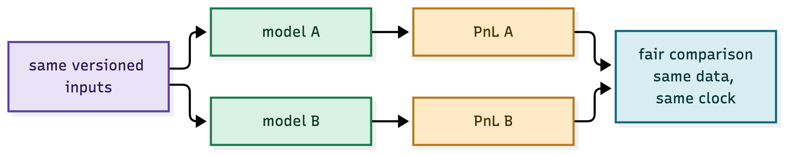

*Figure 38.5 — same inputs, two models, one fair P&L comparison.*

Without the envelope, comparing models is confounded — they saw different data at different
times. With it, the comparison is clean, and the better model wins on merit.

## 38.6 Compliance as a view — proof, not a promise

A regulatory report is **a query over the lake**, not a separately-maintained spreadsheet.

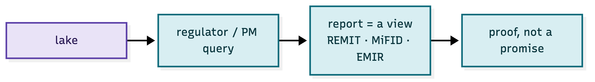

*Figure 38.6 — REMIT, MiFID, EMIR reports are generated from the same evidence.*

The regulator's question ("show me every order, its reasoning and its fill") is answered by a
view, with correlation ids and ages. The report is **proof**, because it is generated from the
append-only record — not reconstructed after the fact.

## 38.7 The self-describing packet

The deepest fact: an envelope **knows its own provenance, its own lineage and its own chain**.
The lake is therefore *self-documenting*.

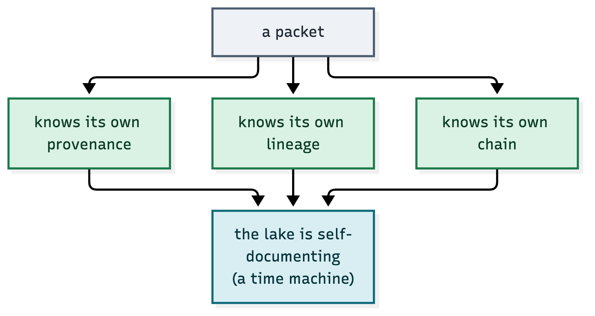

*Figure 38.7 — a packet knows who made it, what it read, and what followed it.*

That is why the envelope is the whole trick: **you don't maintain documentation — the packets
are the documentation.** The system is its own audit trail, its own research log, and its own
time machine.
