# Trading UK Gas — a deep dive
## NBP market mechanics, the famous trades, and the strategies that worked

> A deep, factual tour of UK natural-gas trading: the NBP balance, the weather and storage
> drivers, the 2021–22 shock, the Amaranth blow-up, and the strategies that real funds have
> used — then how AI changes all of it, now and next.

---

# 1. The market — NBP in one breath

The **NBP** (National Balancing Point) is the UK's virtual gas hub: the single price at which
UK gas trades, quoted in **pence per therm** (p/th). One therm ≈ 29.3 kWh. It is the physical
and financial reference for the whole UK gas market.

The NBP price is a **balance**: supply against weather-driven demand, buffered by storage.

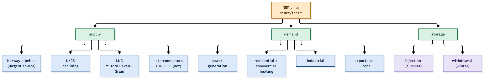

*Figure 1.1 — Norway, UKCS, LNG and interconnectors supply; power, heating, industry and exports demand.*

| Fact | Number |
|---|---|
| UK gas demand | ~70–80 bcm/year |
| price unit | pence per therm (p/th) |
| hub | NBP (virtual) |
| traded | day-ahead, M+1, season, winter, forwards |

The market clears every gas day, and the price is set by the *marginal* unit of supply or
demand — exactly like the power merit order, but for molecules.

---

# 2. Supply — where the gas comes from

UK gas supply has four legs, and they matter because they are the *shocks*:

| Source | Share (approx.) | What shocks it |
|---|---|---|
| **Norway pipeline** | ~45% | outages, maintenance (Kollsnes, Troll) |
| **UKCS (North Sea)** | ~25%, declining | field decline, unplanned outages |
| **LNG** (Milford Haven, Isle of Grain) | ~20%, swing | Asian premium, cargo diversion |
| **interconnectors** (IUK to Belgium, BBL to NL) | net exporter/importer | European demand, price spreads |

Norway is the single largest source — a Norwegian outage is the classic bullish event. LNG is
the *swing*: when Asia pays up, cargoes divert and the UK tightens. The interconnectors link
NBP to TTF (Dutch) and make the UK part of one European gas system.

---

# 3. Demand — where the gas goes

| Use | Driver | Volatility |
|---|---|---|
| **power generation** | gas-fired power, wind/solar output | high, weather |
| **residential + commercial heating** | HDD (temperature) | high, winter |
| **industrial** | economic activity | low |
| **exports** (IUK/BBL) | European prices | high, event |

Heating and power burn are the weather-driven core. A cold winter day can nearly double
demand from a mild one. That is why UK gas is a **weather market** first and foremost.

---

# 4. Storage — the UK's structural weakness

The UK has **very little gas storage** — roughly **9 days** of demand, versus ~80 days for
Germany. This is the single most important structural fact about NBP:

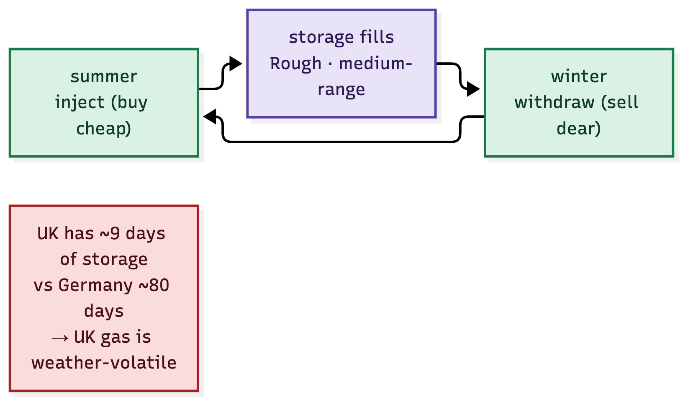

*Figure 4.1 — inject in summer, withdraw in winter; the UK is structurally short storage.*

| Fact | Number |
|---|---|
| UK storage | ~9 days of demand |
| Germany | ~80 days |
| Rough (largest, closed 2017, partly reopened) | ~3.3 bcm |
| consequence | NBP is **more volatile** + weather-sensitive than TTF |

Because the UK cannot store its way through a cold winter, **the market is the storage** —
prices must move sharply to ration demand and attract LNG. That is the structural source of
the UK's winter price spikes.

---

# 5. The seasonal structure — summer vs winter

Gas has a *built-in* seasonal rhythm: inject in summer (cheap), withdraw in winter (dear).
The **summer-winter spread** is the price of storage plus a risk premium.

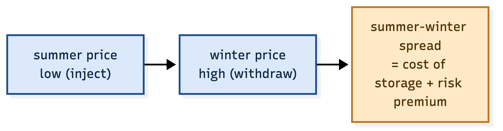

*Figure 5.1 — the winter premium is the cost of carry plus the risk of a cold, tight winter.*

The spread is the most-traded structure in gas. It *should* be bounded by storage economics
(inject now, withdraw later, earn the spread) — but it blew out dramatically in 2021–22 when
storage was low and the risk premium exploded.

---

# 6. Weather — the driver

Weather is the single biggest short-term driver. The measure is **HDD** (heating degree days):
each degree below a baseline (15.5°C) is one unit of heating demand.

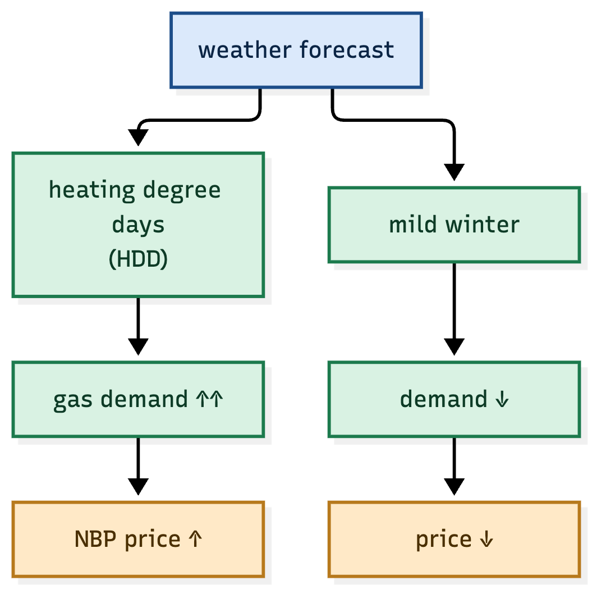

*Figure 6.1 — cold raises demand and price; mild does the reverse.*

| Event | Impact |
|---|---|
| cold snap ("Beast from the East" 2018) | demand spike, price spike |
| mild winter | demand soft, price soft |
| forecast revision (colder) | price jumps on the revision |

The edge in UK gas is often the **weather forecast revision**, not the weather itself — the
trader who sizes the *change in the forecast* faster wins.

---

# 7. Geopolitics — the 2021–22 shock

The defining gas event of the era:

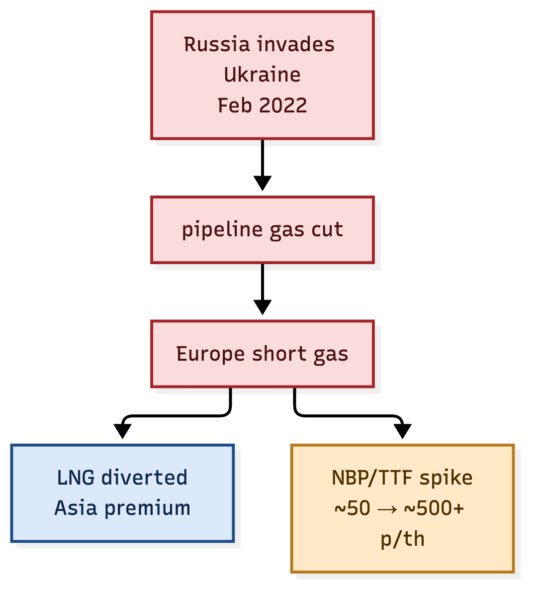

*Figure 7.1 — Russia's invasion cut pipeline gas, Europe scrambled for LNG, prices exploded.*

| Date | Event | NBP/TTF |
|---|---|---|
| early 2021 | tight storage, cold winter | ~40–50 p/th |
| late 2021 | Russia curtails flows | ~200+ p/th |
| Feb 2022 | invasion of Ukraine | spike |
| Aug 2022 | peak panic, LNG diversion | **~500–600+ p/th** |

The lesson: **gas is a geopolitical commodity.** A supply shock to a low-storage system with
little spare capacity is not a 20% move — it is a 10× move. The funds that were *long the
winter / long storage* ahead of 2021–22 made the trade of the decade.

---

# 8. The famous trades — what worked and what blew up

## 8.1 Amaranth (2006) — the calendar-spread blow-up

Amaranth's Brian Hunter bet huge on **natural-gas calendar spreads** (long winter / short
summer, and the March-April and Nov-Jan spreads). In September 2006 the spreads moved against
the position and Amaranth lost **~$6 billion in a week** — the largest hedge-fund collapse to
that date. The CFTC later charged Hunter with attempted manipulation of gas futures.

*Figure 8.1 — one over-sized spread position, one adverse move, $6bn gone.*

**The lesson is not "don't trade spreads" — it is "size the spread, know its liquidity, and
never let one position be the fund."** The calendar spread is a *good trade*; the Amaranth
mistake was the *size* and the *concentration*.

## 8.2 The 2021–22 winners

The funds that won the crisis were **long winter gas, long the storage premium, and long the
tail** — via the curve and options. They read the fundamentals (low storage + tight LNG +
Russia risk) and positioned *before* the spike. That is fundamental, option-shaped trading:
**buy the tail, not the point.**

---

# 9. The strategies that have worked

## 9.1 Weather-driven (the Centaurus / John Arnold play)

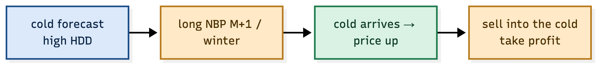

*Figure 9.1 — buy the cold forecast, sell into the cold.*

The classic: on a colder forecast revision, **long M+1 / winter**; when the cold arrives and
the price spikes, **sell into it**. John Arnold at Centaurus built his fortune on weather-driven
gas trading — reading the forecast faster and better than the market.

## 9.2 Storage-based (the fundamental long)

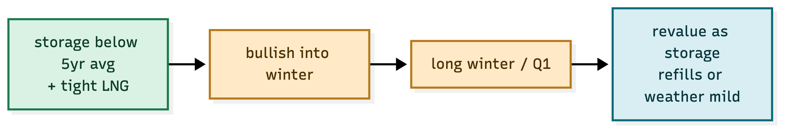

*Figure 9.2 — low storage + tight LNG = bullish into winter.*

When storage is below the 5-year average going into winter, the winter premium is underpriced.
**Long winter / Q1**, and revalue as storage refills or weather turns mild.

## 9.3 The calendar spread (sized right)

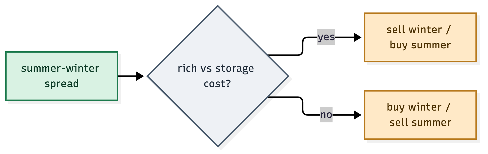

*Figure 9.3 — trade the spread against its storage-cost anchor.*

The spread is the same instrument Amaranth used — but the discipline is the *anchor*: the
spread should not exceed the cost of storage plus a *reasonable* risk premium. When it does,
it is rich; sell it. When it is below, buy it.

## 9.4 The basis — NBP vs TTF

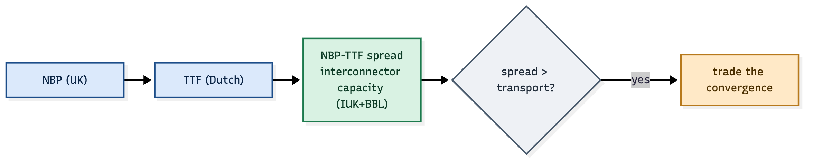

*Figure 9.4 — the NBP-TTF spread is bounded by interconnector capacity.*

NBP and TTF are linked by the IUK and BBL interconnectors. When the spread exceeds transport
cost, the flow arbitrages it away. Trade the *convergence*.

## 9.5 The spark spread — gas vs power

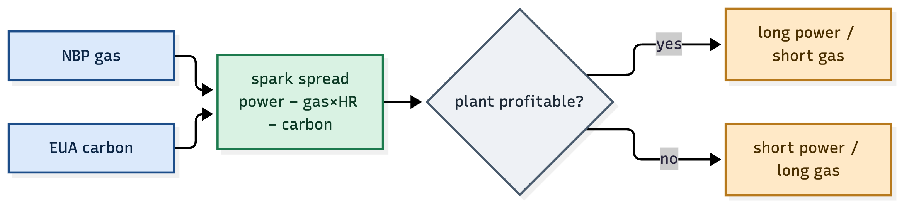

*Figure 9.5 — power minus gas and carbon; trade the plant margin.*

The spark spread ties gas to power. When a gas plant is profitable (spread rich), power is
bid up relative to gas; when it is losing (spread negative), gas is bid up relative to power.
Trade the mean reversion.

---

# 10. The risk lessons

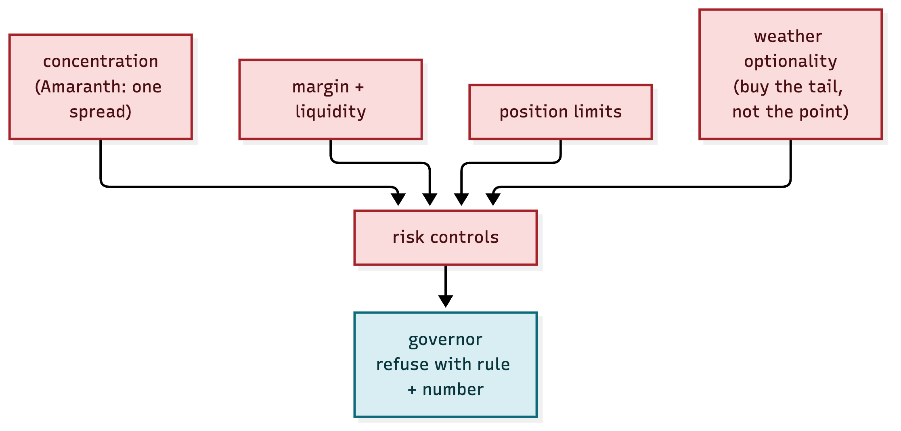

*Figure 10.1 — concentration, margin, liquidity, limits and the tail, all before the governor.*

| Lesson | Source | Control |
|---|---|---|
| concentration kills | Amaranth | one spread ≠ one fund; limits |
| spreads are illiquid | Amaranth | size to the book, not the view |
| the tail is the risk | 2021–22 | options + stress, buy the tail |
| margin calls are real | 2021–22 | free-margin gate before every order |
| weather is optionality | 2018 | trade the forecast, hedge the miss |

The envelope's governor is built exactly for this: **refuse with a rule and a number**, before
the trade, while it can still be refused.

---

# 11. How AI shapes gas trading — now and next

**What it does.** AI turns the same data a trader reads — price, weather, storage, flows,
news — into *forecasts* and *signals* that are faster, more systematic and more probabilistic
than a human alone.

**Why it matters.** Gas is a data-rich, weather-driven, event-driven market. The edge is in
*fusing* many weak signals (a cold forecast, a low storage number, a pipeline outage headline)
into one strong, probability-weighted view — which is exactly what machine learning is good at.

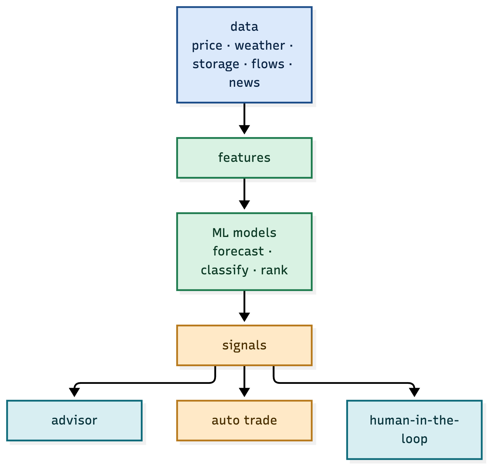

*Figure 11.1 — data → features → ML models → signals → advisor / auto / human.*

| Layer | What AI does | Human's role |
|---|---|---|
| data | ingest + clean | verify sources |
| models | forecast, classify, rank | choose features, judge sanity |
| signals | produce a probability | override, size, approve |
| decision | recommend | own the risk |

The human does not disappear — the human moves *up* the stack, from computing to supervising.

---

# 12. Modelling — machine-learning price forecasts

**What it does.** Predicts the price (or the direction) of a contract — M+1, the winter, the
summer-winter spread — from a feature vector.

**Why it matters.** The gas price is a function of *many* interacting inputs (HDD, storage,
LNG, curve shape). ML finds the mapping where a hand-written formula would miss it.

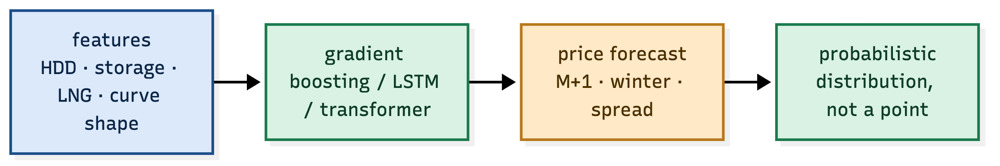

*Figure 12.1 — features in, a price forecast out, with uncertainty.*

| Model | Strength | Use |
|---|---|---|
| gradient boosting (XGBoost/LightGBM) | tabular, interpretable | the workhorse — daily balance |
| LSTM / temporal | sequences, memory | demand over hours |
| transformer | long-range, attention | news + price, multi-horizon |

The honest forecast is not a point — it is a **distribution**. A forecast of "M+1 at 120 p/th
± 15" is tradeable; a forecast of "120" is a guess.

---

# 13. Probabilistic forecasting — trade the distribution

**What it does.** Forecasts quantiles (q05, q50, q95), not a single number.

**Why it matters.** The *asymmetry* is the trade. If the q95 is +40% but the q05 is −5%, the
risk-reward is asymmetric and you size differently than a symmetric point forecast would say.

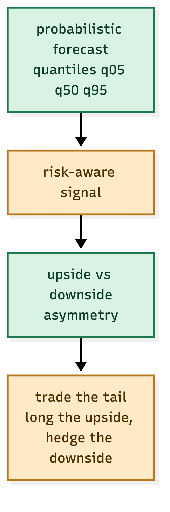

*Figure 13.1 — quantiles give the upside/downside asymmetry, and you trade the tail.*

| Forecast | What it tells you | Action |
|---|---|---|
| q50 (median) | the central view | the base position |
| q05 | the downside | the stop / the hedge |
| q95 | the upside | the tail to buy |

This is where ML beats a rule: a rule says "cold → bullish"; a probabilistic model says
"cold → bullish with 70% confidence and a fat right tail".

---

# 14. Weather-to-demand modelling

**What it does.** Maps a weather forecast (temperature, wind) to gas and power demand.

**Why it matters.** Weather is the single biggest short-term driver of gas demand — heating in
winter, power burn. The model that maps degrees to therms is the foundation of every forecast.

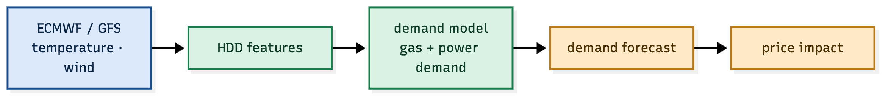

*Figure 14.1 — ECMWF/GFS temperature → HDD → demand → price impact.*

| Input | Feature | Model |
|---|---|---|
| temperature | HDD (heating degree days) | demand regression / ML |
| wind | wind power output | power burn → gas demand |
| solar | solar output | same |

Heating degree days are the workhorse: one degree below a baseline is one unit of heating
demand, aggregated over population and buildings. The ML version learns the *non-linearity*
(extreme cold is worse than linear).

---

# 15. News and NLP — the event edge

**What it does.** Reads the wires and social in real time and turns them into *events* — a
pipeline outage, an LNG cargo diversion, a sanction, a strike.

**Why it matters.** The biggest gas moves are event-driven (a pipeline cut, an invasion). The
trader who learns of the event seconds faster — and sizes it correctly — has the edge.

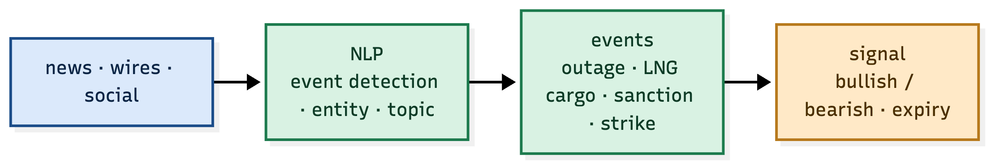

*Figure 15.1 — NLP detects the event, the event becomes a signal with an expiry.*

| Event | Typical market impact |
|---|---|
| pipeline outage | bullish (supply cut) |
| LNG cargo cancelled | bullish (supply short) |
| mild weather revision | bearish (demand soft) |
| storage beat | bearish (looser) |

NLP turns unstructured text into a *typed event with an expiry* — the signal is "bearish
M+1, 2-day horizon", not just "negative news".

---

# 16. Sentiment — the positioning edge

**What it does.** Scores the tone of news and the positioning of the market (CFTC-style
commitments, option skew, flows).

**Why it matters.** When everyone is already long, the marginal buyer is gone — sentiment is
the contrarian and the momentum signal at once.

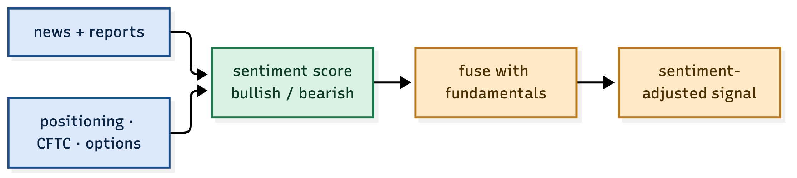

*Figure 16.1 — news tone + positioning fuse into a sentiment-adjusted signal.*

| Sentiment | Reading | Action |
|---|---|---|
| crowded long | exhaustion risk | fade the longs |
| crowded short | squeeze risk | fade the shorts |
| neutral + fundamentals | clean signal | follow the fundamentals |

Sentiment is a *weight*, not a direction — it tells you how much to trust the fundamental
signal, and when a move is over-extended.

---

# 17. The LLM research agent

**What it does.** A large-language-model agent that reads the lake, the news and the models,
and *answers questions with evidence*.

**Why it matters.** The platform already records everything as envelopes. An LLM agent can
read that record and explain a move — and, crucially, *cite the envelopes* as evidence.

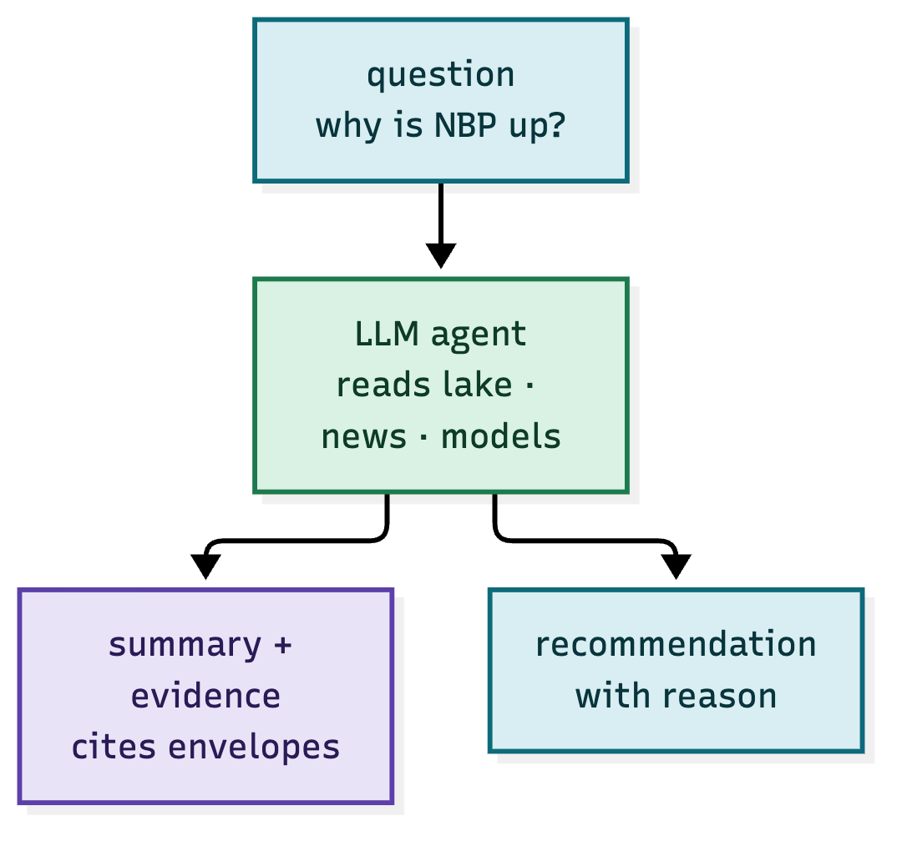

*Figure 17.1 — a question in, a cited answer out.*

> "Why is NBP up today?" → "Cold revision (+4 HDD) and a Norwegian outage (Kollsnes, −30 mcm/d),
> against storage at 60% (below 5yr avg). See envelopes #…, #…, #…."

The LLM does not replace the models — it *narrates* them, and it makes the advisory
self-explanatory for compliance and for the human.

---

# 18. Reinforcement learning — execution and market-making

**What it does.** Learns *how to act* (order size, timing, venue) to maximise a reward
(slippage, fill, PnL).

**Why it matters.** Forecasting is "what"; execution is "how". A good forecast ruined by bad
execution is a loss. RL optimises the *how*.

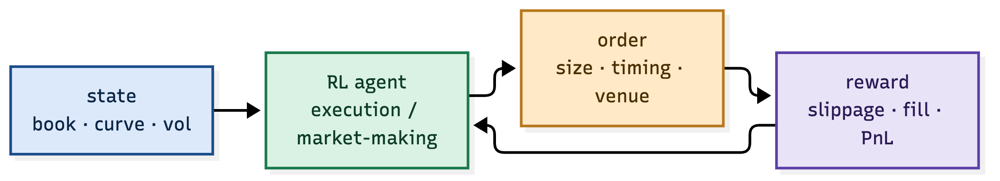

*Figure 18.1 — state → action → reward, learned end to end.*

| Use | State | Action | Reward |
|---|---|---|---|
| execution | book, curve, vol | order size + timing | −slippage, fill |
| market-making | inventory, spread | quote | spread PnL − inventory risk |

RL is the future of the *tactics*, while the *strategy* (what to be long or short) remains
the fundamental and ML models.

---

# 19. Generative models — scenarios and the tail

**What it does.** Generates *synthetic* scenarios — cold snaps, pipeline cuts, LNG booms —
for stress and training.

**Why it matters.** The tail is where the money and the risk are. A generative model can
*sample* the tails that history has not yet shown, so you train and stress for the 1-in-50
winter, not just the 1-in-5.

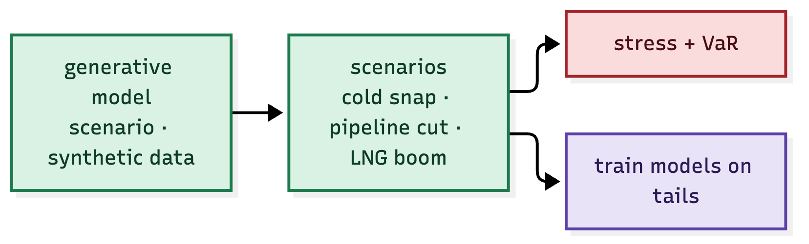

*Figure 19.1 — scenarios feed stress tests and tail-aware training.*

| Use | What it gives |
|---|---|
| stress / VaR | the tail losses |
| training | models that have seen the extreme |

This is the answer to "what happens if we get another 2022": you generate it, and you size
for it.

---

# 20. Multi-agent systems on the envelope

**What it does.** Runs many specialised agents — weather, fundamental, news, sentiment — each
publishing on the bus, and a meta-agent that fuses them into a tier.

**Why it matters.** This is the AI version of the architecture we already built: each agent
is a calculation agent, the bus is the nervous system, the meta-agent is the book's intel
window. AI slots *into* the envelope, it does not replace it.

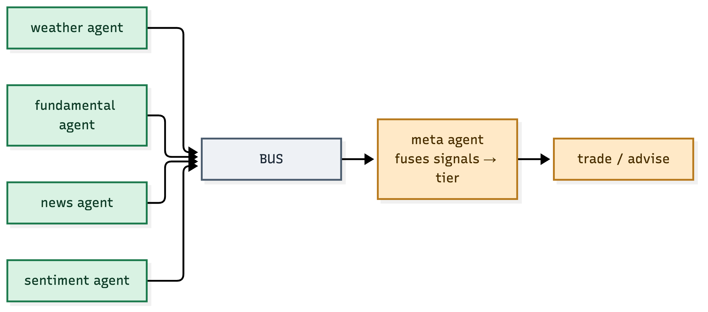

*Figure 20.1 — weather, fundamental, news, sentiment agents → bus → meta-agent → trade.*

The envelope architecture was built for this: **models publish numbers, the book accumulates
them and confirms a pattern.** AI models are just more, and better, numbers.

---

# 21. Human-in-the-loop

**What it does.** Keeps a human in the decision — the AI proposes, the human sizes, approves,
vetoes — and records who did what.

**Why it matters.** Regulation (MiFID II, suitability) and risk demand accountability. The AI
can be wrong in ways a human catches (a headline the model mis-read, a tail it has not seen).
The human is the *guardian*, and the envelope records the override.

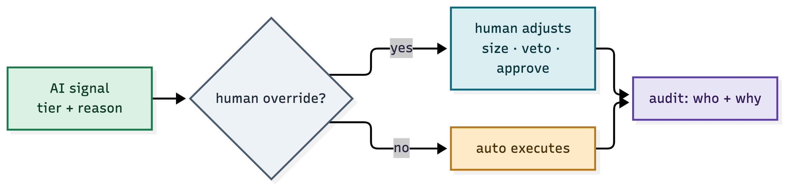

*Figure 21.1 — AI signal → human override or auto → audit of who + why.*

| Mode | Human's role |
|---|---|
| advisory | human reads the AI view |
| systematic | human approves the rules |
| auto | human sets the bounds, AI executes within them |

---

# 22. The data stack for AI

**What it does.** The pipeline from raw data to a deployed agent.

**Why it matters.** AI is only as good as the data. The stack — clean, align, feature, train,
validate, deploy — is where most AI projects fail, and where the envelope helps: every stage
is a stamped, versioned artefact.

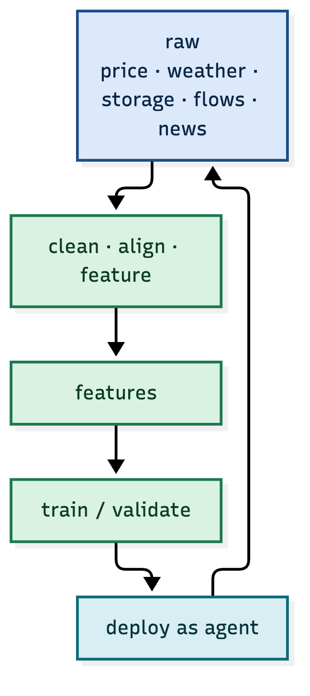

*Figure 22.1 — raw → clean → features → train → deploy, looping.*

| Stage | Envelope role |
|---|---|
| raw | recorded as market/fundamental envelopes |
| features | a derived dataset, versioned |
| train | a model artefact, versioned |
| deploy | an agent that publishes signals |

Versioned data + versioned models = a forecast you can reproduce, which is the same
traceability the trading platform already guarantees.

---

# 23. Ensembles and signal fusion

**What it does.** Combines the fundamental, ML, weather and sentiment models into one signal
with a confidence.

**Why it matters.** No single model is right all the time. The ensemble is more robust than
the best single model — it is the *pattern* of agreement that matters, exactly like the
book's intel window.

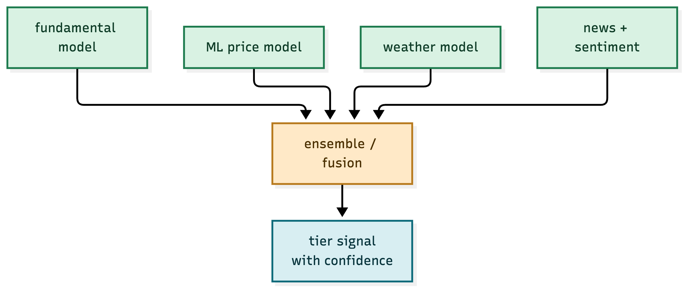

*Figure 23.1 — four models fuse into one tier signal with confidence.*

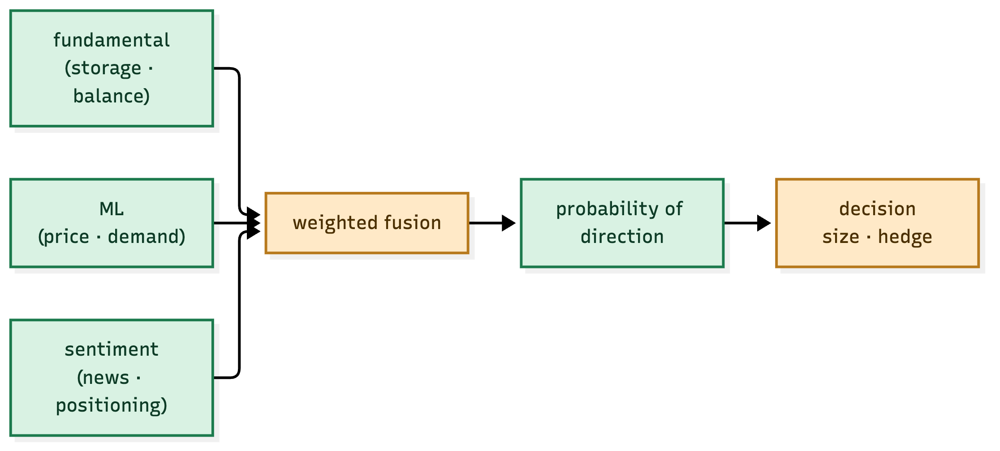

*Figure 23.2 — fundamental + ML + sentiment → probability → decision.*

| Fusion | How |
|---|---|
| voting | count agreeing models |
| weighted | weight by track record |
| stacked | a meta-model learns the weights |

The tier signal is the *confidence* — and confidence is what separates a trade from a gamble.

---

# 24. Now → next → future

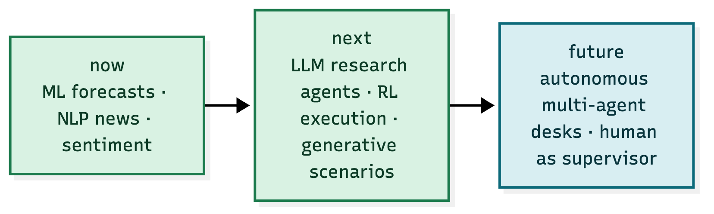

*Figure 24.1 — ML forecasts today, LLM agents + RL next, autonomous desks later.*

| Horizon | Capability |
|---|---|
| now | ML price/demand forecasts, NLP news, sentiment |
| next | LLM research agents, RL execution, generative scenarios |
| future | autonomous multi-agent desks, human as supervisor |

The direction is clear: the human moves from *computing* to *supervising*, and the platform —
with its envelope, its bus, its audit trail — is already built to host that future.

---

# 25. Governance — the risks of AI trading

**What it does.** Governs the AI like it governs any model: versioned, validated, bounded,
and accountable.

**Why it matters.** An AI that trades gas can fail silently (a drift in the weather model) or
loudly (a mis-read headline). The same controls that apply to any model apply to AI — plus
new ones.

| Risk | Control |
|---|---|
| model drift | monitor forecast error, retrain on schedule |
| hallucination (LLM) | cite envelopes, never invent a fact |
| overfitting | validate out-of-sample, walk-forward |
| tail blindness | generative stress, size for the tail |
| opacity | a reason for every signal, a human override |

The envelope is the answer to all of them: **every signal carries a reason, a timestamp and a
provenance, and every decision is auditable.** AI does not change that — it makes it more
necessary.
